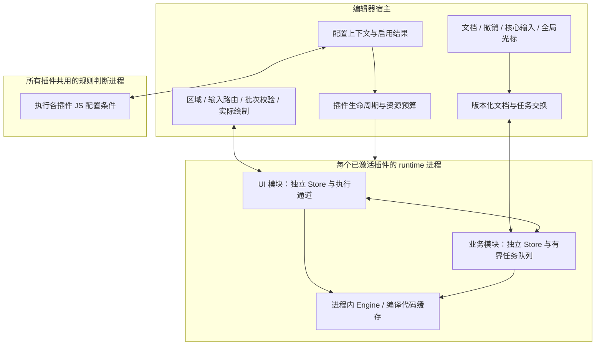

# Nanobug V2 插件架构研究与决策记录

日期：2026-11-08。状态：研究结论与候选设计，尚未冻结规格。

本轮阅读了会话交接、需求总结、当前源码及官方资料。仅新增研究文档，没有实现插件系统、修改现有代码、构建程序或运行性能实验。下文将现状、设计推断和待确认目标分开记录。

配套证据：

- [运行时机制研究](2026-11-08-plugin-runtime.md)：Wasmtime、Tree-sitter、QuickJS 的能力与限制。
- [编辑器扩展机制研究](2026-11-08-editor-plugin-architectures.md)：VS Code、Zed、Neovim、LSP 的可借鉴机制。

## 1. 结论

保留已经明确的“一插件一 runtime 进程、插件自主绘制、JS 判断模块启用条件”。用户进一步明确：模块调用由配置条件决定，条件满足就放行，不增加首次实际使用的二次激活判断，也不因闲置而回收。要同时实现快速启动、低延迟和故障恢复，还须将以下机制纳入设计：

1. 核心编辑不依赖插件响应；声明注册、规则判断、模块加载和功能就绪分别处理。
2. 每个插件内部把 UI 与重任务分开调度，同时对全部插件的后台并发设置总预算。
3. 文档和绘制按版本、按批次交换；队列、数据规模和宿主绘制成本都有上限。
4. 崩溃恢复围绕权威状态、运行代次和操作确认设计，不能仅靠自动重启。
5. 兼容性通过稳定接口、可选能力协商和兼容验证维持；WASM 文件本身不解决接口演进。
6. 初版就提供可选 UI SDK，保留插件自主绘制能力；通过 SDK 支持的文字/布局接口构建的标准或自定义 UI，都以默认自动接入当前全局光标特效为设计目标，复用宿主权威文字布局，不要求开发者另写特效适配，也不强制使用内置控件。
7. **用户已确认初版绘图范围：完整覆盖当前 GPUI canvas 的公开绘图能力，平台专属能力单独标明。** 当前参照版本为 `gpui-pre 0.3.10`；这是首版设计要求，尚未实现或验收。

以上是结合现行需求与资料形成的建议，不是已经测得的性能保证。进程隔离可以限制故障扩散，但 CPU、内存、磁盘和宿主 GPU 仍是共享资源。

## 2. 当前实现与交接文件的差异

| 核实项 | 当前证据与影响 |
| --- | --- |
| 编辑核心 | 自研 Rust `Document` 和简易 Vim，没有 Neovim 子进程；`Cargo.toml` 的 Neovim 描述过时。见 [main.rs](../../src/main.rs)、[lib.rs](../../src/lib.rs)、[使用指南](../使用指南.md)。 |
| 插件底座 | 还没有插件加载器、WASM/JS 引擎、IPC 或进程监督；不能按已有插件实现做局部优化。见 [Cargo.toml](../../Cargo.toml) 和 [使用指南](../使用指南.md)。 |
| GPUI | 已固定 `gpui-pre` / `gpui-pre-platform =0.3.10`，交接中的“版本待定”不再代表当前事实。 |
| 启动链路 | `main` 调用 `app::run`，注册字体后进入 `Editor::new`；构造时同步读取初始文档、光标配置、根目录首层。见 [启动入口](../../src/app/mod.rs)、[工作区初始化](../../src/app/workspace/mod.rs)、[目录树](../../src/explorer/tree.rs)。 |
| 文档真源 | `Document` 拥有正文、撤销和保存，并在修改/撤销时递增 `revision`；尚无插件文档订阅和版本化编辑接口。见 [document.rs](../../src/editor/document.rs)。 |
| 绘图与区域 | 当前已有面板逐行排版缓存，但布局与焦点仍围绕固定文件管理器和编辑区；尚非通用插件区域注册机制。见 [工作区布局](../../src/app/workspace/layout.rs)、[面板绘制](../../src/ui/grid/panel.rs)。 |
| 性能证据 | 尚无完整启动与端到端输入延迟基线；历史微基准不包含插件 IPC、WASM 冷加载等。见 [需求总结的性能说明](../需求总结.md)。 |

因此，首屏不等待插件是必要条件，仍需测量宿主自身的同步工作。同步读取出现在启动路径，不等于已经证明它是实际瓶颈。当前真实文件保存已实现，交接中“没有真实文件保存”描述的是旧独立 Demo。

## 3. 候选结构与模块接口



图中是职责划分，不要求立即建立对应数量的 crate。用户已确定所有插件共用一个规则判断进程执行 JS 配置；其启动阶段、预算和恢复协议仍待细化。Tree-sitter 的执行位置继续待定，不能由 Q5 的采纳推导为同时接受共享语法解析进程。

建议把复杂行为放在少量深模块的小型接口后面：

| 模块 | 调用方需要表达什么 | 模块内部负责什么 |
| --- | --- | --- |
| 配置与启用管理 | 模块配置、当前上下文及其变化 | 条件评估、结果汇总、去重启用；不增加使用频率或闲置回收策略 |
| runtime 监督 | 让配置选中的模块就绪、提交有期限的任务、明确关闭 | 启动握手、状态转换、超时、资源归属、退避重启与连续失败停用 |
| 文档交换 | 订阅快照/增量；基于某版本提出一次编辑 | 版本与范围校验、撤销事务、过时结果处理、重同步 |
| 插件区域 | 注册区域、提交绘制批次、接收输入和尺寸变化 | 焦点、IME 接入、坐标代次、资源校验、绘制缓存与限额 |

不把进程、Store、重试、缓存失效分散给每个插件调用点；也不把所有职责塞成一个难以独立验证的管理器。

## 4. 启动速度：配置决定启用，调度负责执行

**已核实参考。** VS Code 以语言、命令、视图等事件激活扩展，官方建议避免默认 `*` 激活。Wasmtime 支持将编译移出加载关键路径。[Activation Events](https://code.visualstudio.com/api/references/activation-events)、[Pre-Compiling Wasm](https://docs.wasmtime.dev/examples-pre-compiling-wasm.html)

**候选规则。** 安装/更新时建立可快速读取的清单索引，声明命令、语言、视图入口和资源。启动时不遍历每个插件目录、不编译全部模块、不同步执行全部 JS。首个可编辑状态之后，才在预算内处理普通插件激活。

区分三个问题：

- 已注册：用户能看见命令或面板入口，无须执行插件代码。
- 条件满足：按配置启用/放行对应模块，不再等待另外一次“实际使用”判断。
- 已就绪：模块加载完成不等于索引、网络或 LSP 已完成初始化。

用户已否决“长期闲置后回收”。之前“JS 的 true 仅表示资格，还需另有请求才激活”的建议随之撤回：条件满足即按配置放行，条件持续满足时不因面板隐藏、使用频率低或没有近期请求而停用。跨文档仍须避免一个不匹配上下文覆盖其他匹配上下文。条件变为不满足后如何处理已有实例和在途任务，尚需专门定义，不能把这次否决解释为任意情形都永久保留资源。

本机编译缓存建议以模块内容、运行时版本、目标架构与引擎配置区分。分发包仍包含平台无关 WASM；编译缓存不是通用跨平台产物。反序列化产物含本机代码，必须来自受控编译链，不能仅因插件提供了哈希就信任它。[Wasmtime Module::deserialize](https://docs.wasmtime.dev/api/wasmtime/struct.Module.html#method.deserialize)

后台编译、启动与索引均须设置总并发预算。把几十项工作推迟到首帧之后同时启动，仍会破坏接下来的输入体验。并发调度只控制已放行工作的执行顺序，不替配置增加启用条件。编译缓存可以提前准备，但不预测性启动配置未选中的模块，也不以闲置回收代替配置控制。

## 5. 性能：避免排队、重复工作和线程争抢

**已核实参考。** Wasmtime async 的工作发生在 Future 被 poll 时，线程调度由嵌入方负责；Engine/Module 可在进程内共享，但独立 Store 才能拥有独立执行状态。fuel/epoch 不能解除阻塞的 host call。[Wasmtime async](https://docs.wasmtime.dev/api/wasmtime/#async)、[多线程嵌入](https://docs.wasmtime.dev/examples-multithreaded-embedding.html)、[中断配置](https://docs.wasmtime.dev/api/wasmtime/struct.Config.html#method.epoch_interruption)

**候选调度。** 每插件进程内复用 Engine，UI 与重任务有不同 Store 和执行通道。UI 不等待后台模块初始化，不持有后台任务长期占用的锁。总后台并发按机器资源分配，避免每个插件各自开满全部 CPU 核心。一个进程里的独立 Store 能提供更细的任务管理，但原生进程崩溃仍会同时带走该插件所有模块。

**候选通信。** 初版优先有界消息与批量数据；是否采用共享内存、什么编码和传输，留给实际负载对照。不能在没有消息体积和频率证据时认定“零拷贝”是首要优化。

| 数据类型 | 队列与一致性建议 |
| --- | --- |
| 文档快照与增量 | 快照可取最新完整版本；增量必须匹配基础版本，断链后重同步，不能任意丢中间项。 |
| 插件绘制 | 同一区域可用最新完整画面替代旧完整画面；绘制增量须保持依赖链，完成校验后整批呈现。 |
| 文本输入、编辑提交、有副作用命令 | 保序并明确确认；队列满时返回可识别的繁忙/失败，不能静默丢弃。 |
| 诊断、进度、预览 | 按对象与版本合并；旧版本结果不能覆盖新版本状态。 |
| 取消、关闭、健康检查 | 预留处理能力，不能被大幅绘图或索引数据长期堵塞。 |

这部分借鉴版本化文档通知与批次呈现，但不是复制 Neovim 协议。[Buffer updates](https://neovim.io/doc/user/api/#api-buffer-updates)、[UI protocol](https://neovim.io/doc/user/api-ui-events/)

**候选绘图。** 保留插件界面逻辑自由；宿主只接受可验证的区域、原语和资源句柄。文字按行段提交，图片复用资源，未变化区域复用缓存。除了消息字节数，还要限制路径复杂度、图片像素、可见绘图工作量、句柄总量与每帧接收预算。插件在另一个进程生成巨量合法绘制指令，仍可能拖慢宿主。

绘制批次记录区域尺寸/缩放代次，避免缩放后的旧数据再次提交；插件重启后资源句柄失效。自绘输入区域还需文本语义、逻辑光标和 IME 接口，不能让原生输入法的每次同步查询都跨进程等待。高层 UI 库可以是可选 SDK，不应限制插件只能使用固定树或列表控件。

## 6. 高可用：保护权威状态，限制故障扩散

**候选文档接缝。** 保持宿主 `Document` 为正文真源。插件观察带文档 ID、打开代次、修订号的快照/增量；编辑请求附带预期版本，由宿主验证 UTF-8 范围和整批编辑后应用为一次撤销事务。后台格式化结果晚到时，应拒绝或重算，而不是覆盖用户的新输入。[当前 Document](../../src/editor/document.rs)

**候选恢复状态机。** 按未启动、启动中、就绪、降级、退避恢复、连续失败停用管理 runtime。超时先识别具体任务/执行通道；不能仅靠一个独立心跳线程判定整个插件健康。进程退出后递增运行代次，拒绝旧响应，撤销旧资源，重新发送最新文档和可恢复状态。最后有效画面可保留，但恢复期间禁止旧画面继续触发操作。

自动重启需要上限和退避；VS Code 的官方实现也区分可自动重启与反复崩溃。重启不证明状态已恢复。[VS Code 恢复实现](https://github.com/microsoft/vscode/blob/main/src/vs/workbench/services/extensions/electron-browser/nativeExtensionService.ts)

插件 UI 的未保存输入若需要跨 runtime 崩溃恢复，就必须通过宿主保存的文档或明确的状态确认协议承载。仅在插件内存保存数据、偶尔发送快照，不能保证最后一次输入不丢。第一轮先确认需要保护哪些状态，下一轮再决定“已确认”的具体时点。

查询与索引通常可重做；Git 提交、部署、写文件等外部操作不能盲目重放。操作完成而确认丢失时，应通过操作 ID、可查询结果或具体接口的幂等机制判定；无法判定则保留“结果待确认”。仅给请求加 ID，并不能让任意外部操作自动获得恰好一次语义。

**已核实限制。** Wasmtime ResourceLimiter 不覆盖全部宿主和运行时分配；还需统计插件间接占用的宿主图片、队列和缓存。[ResourceLimiter](https://docs.wasmtime.dev/api/wasmtime/trait.ResourceLimiter.html)

**Windows 可用机制。** Job Object 可管理进程组、关联通常的子进程、限制提交内存及 CPU，并在设置相应标志后关闭时终止关联进程。CPU 硬上限会暂停整个 job 的线程，因此更适合失控兜底，不能代替 UI/业务分开的正常调度。原生 LSP 与工具须纳入资源统计和退出管理；其他平台需要分别实现及验收，不能把 Windows 机制写成跨平台保证。[Job Objects](https://learn.microsoft.com/en-us/windows/win32/procthread/job-objects)、[内存限制](https://learn.microsoft.com/en-us/windows/win32/api/winnt/ns-winnt-jobobject_extended_limit_information)、[CPU 限制](https://learn.microsoft.com/en-us/windows/win32/api/winnt/ns-winnt-jobobject_cpu_rate_control_information)

本轮的恢复讨论针对插件故障。宿主自身崩溃、系统掉电后的正文恢复属于另一项持久化要求，不能由“一插件一进程”推导出来。

## 7. 扩展性：稳定接口与明确的能力范围

用户确定插件接口默认向后兼容前两个旧版本，让开发者有迁移窗口。暂用抽象接口序号表示：当前为 N 时，默认支持按 N、N−1、N−2 接口编写的插件；不把它误写为只兼容同一主版本，也不把它等同于两个编辑器发布版本。正式版本编号中“一个接口版本”的粒度尚未确定。

实现建议是分别记录插件包、清单、宿主接口和状态存储版本，加载前协商必需/可选能力，并验证保留版本的行为兼容。源码 SDK、WASM 调用接口和跨进程协议是不同接缝，不用一份 Rust 类型内存布局代替全部兼容约定。两个版本的数量窗口本身不规定日历时长；接口淘汰的发布节奏和迁移通知仍需设计，不能声称已经保证固定迁移期限。

WIT/Component Model 是候选接口工具，不会自行带来文档一致性、资源预算或向后兼容。Tree-sitter grammar 使用其专用加载接口，不应机械套入普通业务模块接口。[Tree-sitter WasmStore](https://docs.rs/tree-sitter/latest/tree_sitter/struct.WasmStore.html)

Zed 的资源与 WASM 逻辑分离值得参考，但它的公开扩展能力不能证明任意自绘 UI 已经解决；绘图、输入、资源与恢复契约仍需本项目自行验证。[Zed 扩展开发](https://zed.dev/docs/extensions/developing-extensions)

插件更新可考虑先验证候选版本，再替换正在使用的版本，失败时保留上一个有效包。若新版本已经不可逆迁移持久状态，仅回退包文件可能无法恢复，必须同时设计状态格式兼容或迁移备份。更新回退仍未被单独确认，不能由接口兼容前两个版本推导出来。

## 8. 验证设计：如何让承诺可验收

尚未执行以下实验，也没有填入虚构结果。

| 维度 | 测量方法与必要区别 |
| --- | --- |
| 启动 | 从进程创建到首帧、指定文档可编辑分别计时；不以出现空窗口替代可编辑。 |
| 冷与热 | 区分系统文件缓存冷/热，以及 WASM 编译缓存命中/未命中，形成独立组合；进程已退出但系统缓存仍热属于热启动。 |
| 首次使用 | 命令/面板触发到输入可用、首个有效画面、首个业务结果分别统计；再次使用单独记录。 |
| 输入 | 记录事件接收到文档提交、场景提交的时间；真正输入到屏幕显示需呈现/外部测量，不能用 CPU 绘制耗时冒充。 |
| 资源 | 同时统计宿主、runtime 及其受管原生工具；私有提交内存、工作集与共享映射分别解释，不简单累加进程 RSS。 |
| 可归因性 | 记录插件、模块、激活原因、排队/编译/初始化耗时、消息量、超时、恢复次数和宿主绘图成本。 |

候选实验矩阵：零插件；50 个已安装但配置条件不匹配；典型 10 个活跃；条件匹配触发冷缓存加载；匹配模块长时间无调用仍保持启用；UI 与索引并行；规则死循环；业务 Wasm 死循环；阻塞 host call；消息洪泛；过大绘制；runtime 被终止；增量丢失；写操作完成但回复丢失；N/N−1/N−2 接口插件；插件升级失败及回退。每组记录样本数、P50/P95/P99 和异常，冷启动样本不足时明确说明，不能用几个样本证明尾延迟。

先测无插件基线，再用小型插件贯通接口并注入故障，才能判断下一步应优化编译、复制、调度还是绘制。共享内存、池化分配和复杂预热只在证据支持时引入。

## 9. 第一轮决策记录

用户先接受 Q1 的初始性能目标；在用 Git 插件故障场景解释 Q2，并将 Q3 收窄为“第一版支持其他开发者独立编写插件”后，用户回答“都采纳”。三个目标现已确认。Q3 最后一次提问明确把兼容期限和更新回退留待后续，因此本次确认不扩展成对原先全部兼容建议的批准。

1. **性能规模与目标：已确认。** 参考本机 Release，50 个已安装插件、典型最多 10 个活跃；缓存已热的启动到可编辑 P95 ≤300 ms，真正冷启动 P95 ≤1 s，并单列首次插件可用时间。数字是待测目标，插件数量不是产品硬上限。输入延迟、内存总额和首次交互阈值随后细化。
2. **恢复标准：已确认。** 插件卡死或崩溃时编辑器仍可写代码、保存文件，只恢复出问题的插件；插件中写到一半的提交说明等用户输入应保留，文件变更列表、索引和预览可重建。外部操作可能已经完成时先检查实际结果，不能自动重复执行；查不清则显示结果待确认。允许插件短暂恢复。输入保存到宿主的接口、确认时点与恢复时限仍待具体设计；这项确认不构成宿主崩溃或掉电恢复承诺。
3. **第三方开发支持：已确认。** 第一版即提供接口、开发工具和文档，让其他开发者能独立为 Nanobug 编写插件。后续 Q7 已确定默认兼容前两个旧接口版本；实验能力政策、更新失败回退及状态迁移规则仍待确认。

三个根目标已确定：性能目标约束加载与执行预算；恢复目标约束状态归属和 JS/解析执行位置；第三方开发目标要求明确接口范围及兼容验证。后续回答已否决空闲回收并确定旧接口兼容数量，继续按这些结论讨论其余问题。现有“每插件一个 runtime”等明确需求不重复要求用户确认。

## 10. 绘图能力补充核实

本轮继续检查了 Cargo.lock 锁定的 `gpui-pre 0.3.10` 本机源码。工作区同期发生模块重组，本文项目源码链接已按当前路径核对；自研编辑核心与尚无插件运行时的结论仍成立。以下描述宿主原生能力，不能当作插件绘图协议已经存在。

| 能力 | 固定版本源码证据 | 需要保留的限制 |
| --- | --- | --- |
| 文字与字形 | [shape_line](C:/Users/Tmiracle/scoop/persist/rustup/.cargo/registry/src/index.crates.io-1949cf8c6b5b557f/gpui-pre-0.3.10/src/text_system.rs:671)、[paint_glyph](C:/Users/Tmiracle/scoop/persist/rustup/.cargo/registry/src/index.crates.io-1949cf8c6b5b557f/gpui-pre-0.3.10/src/window.rs:4839) | 字体排版、资源和实际绘制仍由宿主负责；插件需要独立的数据接口。 |
| 矩形、圆角、矩形描边 | [PaintQuad](C:/Users/Tmiracle/scoop/persist/rustup/.cargo/registry/src/index.crates.io-1949cf8c6b5b557f/gpui-pre-0.3.10/src/window.rs:7807) | 应对指令数量及绘制区域设置预算。 |
| 路径、曲线、填充与描边 | [PathBuilder](C:/Users/Tmiracle/scoop/persist/rustup/.cargo/registry/src/index.crates.io-1949cf8c6b5b557f/gpui-pre-0.3.10/src/path_builder.rs:88)、[paint_path](C:/Users/Tmiracle/scoop/persist/rustup/.cargo/registry/src/index.crates.io-1949cf8c6b5b557f/gpui-pre-0.3.10/src/window.rs:4773) | 路径复杂度会转化成宿主工作量，需要限制，不能仅统计消息字节。 |
| 图片与 SVG | [paint_image](C:/Users/Tmiracle/scoop/persist/rustup/.cargo/registry/src/index.crates.io-1949cf8c6b5b557f/gpui-pre-0.3.10/src/window.rs:5071)、[paint_svg](C:/Users/Tmiracle/scoop/persist/rustup/.cargo/registry/src/index.crates.io-1949cf8c6b5b557f/gpui-pre-0.3.10/src/window.rs:5001) | `paint_svg` 为单色 SVG 路径；图片资源应采用宿主句柄和像素预算。 |
| 裁剪与变换 | [with_content_mask](C:/Users/Tmiracle/scoop/persist/rustup/.cargo/registry/src/index.crates.io-1949cf8c6b5b557f/gpui-pre-0.3.10/src/window.rs:4181)、[路径变换](C:/Users/Tmiracle/scoop/persist/rustup/.cargo/registry/src/index.crates.io-1949cf8c6b5b557f/gpui-pre-0.3.10/src/path_builder.rs:205) | 裁剪为矩形；部分原语支持变换，不能据此宣称所有文字、图片都支持统一任意旋转或任意路径裁剪。 |
| shader、3D、外部纹理 | [canvas](C:/Users/Tmiracle/scoop/persist/rustup/.cargo/registry/src/index.crates.io-1949cf8c6b5b557f/gpui-pre-0.3.10/src/elements/canvas.rs:11)、[paint_surface](C:/Users/Tmiracle/scoop/persist/rustup/.cargo/registry/src/index.crates.io-1949cf8c6b5b557f/gpui-pre-0.3.10/src/window.rs:5172) | canvas 提供原生闭包入口，不等于跨进程可直接提交任意 GPU 程序；`paint_surface` 使用平台特有对象且限 macOS/iOS，不能当作通用跨平台接口。 |

Nanobug 当前已有[缓存文字与面板绘制](../../src/ui/grid/panel.rs)、[光标曲线路径](../../src/ui/cursor.rs)、[图片图标](../../src/explorer/icons.rs)。这些只能证明宿主具备对应绘制路径；插件侧的批次校验、资源归属、输入、故障恢复还需设计和验证。

## 11. 第二轮决策记录

用户对 Q4 不采纳，在 Q7 明确兼容前两个旧接口版本；解释后已采纳 Q5 的单独公共规则判断进程。Q6 最初经功能举例和所有 2D 能力讨论，随后已收敛并确认：初版完整覆盖当前 GPUI canvas 的公开绘图能力，平台专属能力单独标明。

4. **闲置回收：已否决；配置直接决定调用：已确认。** 用户说明模块调用完全取决于配置条件判断，符合条件即放行，不需要回收。取消之前额外的使用需求门槛和闲置回收建议。条件由真变假时的停用、在途任务和实际资源释放另行明确。
5. **公共规则判断进程：已确认。** 所有插件共用一个独立进程执行 JS 配置条件；编辑器提供上下文、接收结果并据此启用模块。规则引擎故障时可单独终止/重启，代价是额外进程与通信开销。它不能擅自加入使用频率或闲置策略。此次确认不包含语法解析共享进程。
6. **绘图范围：已确认。** 初版完整覆盖当前 GPUI canvas 的公开绘图能力，平台专属能力单独标明。参照项目锁定的 `gpui-pre 0.3.10`，不将此前较小的候选原语集合当作首版上限，也不把这一要求扩展为任意二维渲染能力或任意宿主 Rust 代码执行能力。具体能力与边界见第 17 节；接口和实现仍待设计。
7. **旧接口兼容数量：已确认。** 当前插件接口默认兼容前两个旧版本的插件，以便第三方开发者迁移至新接口；用 N/N−1/N−2 表示。接口版本的命名/粒度、淘汰通知和发布节奏仍需明确。新接口宿主兼容旧插件，不自动意味着旧宿主能运行使用新能力的插件。

下一层依赖：按 Q4 的配置驱动原则设计生命周期，并继续定义条件变为不满足时的行为；Q5 已确定规则进程，后续细化调度与恢复；Q6 的公开绘图覆盖范围已确认，后续设计绘制协议及输入接缝；Q7 决定兼容矩阵和迁移窗口。当前仍为研究访谈，只维护研究与决策文档。

## 12. Q5 / Q6 的具体解释

Q5 的场景是打开一个 Vue 文件：编辑器提供当前文件/项目上下文，规则引擎执行配置，返回 Vue grammar 等模块的条件结果，宿主依结果放行。用户已选择单独规则进程这一隔离方式；它不是 WASM 或 JS 的必然要求。

| 执行位置 | 取舍 |
| --- | --- |
| 编辑器进程内专用后台线程（未选） | 少一个进程与通信步骤，需时间/内存限制；引擎或原生绑定的进程级故障仍可能影响宿主。 |
| 所有插件共用一个规则判断进程（已选） | 可以单独终止/重启规则执行环境，避免为了判断启用条件而先启动全部插件 runtime；有额外进程、内存和通信成本，规则执行环境失败时的重新评估恢复仍需设计。 |

Q6 下表是基于第 10 节绘图能力与输入事件形成的表达能力分析，不是已经实现的插件，也不表示仅有绘图就自动获得对应业务功能。插件自行定义内部状态、布局和操作，SDK 可提供可选通用控件。

| 可以构建的界面 | 绘图与交互组合 | 还需的业务能力 |
| --- | --- | --- |
| 自定义文件管理器 | 缩进文字、图标、选中背景、折叠标记、拖拽与滚动 | 文件枚举及文件操作接口 |
| 搜索面板、命令面板 | 文本输入、匹配高亮、结果列表、快捷键选择 | 搜索/匹配逻辑、命令注册 |
| Git 面板、差异视图、提交关系图 | 分栏文字、增删颜色、行号、节点和连接曲线 | Git 数据与命令；大文件差异计算 |
| 补全列表、诊断和悬浮说明 | 浮层、文字、图标、选中项与键盘操作 | 语言分析或 LSP，以及宿主的区域/焦点接口 |
| Markdown 预览、AI 对话 | 标题段落、代码块、表格、链接、图片、流式更新 | Markdown 解析和排版逻辑；对话还需网络/模型调用 |
| 集成终端界面 | 字符网格、颜色、光标、选区、滚动 | PTY、shell 与终端控制序列解析；绘图协议本身不提供这些能力 |
| 图片预览与标注 | 图片位置/尺寸、矩形裁剪、框选、文字和路径标注 | 图片加载解码、坐标计算及保存逻辑 |
| 图表、时间线、流程图/节点编辑器 | 文字、矩形、线条/曲线、拖动、坐标换算与缩放 | 数据来源、布局及计算；实际规模与性能需验证 |

例如文件树的排序、节点样式、多选、拖拽和菜单由插件决定；宿主负责实际绘制与通用输入接入，不强制一套固定文件树组件。普通二维动画可更新坐标、尺寸或颜色；这不等同于直接开放自定义 GPU shader、实时 3D 或完整浏览器 HTML/CSS 执行环境。

## 13. 当前候选是否覆盖所有 2D 图形能力

**结论：不能承诺所有二维图形能力。** 之前的插件绘图范围可以表达广泛的常规编辑器二维界面，但没有定义完整的变换、裁剪、图层、合成、滤镜和像素操作语义。当前插件协议本身尚未实现；底层已有功能、可另行实现的功能与插件承诺支持的功能需要分别核对。用户后续已将首版范围明确为完整覆盖当前 GPUI canvas 的公开绘图能力，见第 17 节。

以通用二维画布为参照，HTML Canvas 2D 规格分别定义变换、路径、填充、合成、阴影、滤镜及像素操作；SkCanvas 还清楚区分变换/裁剪状态与离屏图层。引用它们用于整理能力清单，不表示本项目已经选择浏览器或 Skia，也不把任何一份接口清单称为穷尽所有二维效果。[HTML Canvas 2D](https://html.spec.whatwg.org/multipage/canvas.html#the-2d-rendering-context)、[SkCanvas](https://api.skia.org/classSkCanvas.html)

### 固定 GPUI 版本的进一步核查

以下仅针对本机 `gpui-pre 0.3.10` 已读取的公开绘制入口。“未找到通用入口”不能推导为修改后端或增加渲染实现也不可能做到。

| 能力 | 核实结果与来源 |
| --- | --- |
| 渐变 | 有两个色标的线性渐变；未找到通用多色标/径向/锥形渐变入口。见 [Background](C:/Users/Tmiracle/scoop/persist/rustup/.cargo/registry/src/index.crates.io-1949cf8c6b5b557f/gpui-pre-0.3.10/src/color.rs:779)。因此不能泛称 GPUI 不支持渐变。 |
| 阴影、透明度 | 有矩形/圆角矩形的内外阴影，以及颜色和元素透明度；普通 opacity 不等于先绘制独立图层再整体混合。见 [阴影](C:/Users/Tmiracle/scoop/persist/rustup/.cargo/registry/src/index.crates.io-1949cf8c6b5b557f/gpui-pre-0.3.10/src/window.rs:4576)、[opacity](C:/Users/Tmiracle/scoop/persist/rustup/.cargo/registry/src/index.crates.io-1949cf8c6b5b557f/gpui-pre-0.3.10/src/window.rs:4230)。 |
| 图层与混合 | `paint_layer` 是绘制顺序和几何批次分组，不是通用离屏纹理图层。未找到为一般原语指定 multiply/screen 等模式的通用公开入口。见 [paint_layer](C:/Users/Tmiracle/scoop/persist/rustup/.cargo/registry/src/index.crates.io-1949cf8c6b5b557f/gpui-pre-0.3.10/src/window.rs:4546)、[场景原语](C:/Users/Tmiracle/scoop/persist/rustup/.cargo/registry/src/index.crates.io-1949cf8c6b5b557f/gpui-pre-0.3.10/src/scene.rs:222)。 |
| 裁剪、蒙版与统一变换 | 通用裁剪是矩形；路径/SVG 可变换，但没有找到作用于文字、图片和所有原语的统一变换栈，以及通用 alpha 蒙版/任意路径裁剪入口。见 [ContentMask](C:/Users/Tmiracle/scoop/persist/rustup/.cargo/registry/src/index.crates.io-1949cf8c6b5b557f/gpui-pre-0.3.10/src/window.rs:2243)、[PathBuilder](C:/Users/Tmiracle/scoop/persist/rustup/.cargo/registry/src/index.crates.io-1949cf8c6b5b557f/gpui-pre-0.3.10/src/path_builder.rs:205)。 |
| 滤镜 | 有图片灰度；阴影模糊和系统背景模糊各有专用含义，不能代替通用图片/图层滤镜链。Nanobug 的帮助背景另用 CPU 图片模糊后绘制。见 [图片灰度](C:/Users/Tmiracle/scoop/persist/rustup/.cargo/registry/src/index.crates.io-1949cf8c6b5b557f/gpui-pre-0.3.10/src/elements/img.rs:148)、[当前背景处理](../../src/ui/backdrop.rs:158)。 |
| 像素操作 | 可以用 CPU 像素创建 `RenderImage` 并读取字节；当前帧的 `render_to_image` 受 test/test-support 限制且后端可能不支持，不能当作已具备通用 GPU 画布读写。见 [RenderImage](C:/Users/Tmiracle/scoop/persist/rustup/.cargo/registry/src/index.crates.io-1949cf8c6b5b557f/gpui-pre-0.3.10/src/assets.rs:43)、[render_to_image](C:/Users/Tmiracle/scoop/persist/rustup/.cargo/registry/src/index.crates.io-1949cf8c6b5b557f/gpui-pre-0.3.10/src/window.rs:2884)。 |
| 自定义 2D shader | 当前所查 Canvas/Window/Scene 公共入口没有通用自定义 shader 接口。shader 也可用于二维颜色、滤镜和混合，不应将其一概归为 3D。见 [canvas](C:/Users/Tmiracle/scoop/persist/rustup/.cargo/registry/src/index.crates.io-1949cf8c6b5b557f/gpui-pre-0.3.10/src/elements/canvas.rs:11)、[Skia Runtime Effects 的二维用途](https://skia.org/docs/user/sksl/)。 |

### 对扩展方案的含义（建议，尚未确定）

如果用户希望通用二维绘图，应把统一变换、路径裁剪/蒙版、渐变/图案填充、离屏图层、混合模式、图像/颜色滤镜、像素输入输出等列成可验收能力，明确每项支持范围。图层混合与滤镜具有独立语义，不能用“都能画成图片”省略契约。[SkCanvas](https://api.skia.org/classSkCanvas.html)、[SkPaint](https://api.skia.org/classSkPaint.html)、[混合模式](https://skia.org/docs/user/api/skblendmode_overview/)

插件或宿主也可先软件渲染成位图再显示，这能补足部分效果，但频繁重绘大图时会增加计算、复制与上传开销；不意味着获得高效的原生图层、矢量编辑、命中测试或实时效果能力。该结论是数据处理路径的设计推断，尚未测量具体吞吐或帧率。

建议保留独立的通用绘图接口：底层可使用已有 GPUI 能力，缺少的操作再由额外绘图实现承接。是否采用 Skia 等实现必须另行比较与验证，当前没有选型。高级绘图初始化与核心可编辑路径分开，并遵守已确认的配置启用规则；不能为扩展绘图偷偷恢复使用频率门槛或闲置回收。当前用户是在询问能力，并未批准首版能力缩减或新增渲染依赖。

## 14. 当前 ui 内容、插件复用及绘图封装层

用户询问：插件能否调用 `ui` 里的组件、当前包括哪些，以及提供给插件的绘图是 GPUI 原生还是封装。本节根据本轮当前工作树重新核查，不将拟议 SDK 当作已实现。

### 当前能否直接调用

目前不能直接调用宿主 `src/ui`。`ui` 在 [main.rs](../../src/main.rs:6) 中作为 binary 内部模块声明，[ui/mod.rs](../../src/ui/mod.rs:4) 的导出仅为 `pub(crate)`；[lib.rs](../../src/lib.rs:3) 只公开 `animation` 和 `editor`。当前外部 crate 没有 `nanobug::ui::Panel` 这样的导入入口；内部类型自身写 `pub` 并不改变外层模块的可见性。[Cargo.toml](../../Cargo.toml) 也尚无独立 UI SDK package，插件加载器和跨进程绘图协议仍未实现。[使用指南](../使用指南.md:80)

此外，现有 `Panel`、`Cursor` 等依赖 GPUI `Window`、`Context`、视图实例和宿主字体系统。公开 Rust 模块并不能让另一个进程中的 WASM 插件直接使用这些对象；需要数据接口或专门的可移植 SDK。

### 当前内容

| 内容 | 实际职责 | 源码 |
| --- | --- | --- |
| `Frame` | 一个面板的字符/标签/底色/图标/树形导线/边框等绘制数据，不含完整控件行为 | [grid/mod.rs](../../src/ui/grid/mod.rs:217) |
| `Panel` | 保留 Frame、识别变化行、缓存文字排版并用 GPUI canvas 绘制；还提供字宽与光标覆盖文字查询 | [panel.rs](../../src/ui/grid/panel.rs:174) |
| `Metrics`、`Rect`、`CloseGlyph` | 网格与像素坐标、矩形命中范围、关闭符号外观；关闭点击行为在 workspace 中 | [geometry.rs](../../src/ui/grid/geometry.rs:15)、[点击处理](../../src/app/workspace/view.rs:275) |
| `Cursor`、`CursorCell`、`CursorText` | 全局动画光标、视口裁剪、覆盖文字重着色及特效数据；文档输入/IME 不由这些类型独自承担 | [cursor.rs](../../src/ui/cursor.rs:16)、[光标文字数据](../../src/ui/grid/panel.rs:134) |
| `TextSpacing`、`TextCell` | 字素显示位置、中文宽度缓存、截断/省略号、显示位置到字节偏移换算；使用宿主字体系统 | [text.rs](../../src/ui/text.rs:12) |
| `BackdropRaster` | 将工作区文字、填充和图标栅格化并模糊，生成帮助弹层所需背景图片；不是任意通用滤镜图层 | [backdrop.rs](../../src/ui/backdrop.rs:26) |
| `theme` | 颜色与字体描述常量；尚不是动态主题管理器 | [theme.rs](../../src/ui/theme.rs:1) |

当前没有通用按钮、输入框、列表、文件树等完整独立控件库。已有文件管理器的模型在 `src/explorer`，交互及界面组合在 `src/app/workspace`；已有某项界面功能，不等于已经抽成可给插件使用的控件。

### 绘图的两层含义

当前编辑器的实际路径是：workspace 界面逻辑 → Nanobug `Frame` / `Panel` → GPUI canvas、文字排版和原生绘制。Nanobug 已封装字符网格和缓存；底层实际绘图仍调用 GPUI。[Panel::render](../../src/ui/grid/panel.rs:629)

拟议插件路径是：插件自己的界面逻辑或可选 UI SDK → 绘制批次与资源句柄 → 宿主绘制适配器 → GPUI。插件看到的应是 Nanobug 维护兼容性的接口，而不是直接拿到宿主的 GPUI 对象和 Rust 闭包。跨 WASM/进程的数据需要明确序列化、顺序、资源归属、错误与预算；简单命令应在插件侧累积成批次，不设计成每画一个字符就同步跨进程往返。

### 复用方向与初版 SDK 要求

1. **复用宿主的底层能力。** 插件提交网格或绘制数据，宿主持有原生视图、字体、图片和排版缓存；可据此复用已有 Panel 等实现，但不能承诺现有类型无需调整即可接入。
2. **初版提供插件侧可选 UI SDK：用户已明确要求。** 网格、标签、输入框、按钮、列表等可作为控件候选，具体首版集合仍需确定；SDK 的状态和事件最终接入统一宿主接口与绘制协议。需要专门实现，当前没有这套库。插件也可自行生成底层绘制数据，保留原有自主界面要求。

两者都需要区分接口与实现：稳定插件接口承担当前及前两个旧接口版本的兼容目标，宿主适配器负责处理 GPUI 接入变化。增加封装不会自动增加 GPUI 缺少的二维能力；前节列出的高级绘图仍需独立实现与验证。用户已明确初版必须提供 UI SDK，并完整覆盖当前 GPUI canvas 的公开绘图能力；具体高层控件集合仍未决定。

## 15. 全局光标能否用于插件 UI

**可以作为宿主公共能力扩展到插件 UI，但目前尚无插件接入。** 这一方向与原需求中“内部区域声明逻辑位置，由同一窗口的全局光标层完成动画和绘制”一致。插件可以自行绘制界面，不必使用高层控件 SDK 才能声明光标。[原需求：全窗口光标](../需求总结.md:66)

### 当前源码事实

- 宿主只有一个全局视觉 `Cursor`，`set` 接收目标矩形、可见性及块状状态，动画按需请求帧；输入和 IME 使用另外的逻辑位置。[Cursor](../../src/ui/cursor.rs:15)、[set](../../src/ui/cursor.rs:66)
- 目前逻辑来源为管理器、文档与命令/搜索行；`update_cursor` 换算坐标并更新同一 Cursor。`Focus` 仍只有 Manager 和 Editor，没有插件区域身份。[CursorSpace / caret](../../src/app/workspace/viewport.rs:17)、[update_cursor](../../src/app/workspace/viewport.rs:216)、[Focus](../../src/app/workspace/layout.rs:19)
- 光标视图覆盖宿主窗口，帮助弹层打开时当前实现隐藏该光标；不能据此声称任意插件弹层已支持。[窗口组合](../../src/app/workspace/view.rs:169)
- IME 候选框锚定逻辑位置，不跟随视觉插值；当前文本输入仅面向编辑器的插入/命令/搜索模式。[IME 锚点](../../src/app/workspace/ime.rs:107)、[文本输入条件](../../src/app/workspace/ime.rs:138)
- 覆盖文字重着色与周围文字波纹依赖宿主 `Panel` 及字形数据，不能自动作用于插件交来的一张图片。[set_viewport](../../src/ui/cursor.rs:97)、[文字特效](../../src/ui/cursor.rs:162)、[绘制时的文字读取](../../src/ui/cursor.rs:314)

### 候选插件接入方式

插件提交其区域/控件身份、逻辑光标矩形、形状与可见性，以及适用的视口/布局版本。矩形使用约定的区域局部逻辑像素，避免将接口限制为字符网格；内部滚动与宿主区域移动必须明确各自由谁换算，防止重复扣除偏移。光标位置应与当前已显示的插件画面版本相匹配。

宿主依据实际焦点选择当前唯一主光标的声明，进行窗口坐标换算和遮挡处理，驱动已有动画。插件不直接创建或调用宿主 Cursor 对象，也不必通过 IPC 发送每一帧动画位置。过期焦点、已销毁区域或旧 runtime 代次的声明应失效。

例如从代码编辑区切换到插件搜索框：逻辑输入立即归属搜索框，视觉光标从当前屏幕位置过渡到搜索框；原生输入法候选位置使用目标逻辑位置。文本输入、预编辑与选择范围仍须接入独立的宿主输入接口，报告一个光标矩形本身不会自动获得正确的 IME 行为。

基本光标移动、外形和拖尾可由全局层完成；覆盖文字变色、附近文字位移等特效需要可供宿主使用的文字/布局元数据。按用户后续提出的自动化方向，SDK 文字接口和宿主排版负责生成这些信息，开发者不单独提交特效数据；标准交互控件还自动提供焦点、caret、滚动等正常语义。自定义交互仍须通过 SDK 表达自身焦点与插入点，见下一节。无文字输入的插件视图可不声明文本光标；鼠标指针属于另一套输入显示机制。

以上是接入可行性与候选契约说明，尚未新增插件焦点、光标或 IME 协议，也未进行插件跨区域动画验收。

## 16. 初版 UI SDK 自动接入光标特效

用户明确要求初版就给插件提供 UI SDK，并询问 SDK 绘制文字时能否自动提供布局信息，使开发者无需额外适配即可使用全局光标全部特效。初版 SDK 是确定需求；下列自动接入方式是满足这一需求的设计目标与可行方案，具体接口尚未冻结、尚未实现。

### 推荐的数据所有权

SDK 自动提交带语义的文字节点：原文、字体/样式、布局约束、节点身份、位置以及所属区域。实际字形布局由宿主字体系统生成并保留，与正常绘制使用同一份结果。开发者无需手工给出逐字宽度、字形坐标、字体回退结果或光标特效回调。

```text
SDK 文字节点 / 标准交互控件
  ├─ 文字、样式、布局约束、节点身份
  └─ 标准控件的焦点、caret/选区、滚动和可见性
                    ↓
宿主排版与保留布局
  ├─ 正常文字绘制
  ├─ 逻辑 caret 几何与光标覆盖文字
  └─ 周围文字波纹的颜色/位置变化
```

WASM 侧使用协议定义的节点/布局句柄、文本偏移和必要的尺寸查询结果；`ShapedLine`、`FontId`、`GlyphId`、`Entity<Panel>` 等宿主对象保留在宿主。绘制、caret 和布局版本必须一致，字体、缩放或换行宽度变化时统一失效。复杂控件需要提前测量时由 SDK 批量获取并缓存结果，不逐字符同步跨进程查询。

### “无需额外适配”的精确范围

| 插件使用方式 | 自动完成的工作 | 开发者仍需表达的普通交互 |
| --- | --- | --- |
| SDK 输入框、可编辑文字控件 | 文字布局、焦点、caret/选区、IME 接入、输入活动及光标特效 | 绑定文字数据和业务事件；无需额外特效代码 |
| SDK 列表、树、滚动容器等标准交互控件 | 根据控件状态提供导航光标、区域/滚动状态，并让文字自动参与配置中的特效 | 普通选中项/数据绑定；无需单独报字形布局 |
| 自定义控件通过 SDK 文字/布局接口绘制 | 与标准控件共享自动文字布局及当前光标特效通路，不要求使用 SDK 内置输入框或列表 | 其自身何时获得焦点、当前导航/插入位置等普通交互；不另写特效适配，不能从任意静态文字推断交互 |
| 文字已被烘焙进图片或自定义 shader 输出 | 可显示图像；若另有逻辑 caret，可共享光标自身动画 | 像素本身没有可靠的文本/字形语义，不能宣称自动获得逐字特效 |

“标准控件自动提供焦点与 caret”不代表每段静态标签自动成为可编辑输入框。低层自绘保留自由度，开发者正常定义控件行为；SDK 应把该行为状态与特效连接起来，避免再要求一套特效专用适配。

用户进一步针对“SDK 支持的文字和交互控件”询问自定义绘制元素是否也能接入。这里的条件是使用可识别的文字/布局与正常交互语义，并非必须使用 SDK 的现成控件。作者可自行组合文字、图标、背景、路径及自己的布局和交互；SDK 绘制的文字自动进入同一特效通路。图片或外部渲染结果若另有等价语义协议，也可研究接入，但不能从像素自动推导逐字布局。当前附近内容效果针对文字，不能据此扩张为任意图片或路径都自动发生变形。

### 可复用的当前代码与待完成工作

- 当前四种预设为 Fluid、Elastic、Afterglow、Ripple；底层有 Droplet、Stretch、Rebound、Afterimage、Ripple、Breath、Blink、Scale、Glow、Fade、ScrollDrag 共 11 种效果类型。`NearbyText / Both` 通过 Ripple 波纹应用到文字，并不表示全部效果都会变形正文；当前 Glow 是透明度脉冲，不是通用 GPU bloom。[预设](../../src/animation/cursor/motion.rs:112)、[效果类型](../../src/animation/cursor/lifecycle.rs:61)、[波纹分发](../../src/animation/cursor/lifecycle.rs:664)
- `Run` 已保留原生排版、字素索引、位移、字体和原色；文字波纹在绘制时改变颜色/位置，不必逐帧重排文本。光标覆盖文字也从同一保留布局提取。[Run](../../src/ui/grid/panel.rs:57)、[cursor_text](../../src/ui/grid/panel.rs:277)、[绘制波纹](../../src/ui/grid/panel.rs:570)
- 现有 `PreparedRow::cluster_at` 仅查网格 runs，未查 label_runs；必须泛化成文本节点定位与效果作用区域，不能直接声称现有 Panel 已适配任何自由布局或 SDK 标签。[cluster_at](../../src/ui/grid/panel.rs:123)
- SDK 的焦点、滚动、显示/隐藏与输入活动必须接入光标生命周期；文字输入与 IME 需要标准化桥接。现有 IME 仍只服务内置编辑区域。[当前 IME](../../src/app/workspace/ime.rs:25)
- SDK 支持的变换、裁剪与合成必须同样作用于保留布局和光标坐标。Q6 后续已确定完整覆盖当前 GPUI canvas 公开绘图能力；超出该版本公开能力的任意旋转、剪切、非矩形遮罩或离屏滤镜，不因保留原文而自动获得支持。

### 性能与验收目标

正常绘制与光标特效共享布局缓存；动画帧由宿主驱动，不让插件每帧重报字形。文本/样式/宽度未变化时复用排版，仅对相关可见文字执行效果采样；插件模块是否启用仍完全由配置条件决定，这些缓存策略不引入闲置停用。

验收目标是：凡通过首版 SDK 支持的文字/布局接口构建的 UI，包括作者自定义绘制的控件，在提供正常焦点、caret 与滚动行为后，无需插件开发者另写特效适配，即可按全局配置参与当前全部光标效果。不以使用现成控件作为前提。需覆盖中文、组合字素、Emoji、跨控件焦点、滚动、裁剪、缩放、字体变化、插件恢复和布局版本失效；Emoji 保色/重着色等具体视觉语义需明确并与内置界面保持一致。当前只完成可行性核查，没有完成 SDK 或以上验收。

## 17. 自定义绘制 API 与 GPUI canvas 的能力对齐

用户已表示光标疑惑解决，并明确采纳：**初版就按完整覆盖当前 GPUI canvas 的公开绘图能力设计，平台专属能力单独标明。** 这里的参照是项目锁定的 `gpui-pre 0.3.10`，不是任意二维渲染引擎，也不是未来所有 GPUI 版本。绘图覆盖范围已确认；以下配套接口与验收方法仍是设计建议，尚未实现或验收。

### 初版要求逐项完整覆盖，当前接口尚未实现

封装本身不必减少 GPUI 已公开的绘图表达能力：插件提交绘制数据与资源句柄，宿主调用与原生 Canvas 相同的 GPUI 绘制入口。此前列出的文字、矩形、路径等只是候选接口，不是完整覆盖清单。

| 对齐内容 | 必须覆盖的事项 |
| --- | --- |
| 绘图原语 | 字形与 Emoji、下划线/删除线、矩形/圆角/边框、路径/曲线、GPUI 支持的填充与渐变、内外阴影、SVG、图片及图片帧等，逐项按原生支持范围映射。参见第 10、13 节源码证据。 |
| 绘制状态 | GPUI 支持的矩形裁剪、偏移、透明度、原语变换及绘制批次/顺序；不能将 `paint_layer` 扩称为任意离屏纹理图层。 |
| 布局与准备阶段 | 布局后的区域尺寸、坐标、文字测量及资源准备结果；准备结果与实际显示画面须有一致版本。 |
| 交互与资源 | 命中区域、鼠标/键盘、焦点、IME、帧请求及图片/字体资源生命周期，通过配套协议提供，不能假设绘制命令天然包含这些能力。 |
| 平台专属入口 | 例如 macOS/iOS 的 `paint_surface` 接受原生 `CVPixelBuffer`。平台专属公开绘图能力列入覆盖清单，在相应目标平台设计资源桥接并标明可用平台；不能把原生指针作为普通 WASM 数据传递，也不能宣称同一入口在所有平台都存在。 |

### Canvas 不只是一份绘图命令列表

原生签名为 `prepaint(bounds, &mut Window, &mut App) -> T` 与 `paint(bounds, T, &mut Window, &mut App)`。Canvas 是实现了 `Element` / `Styled` 的包装：按样式申请布局，在两个阶段传递任意原生 Rust 状态 `T`，并由 `style.paint` 包裹绘图回调。它没有独立于 GPUI 的另一套画布引擎。[canvas.rs](C:/Users/Tmiracle/scoop/persist/rustup/.cargo/registry/src/index.crates.io-1949cf8c6b5b557f/gpui-pre-0.3.10/src/elements/canvas.rs:10)

原生回调还可访问 GPUI 应用运行时：`insert_hitbox` 要求在 prepaint 调用，事件回调与 `handle_input` 在 paint 注册，另有 `on_next_frame` 和 App 实体订阅。这些需要由宿主在正确阶段执行，并把插件操作转换为受管理的对象/回调 ID；不能把宿主 `Window`、`App`、实体或 Rust 闭包直接暴露给独立进程中的 WASM。[命中](C:/Users/Tmiracle/scoop/persist/rustup/.cargo/registry/src/index.crates.io-1949cf8c6b5b557f/gpui-pre-0.3.10/src/window.rs:5308)、[输入](C:/Users/Tmiracle/scoop/persist/rustup/.cargo/registry/src/index.crates.io-1949cf8c6b5b557f/gpui-pre-0.3.10/src/window.rs:5401)、[事件](C:/Users/Tmiracle/scoop/persist/rustup/.cargo/registry/src/index.crates.io-1949cf8c6b5b557f/gpui-pre-0.3.10/src/window.rs:5467)、[帧请求](C:/Users/Tmiracle/scoop/persist/rustup/.cargo/registry/src/index.crates.io-1949cf8c6b5b557f/gpui-pre-0.3.10/src/window.rs:2721)

用户已确认固定 GPUI 版本下的公开绘图能力完整覆盖。为落实这一目标，所需布局、输入与资源能力仍须逐项设计；这不表示插件可以原样执行任何原生 Canvas 闭包及任意宿主应用代码。GPUI 自身不具备的通用滤镜、混合或 shader 能力，也不会因包一层 SDK 自动获得。

### 性能及验收方式

绘图指令在插件侧形成批次，宿主保留资源与文字布局；不能为每个原语建立同步 IPC 往返，也不能在宿主每帧的绘制回调中等待插件运行。测量请求需批量化并缓存，插件根据有效布局结果提交一致画面。该机制保留配置决定模块启用的既有约定，不加入闲置停用策略。

实现时应维护按版本、平台分类的能力对照表，对每项绘图能力提供原生 GPUI 与插件 SDK 的同场景渲染对照，并验证裁剪/顺序、输入、资源释放与插件恢复。还需实测通信、准备和绘制成本；绘图结果可对齐不代表性能、回调时序或二进制接口零差异。GPUI 升级后重新核查能力，SDK 兼容继续遵守用户已明确的当前接口及前两个旧接口版本目标。此次仅核查源码与记录设计，没有执行渲染或性能验收。

## 18. 内存生命周期：项目关闭与实例保留（Q8 待确认）

Q8 曾建议条件变为不满足后保留模块实例，直到显式禁用、卸载或退出编辑器。用户尚未采纳这一建议，而是追问实例与项目的区别、同时打开 Rust/Vue 项目时关闭 Vue 是否释放内存，并要求说明完整生命周期。因此不能把“所有已加载实例保留到退出”记为已确认规则。

### 原建议的实际代价与修正理由

按原建议，关闭 Vue 项目即使清理项目的逻辑数据，也会留下 Vue 模块实例及运行环境。Guest 内释放对象通常只是把内存交回该实例的分配器；它不能保证进程占用回到项目打开前的水平。Wasmtime 的实例归 Store 所有，普通实例需要随 Store 销毁才被回收，丢弃 Instance 句柄不是独立卸载实例。[Store](https://docs.wasmtime.dev/api/wasmtime/struct.Store.html)、[运行时补充证据](2026-11-08-plugin-runtime.md)

可将已编译代码与运行状态分开：同一插件进程内共享 Engine/Module，按需要独立回收的项目或模块建立 Store。销毁项目 Store 不要求重新编译仍被保留的 Module，但再次创建实例仍有初始化成本。[Module](https://docs.wasmtime.dev/api/wasmtime/struct.Module.html)、[官方多线程示例](https://docs.wasmtime.dev/examples-multithreaded-embedding.html)

**修正建议，待用户确认：项目仍存在时，不因闲置自动销毁实例；项目真正关闭时，释放它独占的运行状态；插件已无任何项目、窗口或全局功能需要时，完成收尾后退出其进程。** 这是对 Q8 的新建议，不是对用户先前否决闲置回收的改写，也不新增配置满足后的二次激活门槛。单纯条件暂时不满足与项目关闭是两个不同事件。

下文的“使用方”指资源所有者，包括仍打开且按候选规则保留了实例的项目、有效的窗口/全局模块，以及尚未完成收尾的操作；不以近期调用次数或面板是否可见判断。项目暂时没有匹配文件而保留实例时，仍持有该实例，不能又以“没有近期使用方”为由退出进程。

### 建议的资源归属

| 资源 | 所有者与释放边界 |
| --- | --- |
| 插件包、受控的本机编译缓存 | 磁盘产物；可跨会话保留，不等于保留插件运行实例。有效缓存可减少后续编译，但恢复仍需启动和实例化。 |
| 插件清单索引、JS 规则及所需上下文 | 编辑器及共享规则进程管理；项目关闭时移除对应上下文，不因为安装了插件就创建其全部模块。规则自身的预算与恢复仍待设计。 |
| Engine、已编译 Module、插件级全局模块 | 属于插件进程或明确的全局功能；可为多个项目复用，最后使用方结束后按插件关闭流程释放。 |
| 项目实例及索引、项目配置、项目级订阅 | 属于明确的项目作用域；需要可靠独立回收的大块 Wasm 状态使用独立 Store，避免所有项目挤进永久 Store。具体模块采用项目实例还是全局实例仍需在接口设计时声明。 |
| 文档快照、解析结果、局部布局、撤销和输入状态 | 按文档与实际使用方管理；关闭一个标签不等于所有使用方都已关闭。未保存输入不能当缓存丢弃，项目索引仍需的数据按项目资源管理。 |
| 任务参数、临时缓冲和排队消息 | 任务完成、确认失败或取消完成后释放；不能认为发出取消请求就已经停止使用资源。外部副作用需保留足够的结果核对记录。 |
| 宿主图片/字体引用、绘制批次、布局、GPU 资源句柄 | 由宿主管理并记录插件、项目、文档等归属。释放最后引用并等待必要的渲染使用结束；插件进程退出不会替宿主自动清理这些对象。共有字体等仍可由其他界面使用。 |
| 原生 LSP、文件监听及其他子进程/句柄 | 移除已关闭项目的订阅和工作区；共享者仍被使用时保留，独占资源及最后使用方结束时关闭。不能从停止 WASM 新调用推导为它们已停止。 |

### 从安装到退出的建议生命周期

| 阶段 | 新增或保留 | 结束与释放 |
| --- | --- | --- |
| 已安装、配置尚未选择模块 | 插件包、索引、必要规则数据 | 不创建该模块实例；编译缓存准备不等于激活模块。 |
| 条件首次满足 | 启动或复用所属插件进程，加载已编译代码或执行受预算控制的编译，创建相应实例 | 条件满足即放行，后台调度不增加“等到实际使用”的门槛。 |
| 编辑与后台工作 | 依据任务产生文档、项目、绘制及临时数据 | 已完成任务释放临时状态；过期可重建缓存按预算管理，不以此停用仍符合配置的模块。 |
| 切换焦点、隐藏面板、模块无近期调用 | 仍有效的项目和模块状态 | 不据闲置时间自动销毁；是否接收新调用继续取决于配置。 |
| 条件暂时不满足、项目仍打开 | 按 Q8 修正候选保留实例和必要状态 | 停止新调用；在途任务、监听和定时器需明确暂停/取消/收尾协议，不能假设自动停止。 |
| 关闭文档或项目 | 只保留仍被其他使用方需要的数据，以及需保存/确认的用户输入和外部操作记录 | 撤销对应订阅、清理队列，停止可取消任务，移除 UI/资源引用；在不再被执行使用后销毁独占 Store 和项目资源。 |
| 某插件最后一个使用方关闭 | 必要的磁盘缓存及编辑器注册信息 | 没有其他项目、窗口或全局功能需要时，完成受期限约束的收尾后退出 runtime 及其独占子进程。若仍有使用方，仅释放关闭的作用域。 |
| 再次打开项目 | 复用有效磁盘编译缓存，创建新项目状态；若同一插件进程仍在，可复用其已编译代码 | 不复用已销毁的旧项目句柄，不因缓存存在而提前激活配置未选择的模块。 |
| 显式禁用、卸载、故障重建、编辑器退出 | 仅保留按既定规则保存的数据；故障后只恢复仍符合配置的能力 | 失效旧运行代次，清理插件资源；运行进程与宿主所持资源分别收尾。卸载后的磁盘数据保留政策另定。 |

项目关闭收尾须先标记作用域结束、阻止新请求和旧结果回写，再取消或完成正在使用资源的操作，最后销毁资源。已经发出的 Git 提交等操作按已确认的结果核对规则处理，不把取消请求等同于外部操作回滚。故障、超时且同进程仍有其他项目时的重建细节属于后续恢复协议；不能为回收单个项目而无声影响其他项目。

### Rust / Vue 双项目场景及验收边界

按这一修正建议，关闭 Vue 项目应移除它独占的项目状态、UI 资源与后台订阅，并销毁可独立回收的实例。若 Vue 插件已无其他使用方，则退出 Vue 插件进程；Rust 项目及其资源保留。若仍有另一个项目或全局功能使用同一个插件，则只释放关闭项目的部分，插件进程继续存在。

逻辑对象释放、实例回收、进程私有地址空间回收和任务管理器显示的物理工作集变化不是同一指标。Wasmtime Pooling 分配器可以保留池、常驻页或延后批量 decommit；宿主分配器、渲染与系统缓存也影响观察值，不能承诺每次关闭都立即按精确字节下降。[PoolingAllocationConfig](https://docs.wasmtime.dev/api/wasmtime/struct.PoolingAllocationConfig.html)

拟议验收应同时追踪存活项目/Store/任务/句柄、插件及受管子进程、宿主承担的插件资源、私有提交和工作集，反复打开关闭相同项目后应达到有界稳定状态，不能逐轮遗留已关闭项目。当前没有实现该生命周期，也没有测量释放量或时间；Q8、实例作用域及最终运行时/分配器仍未确认。
