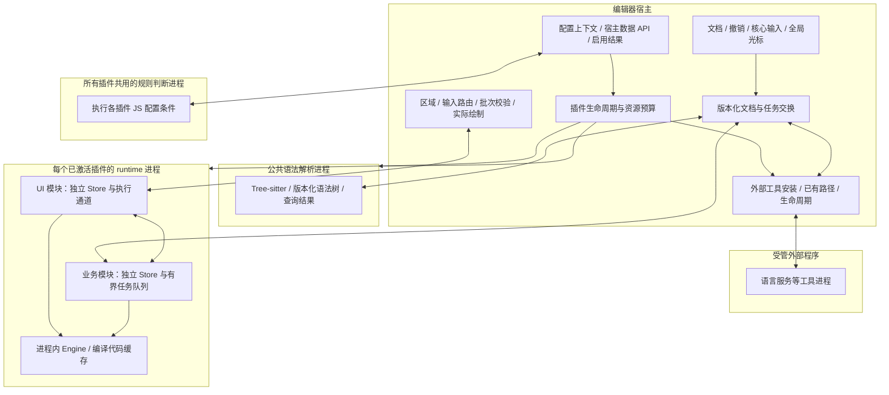

# Nanobug V2 插件架构研究与决策记录

调查开始：2026-11-08。最近更新：2026-11-11。状态：研究结论与候选设计，尚未冻结规格。

访谈表达方式：用户于 2026-11-09 要求后续都用“大白话”描述问题。先说明实际会发生什么，再用具体例子解释，最后明确需要决定的事情；少用术语，一句话表达一个意思。继续沿用用户要求的一次讨论一个问题。

2026-11-10 用户进一步要求：“不要再格式化上问这么多问题了，按照idea和vscode的相似做法就行”。格式化分支停止逐项访谈，保留已经确认的约定，其余常规交互由实现方参考官方资料和工程判断完成。不要把这项授权改写成用户逐条接受了此前待确认的提案，也不要继续产生格式化细节问题；后续讨论返回启动性能、插件隔离和扩展接口等架构选择。

2026-11-11 用户要求目前不讨论布局；底部先默认只占一个窗口，以新面板覆盖切换。Q74 的标签和手动分栏提案没有一并获采纳，布局分支暂缓，继续讨论插件自身的架构和接口。

用户随后明确跨文件修改是“必须的基础技能”，已确认 Q76 属于初版必备接口。后续访谈聚焦确有取舍的架构和产品边界，常规接口细节由设计方补齐；这不代表用户已批准所有尚未提出的新能力，也不改变当前只做设计、尚未进入生产实现的范围。

Q80 最新修正：分发范围仅为官方插件和本地 ZIP；当前没有在线市场，先用本地 JSON 模拟市场数据做测试，在线市场后续补齐。撤回第三方作者向官方市场投稿的提案，不把当前范围扩大为在线服务建设、作者后台或多市场源。第三方 SDK 与本地 ZIP 开发路径继续保留。

本轮阅读了会话交接、需求总结、当前源码及官方资料。仅新增研究文档，没有实现插件系统、修改现有代码、构建程序或运行性能实验。下文将现状、设计推断和待确认目标分开记录。

配套证据：

- [运行时机制研究](2026-11-08-plugin-runtime.md)：Wasmtime、Tree-sitter、QuickJS 的能力与限制。
- [编辑器扩展机制研究](2026-11-08-editor-plugin-architectures.md)：VS Code、Zed、Neovim、LSP 的可借鉴机制。
- [插件版本兼容与实验接口设计](2026-11-09-plugin-api-versioning.md)：2026-11-09 用户采用 VS Code 规则后的当前版本治理方案，替代此前按前两个主版本淘汰的建议。
- [格式化常规交互研究](2026-11-10-formatting-conventions.md)：核对 VS Code 与 IntelliJ IDEA 的官方行为，区分共同做法、实际差异和 Nanobug 的设计选择；剩余格式化交互按第 71 节收敛。

## 1. 结论

保留已经明确的“一插件一 runtime 进程、插件自主绘制、JS 判断模块启用条件”。用户进一步明确：模块调用由配置条件决定，条件满足就放行，不增加首次实际使用的二次激活判断，也不因闲置而回收。要同时实现快速启动、低延迟和故障恢复，还须将以下机制纳入设计：

1. 核心编辑不依赖插件响应；声明注册、规则判断、模块加载和功能就绪分别处理。
2. 每个插件内部把 UI 与重任务分开调度，同时对全部插件的后台并发设置总预算。
3. 文档和绘制按版本、按批次交换；队列、数据规模和宿主绘制成本都有上限。
4. 崩溃恢复围绕权威状态、运行代次和操作确认设计，不能仅靠自动重启。
5. 兼容性通过稳定接口、可选能力协商和兼容验证维持；WASM 文件本身不解决接口演进。
6. 初版就提供可选 UI SDK，保留插件自主绘制能力；通过 SDK 支持的文字/布局接口构建的标准或自定义 UI，都以默认自动接入当前全局光标特效为设计目标，复用宿主权威文字布局，不要求开发者另写特效适配，也不强制使用内置控件。
7. **用户已确认初版绘图范围：完整覆盖当前 GPUI canvas 的公开绘图能力，平台专属能力单独标明。** 当前参照版本为 `gpui-pre 0.3.10`；这是首版设计要求，尚未实现或验收。
8. **用户已确认内存生命周期：项目关闭时释放独占资源，项目仍打开时不因闲置回收。** 插件最后一个资源所有者结束后完成收尾并退出其运行进程，仍被其他项目或全局功能使用的共享资源保留；宿主资源与插件进程资源分别清理。
9. **用户已确认可恢复输入由宿主管理。** 需要恢复的用户输入由宿主记录后再呈现为已接收输入，SDK 输入控件自动接入，自定义 UI 绑定同一状态接口；插件恢复时从宿主取回。此内存确认点覆盖宿主仍正常运行时的插件故障；跨编辑器重启另由 Q10 的本机草稿保存承担。
10. **用户已确认首版提供跨编辑器重启的本机草稿恢复。** 正常关闭前保存需要保留的业务草稿，意外退出后恢复最近成功保存的版本；密码、令牌等不进入普通草稿存储。失败时按 Q12 保留内存并处理关闭，具体写入调度仍待设计。
11. **用户已确认草稿损失的初始验收目标为不超过最近 1 秒输入。** 适用于存储正常时的编辑器进程异常退出；有修改时后台合并保存，持续输入也推进保存，正常关闭前完成最后一次保存。目标尚未实现或实测，不降低插件故障时恢复全部已接收输入的要求。
12. **用户已确认草稿保存失败时保留内存并允许继续编辑。** 明示未保存状态、有限重试；关闭受影响项目或编辑器前，提供重试、另存、取消关闭或明确放弃。成功保存或用户明确放弃后再完成关闭并释放对应草稿，其他项目继续可编辑。
13. **用户已确认插件自动恢复上限。** 每个插件在任意 5 分钟内最多自动重启 3 次，三次尝试分别等待 1、3、10 秒；再次故障且额度耗尽时暂停自动恢复并提供手动重试，宿主保留草稿，正文和其他插件继续工作。
14. **用户已确认更新失败回退，并要求旧宿主安装需要更新宿主的插件时提示升级编辑器。** 新版本接管前启动或迁移失败，恢复上一兼容可用版本及对应状态，宿主最新草稿保留。安装兼容性根据插件声明的最低宿主版本、所需 API 与必需能力判断；宿主过旧时提示升级并阻止不兼容新版本启用，保留已有可用版本。
15. **用户最新选择 VS Code 的版本兼容规范。** 插件包版本、所需宿主范围与 SDK 版本分开；稳定接口长期向后兼容，不再按 N/N−1/N−2 窗口自动淘汰。当前开发期公开 API 标记仍固定 `1.0`，仅手动改版；实际兼容性同时核查宿主与接口需求。
16. **用户最新选择单独管理实验接口。** 未稳定能力显式声明并在开发/测试路径启用，稳定后进入稳定 SDK。原 Q17 的全开发期兼容豁免问题由稳定/实验分类取代，Q18 已确定首批稳定化的优先范围。原定 3 个月保留为稳定接口确需破坏性迁移时的提前通知，不是到期自动删除规则；实验能力不承诺同一期限。
17. **Q18 已确认基础接口优先稳定，UI SDK 与自定义绘图先实验交付。** 插件注册/生命周期、文档访问、草稿保存及资源释放等基础接口优先验证并稳定；UI SDK 和自定义绘图接口验证成熟后逐项转稳定。首版完整 canvas 公开能力与全局光标接入目标继续适用；当前尚未实现稳定插件 API。
18. **Q19 已确认启用规则故障时保留有效结果、阻止未知条件下的新调用。** 中止出错或超时的判断并报告原因，规则进程失效时单独恢复；仅复用有效配置及未变化相关上下文的成功结果。缺少有效结果的新项目、新配置或变化后的上下文暂不放行相应新调用，已有实例和草稿保留，正文继续可编辑。
19. **Q20 已按用户修正：JS 可以主动调用宿主数据 API。** 宿主提供常用文件读取及其他用于判断的 API，JS 使用返回的数据为对应模块输出 `true` 或 `false`，宿主执行放行结果；不再要求所有数据必须先由插件声明、预先填入固定上下文字段。调用方式、具体 API 范围与预算继续设计。
20. **Q21 已确认可能等待的 API 使用异步调用。** 文件读取等通过 Promise/`async/await` 返回，等待数据时让其他可运行规则与正文编辑继续推进；已有内存上下文可同步读取。初始时间预算见 Q24，实际调度、取消与缓存一致性仍待设计和验证。
21. **Q22 已确认宿主自动记录依赖、更新缓存并重新执行受影响规则。** 规则通过数据 API 的实际读取/查询建立依赖；相关数据变化后由宿主刷新并合并调度，插件作者无需自己编写监听与缓存更新逻辑。具体监听、遗漏后的核查、缓存容量和刷新时限仍待设计。
22. **Q23 已确认磁盘文件与未保存文档分开读取。** 文件 API 默认返回已保存的磁盘内容，文档 API 返回包含未保存修改的当前文档内容；JS 显式选择来源，宿主分别跟踪依赖、版本与变化。具体 API 名称和快照结构继续设计。
23. **Q24 已确认规则的初始时间预算。** 每次判断累计 JS 计算 20 ms、整次判断从开始执行起 5 秒内完成，后者包含 API 等待；后续根据实测调整。超限按 Q19 作为本次判断失败处理，不转成条件真假；数值尚未经过性能或中断时限验收。
24. **Q25 已确认共享规则进程的自动恢复上限。** 与各插件 runtime 独立计数，任意 5 分钟最多自动重启 3 次，三次等待 1、3、10 秒；成功后继续运行，再次故障且额度耗尽时暂停自动恢复并提供手动重试。单条规则的普通报错或可中止超时不直接触发公共进程重启。
25. **Q26 已确认连续计算超限时暂停单条规则。** 同一规则在同一项目/文档作用域和有效配置下，正常触发的判断连续 3 次耗尽 JS 计算预算后暂停自动执行；修改规则或手动重试后恢复，一次成功判断清除连续计数。读取失败与整体等待超时不计入，其他规则/项目及已有实例和草稿保留。
26. **Q27 已确认临时读取失败由宿主最多再试两次。** 首次失败后分别等待 100 ms、300 ms 再读，包含第一次总共最多读取三次；全部尝试与判断共用原来的 5 秒总时限。只重试读取请求，JS 仍等待同一次 API 调用；格式、权限等非临时错误直接报告。次数与间隔作为初始策略，后续可按实测调整。
27. **Q28 已确认同一规则只保留一项执行和一项最新等待。** 对同一项目/文档中的同一规则，连续变化更新尚未执行的那项任务，不为每个中间版本分别排队；过时结果不再采用，文件修改与用户输入照常保留。不同规则和项目/文档分别管理，具体调度与取消实现待完成。
28. **用户已确认不同规则可以并行，但控制总数量。** 在公共规则进程内支持不同规则同时推进读取和计算，为正文编辑保留计算能力；有空余执行能力就安排，忙满后才排队。具体并行上限根据实测确定，尚未选定 JS 引擎或执行器数量；忙满后的处理原则见 Q29。
29. **Q29 已确认排队时当前操作相关规则优先，其他任务也持续推进。** 执行能力忙满时，优先安排当前操作窗口、文件和项目相关判断，同时给其他项目和插件持续的执行机会；切换焦点调整后续顺序。该原则不改变配置条件或实例生命周期，具体算法、权重与最大等待时间仍待设计。
30. **Q30 已确认核心界面就绪后自动开始插件准备工作。** 先让核心界面及当前场景的基本操作可用，再启动公共规则进程，判断配置并自动安排条件满足的插件加载。就绪不以用户实际输入、保存或点击为条件；只浏览项目、没有打开正文或文档只读时也照常推进适用规则。具体就绪信号与首次插件可用时间继续设计和测量。
31. **Q31 已确认不按源文件总大小拒绝条件查询。** JS 提交目标、筛选条件和所需字段，宿主在后台读取、解析并筛选，只返回匹配内容；结果多时分批返回。无索引时仍可能扫描整个文件，沿用整次判断 5 秒预算，超时报告查询未完成，不当作没有匹配。具体筛选能力、批次、内存及索引方案待设计，未设 10 MB 文件上限。
32. **用户已确认借鉴 LazyVim 的轻量解析扩展方式。** 宿主提供通用文本 API，规则作者可提供少量 JS 解析代码处理未知配置格式；常见格式的宿主解析器作为便利能力。继续使用 JS 和已确认的独立规则进程、异步 I/O、依赖跟踪、缓存与时间预算；不照搬同步条件执行或仅在配置解析时缓存结果。Q32 的宿主筛选清单仍未冻结，辅助代码的交付方式见已确认的 Q33。
33. **Q33 已确认轻量解析代码随插件交付，规则可直接使用。** 辅助 JS 函数或文件随所属插件打包，在公共规则进程中供启用规则调用，无需另行安装解析库或先启动 WASM 业务模块；辅助代码与条件脚本共用原计算和时间预算。具体导入、加载、初始化、代码缓存及版本关联待设计。
34. **Q34 已确认安装、更新时提前准备插件清单与编译缓存。** 后续启动复用有效索引和运行时支持的本机编译产物，接受安装、更新增加准备耗时与部分磁盘占用；缺失或失效时，在核心界面就绪后后台重建。实际编译范围、缓存失效及准备失败处理仍需设计，不提前执行条件未选中的业务模块。
35. **Q35 已确认积压时跳过可替代的过时画面。** 同一区域优先显示最新有效完整状态；依赖前序状态的增量先正确合并或补齐，输入、编辑、保存及有副作用操作不随画面丢弃。具体队列、帧率及呈现协议待设计。

后续关键架构决定：**Q65 已确认独立的公共语法解析服务。** 宿主管理独立解析进程，让使用相同文档版本、grammar 及解析配置的功能复用基础语法结果；插件专有分析仍可自行实现。核心先可编辑，解析随后准备，项目关闭释放独占数据；公共服务进程故障可使多个依赖功能短暂不可用，正文编辑与保存继续。实际协议、恢复机制和资源节省量尚待实现验证，详见第 72 节。

以上是结合现行需求与资料形成的建议，不是已经测得的性能保证。进程隔离可以限制故障扩散，但 CPU、内存、磁盘和宿主 GPU 仍是共享资源。

## 2. 当前实现与交接文件的差异

| 核实项 | 当前证据与影响 |
| --- | --- |
| 编辑核心 | 自研 Rust `Document` 和简易 Vim，没有 Neovim 子进程；`Cargo.toml` 的 Neovim 描述过时。见 [main.rs](../../src/main.rs)、[lib.rs](../../src/lib.rs)、[使用指南](../使用指南.md)。 |
| 插件底座 | 还没有插件加载器、WASM/JS 引擎、IPC 或进程监督；不能按已有插件实现做局部优化。见 [Cargo.toml](../../Cargo.toml) 和 [使用指南](../使用指南.md)。 |
| GPUI | 已固定 `gpui-pre` / `gpui-pre-platform =0.3.10`，交接中的“版本待定”不再代表当前事实。 |
| 启动链路 | `main` 调用 `app::run`，注册字体后进入 `Workspace::new`；构造时同步读取初始文档、光标配置、根目录首层。见 [启动入口](../../src/app/mod.rs)、[工作区初始化](../../src/grid/workspace/mod.rs)、[目录树](../../src/grid/windows/manager/tree.rs)。 |
| 文档真源 | `Document` 拥有正文、撤销和保存，并在修改/撤销时递增 `revision`；尚无插件文档订阅和版本化编辑接口。见 [document.rs](../../src/document/mod.rs)。 |
| 绘图与区域 | 当前已有面板逐行排版缓存，但布局与焦点仍围绕固定文件管理器和编辑区；尚非通用插件区域注册机制。见 [工作区布局](../../src/grid/workspace/layout.rs)、[面板绘制](../../src/grid/render/panel.rs)。 |
| 性能证据 | 尚无完整启动与端到端输入延迟基线；历史微基准不包含插件 IPC、WASM 冷加载等。见 [需求总结的性能说明](../需求总结.md)。 |

因此，首屏不等待插件是必要条件，仍需测量宿主自身的同步工作。同步读取出现在启动路径，不等于已经证明它是实际瓶颈。当前真实文件保存已实现，交接中“没有真实文件保存”描述的是旧独立 Demo。

## 3. 候选结构与模块接口



图中是职责划分，不要求立即建立对应数量的 crate。用户已确定所有插件共用一个规则判断进程执行 JS 配置，Q19 进一步确认故障时保留仍有效结果、暂停依赖未知结果的新调用并单独恢复规则进程；Q30 已确定在核心界面就绪后自动启动规则与插件准备工作，具体就绪信号、预算和恢复协议细节仍待设计。Q65 后续单独确认公共语法解析进程，与规则判断进程分开，插件通过宿主交换所需数据；这项确认不能追溯为 Q5 当时已经接受共享解析，也不合并各插件自己的 runtime。

建议把复杂行为放在少量深模块的小型接口后面：

| 模块 | 调用方需要表达什么 | 模块内部负责什么 |
| --- | --- | --- |
| 配置与启用管理 | 模块配置、当前上下文、对宿主数据 API 的请求及判断结果 | 数据取得与缓存、条件评估、结果汇总、去重启用；不增加使用频率或闲置回收策略 |
| runtime 监督 | 让配置选中的模块就绪、提交有期限的任务、明确关闭 | 启动握手、状态转换、超时、资源归属、退避重启与连续失败停用 |
| 文档交换 | 订阅快照/增量；基于某版本提出一次编辑 | 版本与范围校验、撤销事务、过时结果处理、重同步 |
| 公共语法解析 | 指定文档版本、语法定义及所需结构信息 | grammar 加载、增量解析、相同输入复用、批量查询、资源归属及故障恢复 |
| 外部工具托管 | 声明所需工具或指定已有路径，申请启动、通信与停止 | 安装准备、兼容核对、文件复用、进程与资源归属、项目关闭收尾；Q70 已确认可安全重建服务的独立有限恢复 |
| 插件区域 | 注册区域、提交绘制批次、接收输入和尺寸变化 | 焦点、IME 接入、坐标代次、资源校验、绘制缓存与限额 |

不把进程、Store、重试、缓存失效分散给每个插件调用点；也不把所有职责塞成一个难以独立验证的管理器。

## 4. 启动速度：配置决定启用，调度负责执行

**已核实参考。** VS Code 以语言、命令、视图等事件激活扩展，官方建议避免默认 `*` 激活。Wasmtime 支持将编译移出加载关键路径。[Activation Events](https://code.visualstudio.com/api/references/activation-events)、[Pre-Compiling Wasm](https://docs.wasmtime.dev/examples-pre-compiling-wasm.html)

**Q34 已确认准备时机。** 安装、更新时提前整理插件清单并准备运行时支持的本机编译缓存，后续启动优先复用有效结果。用户接受安装、更新增加部分耗时和磁盘占用；缓存缺失或失效时，核心界面就绪后后台重建。具体清单字段、实际编译范围、缓存策略及性能收益仍待设计和验证。

**Q30 已确认启动顺序。** 核心界面及当前场景的基本操作准备好后，再自动在后台启动公共规则进程、执行启用条件并在预算内安排满足条件的插件加载。打开可编辑文档时就绪包括可输入和保存；只看项目、没有打开文档或文档只读时，也在相应基本操作就绪后继续推进，不等待用户实际输入或点击。此顺序尚未实现或验收。

区分三个问题：

- 已注册：用户能看见命令或面板入口，无须执行插件代码。
- 条件满足：按配置启用/放行对应模块，不再等待另外一次“实际使用”判断。
- 已就绪：模块加载完成不等于索引、网络或 LSP 已完成初始化。

用户已否决“长期闲置后回收”。之前“JS 的 true 仅表示资格，还需另有请求才激活”的建议随之撤回：条件满足即按配置放行，条件持续满足时不因面板隐藏、使用频率低或没有近期请求而停用。跨文档仍须避免一个不匹配上下文覆盖其他匹配上下文。Q8 后续已确认：项目仍打开时不因闲置回收，条件暂时不满足可保留实例；项目真正关闭时释放独占资源，最后资源所有者结束后收尾并退出插件进程。任务取消、操作收尾与资源释放的具体协议仍待设计，不能将不闲置回收解释为任意情形都永久保留资源。

本机编译缓存建议以模块内容、运行时版本、目标架构与引擎配置区分。分发包仍包含平台无关 WASM；编译缓存不是通用跨平台产物。反序列化产物含本机代码，必须来自受控编译链，不能仅因插件提供了哈希就信任它。[Wasmtime Module::deserialize](https://docs.wasmtime.dev/api/wasmtime/struct.Module.html#method.deserialize)

Q71 已确认后台编译、启动与索引等重任务统一限量并行，交互和当前操作优先，同时让其他项目持续推进。把几十项工作推迟到首帧之后同时启动，仍可能影响接下来的输入体验。并发调度只控制已放行工作的执行顺序，不替配置增加启用条件。编译缓存可以提前准备，但不预测性启动配置未选中的模块，也不以闲置回收代替配置控制；具体上限和效果仍需实测。

## 5. 性能：避免排队、重复工作和线程争抢

**已核实参考。** Wasmtime async 的工作发生在 Future 被 poll 时，线程调度由嵌入方负责；Engine/Module 可在进程内共享，但独立 Store 才能拥有独立执行状态。fuel/epoch 不能解除阻塞的 host call。[Wasmtime async](https://docs.wasmtime.dev/api/wasmtime/#async)、[多线程嵌入](https://docs.wasmtime.dev/examples-multithreaded-embedding.html)、[中断配置](https://docs.wasmtime.dev/api/wasmtime/struct.Config.html#method.epoch_interruption)

**候选调度。** 每插件进程内复用 Engine，UI 与重任务有不同 Store 和执行通道。UI 不等待后台模块初始化，不持有后台任务长期占用的锁。总后台并发按机器资源分配，避免每个插件各自开满全部 CPU 核心。一个进程里的独立 Store 能提供更细的任务管理，但原生进程崩溃仍会同时带走该插件所有模块。

**候选通信。** 初版优先有界消息与批量数据；是否采用共享内存、什么编码和传输，留给实际负载对照。不能在没有消息体积和频率证据时认定“零拷贝”是首要优化。

| 数据类型 | 队列与一致性建议 |
| --- | --- |
| 文档快照与增量 | 快照可取最新完整版本；增量必须匹配基础版本，断链后重同步，不能任意丢中间项。 |
| 插件绘制 | Q35 已确认：同一区域可用最新有效完整画面替代尚未呈现的旧完整画面；绘制增量须保持依赖链，完成校验后整批呈现。 |
| 文本输入、编辑提交、有副作用命令 | 保序并明确确认；队列满时返回可识别的繁忙/失败，不能静默丢弃。 |
| 诊断、进度、预览 | 按对象与版本合并；旧版本结果不能覆盖新版本状态。 |
| 取消、关闭、健康检查 | 预留处理能力，不能被大幅绘图或索引数据长期堵塞。 |

这部分借鉴版本化文档通知与批次呈现，但不是复制 Neovim 协议。[Buffer updates](https://neovim.io/doc/user/api/#api-buffer-updates)、[UI protocol](https://neovim.io/doc/user/api-ui-events/)

**候选绘图。** 保留插件界面逻辑自由；宿主只接受可验证的区域、原语和资源句柄。文字按行段提交，图片复用资源，未变化区域复用缓存。除了消息字节数，还要限制路径复杂度、图片像素、可见绘图工作量、句柄总量与每帧接收预算。插件在另一个进程生成巨量合法绘制指令，仍可能拖慢宿主。

绘制批次记录区域尺寸/缩放代次，避免缩放后的旧数据再次提交；插件重启后资源句柄失效。自绘输入区域还需文本语义、逻辑光标和 IME 接口，不能让原生输入法的每次同步查询都跨进程等待。高层 UI 库可以是可选 SDK，不应限制插件只能使用固定树或列表控件。

## 6. 高可用：保护权威状态，限制故障扩散

**文档交换方向（单文档格式化与跨文件文本修改已确认）。** 保持宿主 `Document` 为正文真源。插件观察带文档 ID、打开代次、修订号的快照/增量；编辑请求附带预期版本，由宿主验证范围后应用。Q59 已确认单文档格式化采用版本校验、整批应用和一次撤销；过期结果作废并提醒，由用户自行再次触发，不自动重算。Q76 已确认初版必须提供宿主管理的跨文件文本修改、统一预览入口与整组撤销，拒绝失效修改计划。实际磁盘保存、其他编辑类型以及具体位置编码、交换协议继续设计。[当前 Document](../../src/document/mod.rs)

**候选恢复状态机。** 按未启动、启动中、就绪、降级、退避恢复、连续失败停用管理 runtime。超时先识别具体任务/执行通道；不能仅靠一个独立心跳线程判定整个插件健康。进程退出后递增运行代次，拒绝旧响应，撤销旧资源，重新发送最新文档和可恢复状态。最后有效画面可保留，但恢复期间禁止旧画面继续触发操作。

自动重启需要上限和退避；VS Code 的官方实现也区分可自动重启与反复崩溃。重启不证明状态已恢复。[VS Code 恢复实现](https://github.com/microsoft/vscode/blob/main/src/vs/workbench/services/extensions/electron-browser/nativeExtensionService.ts)

插件 UI 的未保存输入若需要跨 runtime 崩溃恢复，就必须通过宿主保存的文档或明确的状态确认协议承载。仅在插件内存保存数据、偶尔发送快照，不能保证最后一次输入不丢。Q9 已确定以宿主接收记录为输入确认依据；具体消息格式、版本和恢复流程仍待实现。

**Q9 已确认：可恢复用户输入由宿主管理。** 提交说明、搜索/表单草稿等需要恢复的输入接入宿主状态接口，宿主接收记录后再呈现为已接收输入。SDK 输入控件自动绑定该接口，自定义 UI 也可绑定同一状态接口；不要求使用固定控件外观。插件重启后读取宿主保留的内容。用户已采纳该状态管理方式，宿主承担必要草稿与同步成本；索引和预览等可重建数据继续由插件管理。

Q9 的内存确认只在宿主仍正常运行的前提下保留必要草稿。草稿状态同样记录项目/文档归属，项目关闭时按已确认的生命周期与未保存内容处理规则收尾，不能成为永久遗留状态。后续 Q10 已另行确认磁盘草稿恢复，不能把宿主已接收输入等同于已经完成持久化。

**Q10 已确认：首版提供跨编辑器重启的本机草稿恢复。** 对明确允许持久化的业务草稿后台保存，密码、令牌等不进入普通草稿存储；正常关闭项目或编辑器前完成草稿保存再释放内存，意外退出后恢复最近成功保存的版本。Q11 已确定最近 1 秒输入的初始损失目标，Q12 已确定写入失败时的编辑与关闭行为；具体保存调度、保留期限及是否覆盖系统掉电仍待细化。不得把 Q9 的内存确认点写成磁盘耐久性承诺，也不得因恢复存储存在而提前激活配置未选择的插件。

**Q11 已确认：草稿后台保存与异常退出时的输入损失目标。** 用户采纳在存储正常的条件下，把编辑器进程意外退出时的草稿损失范围设为不超过最近 1 秒输入的初始验收目标。有修改时后台合并保存，持续输入也必须推进保存，不能只等待用户停下输入；正常关闭前完成最后一次保存。1 秒是待实现、实测的目标，不能把设置 1 秒定时器直接当成严格完成时限。写入失败或长时间阻塞时不能继续显示为已保存，交互与关闭按已确认的 Q12 处理。此窗口只针对宿主异常退出，插件故障仍按 Q9 从宿主恢复全部已接收输入；系统掉电不自动纳入同一保证。

**Q12 已确认：草稿保存失败时的编辑与关闭行为。** 保留宿主内存中的草稿、允许继续编辑，持续标明尚未成功保存的状态，并进行有间隔和上限的重试；不反复弹窗打断输入。正常关闭受影响项目或退出编辑器时，若仍有未保存草稿，则暂缓完成关闭，提供重试、另存/导出、取消关闭或明确放弃的路径；成功保存或用户明确放弃后再完成关闭并释放相应状态，其他项目继续可编辑。关闭请求尚未完成时保留草稿不改变 Q8 的项目关闭释放规则。此策略只处理普通可恢复业务草稿，不能据此把密码、令牌写入其他普通文件；系统强制终止或掉电无法依靠关闭交互补救。具体存储接口、重试参数和界面尚未实现。

**Q13 已确认：插件进程反复故障时的自动重启上限。** 每个插件在任意 5 分钟内最多自动重启 3 次，三次恢复尝试分别等待 1、3、10 秒；如果再次故障且已无额度，则暂停该插件的自动恢复，显示故障原因和手动重试入口。第 3 次重启成功后继续正常运行，不因次数已满而主动终止。进入暂停状态后不因切换文件、焦点或窗口到期自动反复尝试。编辑器正文和其他插件继续工作，宿主保留已确认输入；恢复中的旧画面不继续触发操作。此策略处理插件进程崩溃或启动恢复失败，不能将一次普通任务报错直接当作整个插件进程故障；卡死判定、操作超时与共享规则进程的恢复需分别细化。恢复仍遵守配置选择和外部操作结果核对规则，不自动重复 Git 提交等外部操作，不把故障暂停改写成闲置回收。用户已采纳数值与策略，尚未实现或验证。

查询与索引通常可重做；Git 提交、部署、写文件等外部操作不能盲目重放。操作完成而确认丢失时，应通过操作 ID、可查询结果或具体接口的幂等机制判定；无法判定则保留“结果待确认”。仅给请求加 ID，并不能让任意外部操作自动获得恰好一次语义。

**Q72 已确认内存保护触发后的恢复例外。** 因明确内存超限且无法控制占用而停止的对象暂停自动重启，保留正文与已确认草稿，显示原因并由用户处理或手动恢复；正常崩溃仍按原有限重启规则。该保护不属于闲置回收，具体分配限制、归因和平台执行机制尚未实现。

**Q81 已确认宿主连续启动崩溃后的恢复入口。** 用户下次打开时进入临时仅核心模式，先提供文件打开、编辑和保存，暂停插件及其执行链，保留安装、配置、未应用修改和已保存草稿，并提供主动恢复入口。正常启动仍按条件自动加载；具体触发阈值及异常记录需独立实现，不套用插件进程的重启计数，也不据此断定故障由插件造成。

**已核实限制。** Wasmtime ResourceLimiter 不覆盖全部宿主和运行时分配；还需统计插件间接占用的宿主图片、队列和缓存。[ResourceLimiter](https://docs.wasmtime.dev/api/wasmtime/trait.ResourceLimiter.html)

**Windows 可用机制。** Job Object 可管理进程组、关联通常的子进程、限制提交内存及 CPU，并在设置相应标志后关闭时终止关联进程。CPU 硬上限会暂停整个 job 的线程，因此更适合失控兜底，不能代替 UI/业务分开的正常调度。原生 LSP 与工具须纳入资源统计和退出管理；其他平台需要分别实现及验收，不能把 Windows 机制写成跨平台保证。[Job Objects](https://learn.microsoft.com/en-us/windows/win32/procthread/job-objects)、[内存限制](https://learn.microsoft.com/en-us/windows/win32/api/winnt/ns-winnt-jobobject_extended_limit_information)、[CPU 限制](https://learn.microsoft.com/en-us/windows/win32/api/winnt/ns-winnt-jobobject_cpu_rate_control_information)

已确认的恢复范围包括插件故障时从宿主恢复输入，以及编辑器重启后恢复已保存的插件业务草稿。编辑正文自身的异常恢复与系统掉电耐久性仍需单独定义，不能由“一插件一进程”或草稿自动保存推导出来。

## 7. 扩展性：稳定接口与明确的能力范围

**2026-11-09 当前决定：采用 VS Code 的版本兼容与实验接口规范。** 插件包按自己的版本发布，清单声明所需编辑器版本范围，SDK 提供对应开发绑定；稳定 API 长期保持向后兼容，实验 API 独立声明、启用和演进。此前 Q7/Q15 的 N/N−1/N−2 滚动窗口不再作为稳定接口淘汰规则。详见[版本专项设计](2026-11-09-plugin-api-versioning.md)。

**用户追加要求已确认：宿主版本过低时提示升级编辑器。** 安装或更新时，依据插件清单声明的最低编辑器版本、所需插件 API 版本与必需能力检查兼容性。因宿主过旧而不满足要求时，提示“编辑器版本过低，请升级”，并列出当前版本和插件要求的最低版本或接口要求；不启用不兼容新包、不执行其数据迁移，已有可用版本继续保留。提示用户升级不等于自动升级编辑器的授权。插件包版本与编辑器版本属于独立序列，不能直接比较两个版本号的大小来判定兼容。

可选能力允许插件按声明降级；必需能力缺失才阻止对应插件启用。平台不支持、插件声明不支持当前宿主、实验契约不匹配等问题应报告实际原因，不能统一误报为编辑器过旧。上述检查流程是落实用户升级提示要求的设计方向，清单字段与错误码尚未实现。

**Q15/Q16 的历史决定与本轮替代。** 此前选择独立 API 主版本窗口，后来明确开发期公开 API 固定 `1.0`。本轮选择 VS Code 方式后，以宿主版本范围和稳定/实验契约判断兼容，不再用三代窗口决定稳定接口是否保留。固定 `1.0` 的人工改版要求继续保留；本文不修改编辑器或插件包自身的版本。

相同的 `1.0` 标记本身不能区分不同开发构建中的接口变化。设计由 SDK 生成实际导入与所选实验提案的契约记录，宿主在运行前校验；稳定接口维持旧产物兼容，不采用整套最新 SDK 哈希必须相等的判断。契约记录属于 Nanobug 的 Rust/WASM 适配设计，不是 VS Code 既有字段，具体格式尚未冻结。

**三个月期限在新方案中的含义。** 稳定接口确需不兼容迁移时，提供三个月提前通知与可用替代路径；期满不自动删除接口，仍需明确发布决定。该期限是 Nanobug 自身要求，不是 VS Code 的统一政策。实验接口允许更快的不兼容演进，不套用稳定接口的兼容期限。不增加此前未采纳的十二个月期限；当前尚未启动任何实际弃用倒计时。

**开发期按接口稳定性管理。** 未稳定的 API 明示为实验能力，插件显式选择并通过开发/测试路径启用；已经宣布稳定的接口，即使编辑器仍在开发期也遵守稳定契约。首版 UI SDK 和完整 GPUI canvas 公开能力要求继续保留，实验标记不能作为减少实现范围的理由。

**Q17 已由新方向替代，Q18 已确定稳定化优先范围。** 不再对整个开发阶段作统一兼容豁免。用户已采纳插件注册/生命周期、文档访问、草稿保存与资源释放等基础接口优先稳定，UI SDK 与自定义绘图接口先以实验方式交付，验证成熟后逐项稳定。具体函数签名与行为验收仍需完成；当前没有已发布的稳定插件 API。

实现建议是分别记录插件包、清单、宿主契约和状态存储信息，加载前检查必需/可选能力，并用历史稳定插件的原始产物验证行为兼容。源码 SDK、WASM 调用接口和跨进程协议是不同接缝，不用一份 Rust 类型内存布局代替全部兼容约定；WIT、消息编码及正式清单格式继续待设计。

WIT/Component Model 是候选接口工具，不会自行带来文档一致性、资源预算或向后兼容。Tree-sitter grammar 使用其专用加载接口，不应机械套入普通业务模块接口。[Tree-sitter WasmStore](https://docs.rs/tree-sitter/latest/tree_sitter/struct.WasmStore.html)

Zed 的资源与 WASM 逻辑分离值得参考，但它的公开扩展能力不能证明任意自绘 UI 已经解决；绘图、输入、资源与恢复契约仍需本项目自行验证。[Zed 扩展开发](https://zed.dev/docs/extensions/developing-extensions)

用户已单独确认更新失败回退：先保留可用旧版本及更新前状态，在副本上验证新版本的迁移，再完成版本切换。仅回退包文件不一定能恢复已经改变的数据格式，因此版本与状态必须配套管理。该要求来自 Q14 的明确采纳，不因本轮版本治理变化而取消。

**Q14 已确认：插件更新接管前失败时自动回退。** 首版保留上一可用且与当前宿主兼容的插件包及更新前状态，将新版本的状态迁移放在副本中验证；新版本启动或迁移失败时恢复上一可用版本，验证成功后才接管用户操作。旧版本作为磁盘备份保留，不要求额外常驻第二套插件进程，更新时的具体切换协议仍需设计并遵守每插件一个 runtime 的既有要求。普通用户输入仍由宿主按 Q9 保管，不能用旧快照覆盖宿主已确认的新输入。

已确认的自动回退范围限于新版本接管用户操作前的更新失败。新版本已正常接管后产生的输入或其他数据，不能被更新前备份自动覆盖；接管后的运行故障先按 Q13 恢复，后续版本回退与数据转换另行处理。验证和迁移阶段不能靠回退插件包撤销已发生的 Git 提交、部署或任意外部文件修改。没有兼容旧包或备份不可用时应明确报告更新失败，不能声称已安全回退。用户已接受保留旧包、状态副本以及增加验证和切换工作的方案；尚未实现或验收。

## 8. 验证设计：如何让承诺可验收

尚未执行以下实验，也没有填入虚构结果。

| 维度 | 测量方法与必要区别 |
| --- | --- |
| 启动 | 从进程创建到首帧、指定文档可编辑分别计时；不以出现空窗口替代可编辑。 |
| 冷与热 | 区分系统文件缓存冷/热，以及 WASM 编译缓存命中/未命中，形成独立组合；进程已退出但系统缓存仍热属于热启动。 |
| 首次使用 | 命令/面板触发到输入可用、首个有效画面、首个业务结果分别统计；再次使用单独记录。 |
| 输入 | 记录事件接收到文档提交、场景提交的时间；真正输入到屏幕显示需呈现/外部测量，不能用 CPU 绘制耗时冒充。 |
| 资源 | 同时统计宿主、runtime 及其受管原生工具；私有提交内存、工作集与共享映射分别解释，不简单累加进程 RSS。 |
| 可归因性 | 记录插件、模块、激活原因、排队/编译/初始化耗时、消息量、超时、恢复次数和宿主绘图成本。 |

候选实验矩阵：零插件；50 个已安装但配置条件不匹配；典型 10 个活跃；条件匹配触发冷缓存加载；匹配模块长时间无调用仍保持启用；UI 与索引并行；规则死循环；业务 Wasm 死循环；阻塞 host call；消息洪泛；过大绘制；runtime 被终止；增量丢失；写操作完成但回复丢失；历史稳定接口插件原始产物；实验未授权/契约不匹配；旧宿主加载新能力插件；插件升级失败及回退。每组记录样本数、P50/P95/P99 和异常，冷启动样本不足时明确说明，不能用几个样本证明尾延迟。

先测无插件基线，再用小型插件贯通接口并注入故障，才能判断下一步应优化编译、复制、调度还是绘制。共享内存、池化分配和复杂预热只在证据支持时引入。

## 9. 第一轮决策记录

用户先接受 Q1 的初始性能目标；在用 Git 插件故障场景解释 Q2，并将 Q3 收窄为“第一版支持其他开发者独立编写插件”后，用户回答“都采纳”。三个目标现已确认。Q3 最后一次提问明确把兼容期限和更新回退留待后续，因此本次确认不扩展成对原先全部兼容建议的批准。

1. **性能规模与目标：已确认。** 参考本机 Release，50 个已安装插件、典型最多 10 个活跃；缓存已热的启动到可编辑 P95 ≤300 ms，真正冷启动 P95 ≤1 s，并单列首次插件可用时间。数字是待测目标，插件数量不是产品硬上限。输入延迟、内存总额和首次交互阈值随后细化。
2. **恢复标准：已确认。** 插件卡死或崩溃时编辑器仍可写代码、保存文件，只恢复出问题的插件；插件中写到一半的提交说明等用户输入应保留，文件变更列表、索引和预览可重建。外部操作可能已经完成时先检查实际结果，不能自动重复执行；查不清则显示结果待确认。允许插件短暂恢复。后续 Q9 已确定需要恢复的输入由宿主先记录再呈现为已接收输入，Q10 已确定跨编辑器重启的本机草稿恢复，Q11 已确定存储正常时宿主异常退出的草稿损失不超过最近 1 秒输入这一初始验收目标；具体接口、同步与写入调度、恢复时限仍待设计，系统掉电耐久性尚未确认。
3. **第三方开发支持：已确认。** 第一版即提供接口、开发工具和文档，让其他开发者能独立为 Nanobug 编写插件。最新采用 VS Code 的宿主范围、稳定接口长期兼容与独立实验接口制度，替代早先 Q7/Q15 的滚动窗口；保留当前公开 API `1.0` 人工改版要求、稳定接口确需迁移时的三个月通知、Q14 接管前失败回退以及宿主过旧的升级提示。Q18 已确定基础接口优先稳定、UI SDK 与绘图先实验；Q82 后续确认开发调试默认使用独立测试编辑器实例并加载本机编译输出。具体接口、调试和迁移协议待设计。

三个根目标已确定：性能目标约束加载与执行预算；恢复目标约束状态归属和 JS/解析执行位置；第三方开发目标要求明确接口范围及兼容验证。后续回答已否决空闲回收，并将版本治理调整为 VS Code 模式；继续按最新结论讨论其余问题。现有“每插件一个 runtime”等明确需求不重复要求用户确认。

## 10. 绘图能力补充核实

本轮继续检查了 Cargo.lock 锁定的 `gpui-pre 0.3.10` 本机源码。工作区同期发生模块重组，本文项目源码链接已按当前路径核对；自研编辑核心与尚无插件运行时的结论仍成立。以下描述宿主原生能力，不能当作插件绘图协议已经存在。

| 能力 | 固定版本源码证据 | 需要保留的限制 |
| --- | --- | --- |
| 文字与字形 | [shape_line](C:/Users/Tmiracle/scoop/persist/rustup/.cargo/registry/src/index.crates.io-1949cf8c6b5b557f/gpui-pre-0.3.10/src/text_system.rs)、[paint_glyph](C:/Users/Tmiracle/scoop/persist/rustup/.cargo/registry/src/index.crates.io-1949cf8c6b5b557f/gpui-pre-0.3.10/src/window.rs) | 字体排版、资源和实际绘制仍由宿主负责；插件需要独立的数据接口。 |
| 矩形、圆角、矩形描边 | [PaintQuad](C:/Users/Tmiracle/scoop/persist/rustup/.cargo/registry/src/index.crates.io-1949cf8c6b5b557f/gpui-pre-0.3.10/src/window.rs) | 应对指令数量及绘制区域设置预算。 |
| 路径、曲线、填充与描边 | [PathBuilder](C:/Users/Tmiracle/scoop/persist/rustup/.cargo/registry/src/index.crates.io-1949cf8c6b5b557f/gpui-pre-0.3.10/src/path_builder.rs)、[paint_path](C:/Users/Tmiracle/scoop/persist/rustup/.cargo/registry/src/index.crates.io-1949cf8c6b5b557f/gpui-pre-0.3.10/src/window.rs) | 路径复杂度会转化成宿主工作量，需要限制，不能仅统计消息字节。 |
| 图片与 SVG | [paint_image](C:/Users/Tmiracle/scoop/persist/rustup/.cargo/registry/src/index.crates.io-1949cf8c6b5b557f/gpui-pre-0.3.10/src/window.rs)、[paint_svg](C:/Users/Tmiracle/scoop/persist/rustup/.cargo/registry/src/index.crates.io-1949cf8c6b5b557f/gpui-pre-0.3.10/src/window.rs) | `paint_svg` 为单色 SVG 路径；图片资源应采用宿主句柄和像素预算。 |
| 裁剪与变换 | [with_content_mask](C:/Users/Tmiracle/scoop/persist/rustup/.cargo/registry/src/index.crates.io-1949cf8c6b5b557f/gpui-pre-0.3.10/src/window.rs)、[路径变换](C:/Users/Tmiracle/scoop/persist/rustup/.cargo/registry/src/index.crates.io-1949cf8c6b5b557f/gpui-pre-0.3.10/src/path_builder.rs) | 裁剪为矩形；部分原语支持变换，不能据此宣称所有文字、图片都支持统一任意旋转或任意路径裁剪。 |
| shader、3D、外部纹理 | [canvas](C:/Users/Tmiracle/scoop/persist/rustup/.cargo/registry/src/index.crates.io-1949cf8c6b5b557f/gpui-pre-0.3.10/src/elements/canvas.rs)、[paint_surface](C:/Users/Tmiracle/scoop/persist/rustup/.cargo/registry/src/index.crates.io-1949cf8c6b5b557f/gpui-pre-0.3.10/src/window.rs) | canvas 提供原生闭包入口，不等于跨进程可直接提交任意 GPU 程序；`paint_surface` 使用平台特有对象且限 macOS/iOS，不能当作通用跨平台接口。 |

Nanobug 当前已有[缓存文字与面板绘制](../../src/grid/render/panel.rs)、[光标曲线路径](../../src/grid/render/cursor.rs)、[图片图标](../../src/grid/windows/manager/icons.rs)。这些只能证明宿主具备对应绘制路径；插件侧的批次校验、资源归属、输入、故障恢复还需设计和验证。

## 11. 第二轮决策记录

用户对 Q4 不采纳，Q7 曾明确兼容前两个旧接口版本，后续已改用 VS Code 的稳定/实验治理规则；解释后已采纳 Q5 的单独公共规则判断进程。Q6 最初经功能举例和所有 2D 能力讨论，随后已收敛并确认：初版完整覆盖当前 GPUI canvas 的公开绘图能力，平台专属能力单独标明。

4. **闲置回收：已否决；配置直接决定调用：已确认。** 用户说明模块调用完全取决于配置条件判断，符合条件即放行，不需要回收。取消之前额外的使用需求门槛和闲置回收建议。后续 Q8 已补齐项目关闭时的独占资源释放边界；在途任务和实际收尾协议仍需设计。
5. **公共规则判断进程：已确认。** 所有插件共用一个独立进程执行 JS 配置条件；编辑器提供上下文、接收结果并据此启用模块。规则引擎故障时可单独终止/重启，代价是额外进程与通信开销。它不能擅自加入使用频率或闲置策略。此次确认不包含语法解析共享进程。
6. **绘图范围：已确认。** 初版完整覆盖当前 GPUI canvas 的公开绘图能力，平台专属能力单独标明。参照项目锁定的 `gpui-pre 0.3.10`，不将此前较小的候选原语集合当作首版上限，也不把这一要求扩展为任意二维渲染能力或任意宿主 Rust 代码执行能力。具体能力与边界见第 17 节；接口和实现仍待设计。
7. **旧接口兼容数量：历史决定已被新方案替代。** 曾接受 N/N−1/N−2，最新改用稳定接口长期兼容、实验接口独立演进；不再按固定代数淘汰稳定接口。新宿主兼容旧插件，不意味着旧宿主能运行使用新能力的插件；宿主过旧仍明确提示升级编辑器。
8. **内存生命周期：已确认。** 项目关闭时释放独占资源，项目仍打开时不因闲置回收；最后一个资源所有者结束后，完成收尾并退出插件进程。共享资源按剩余所有者保留，未保存输入和外部操作结果先按对应规则处理。完整生命周期见第 18 节；具体运行时选型、实例粒度和释放时限尚未冻结。
9. **可恢复输入的管理方式：已确认。** 需要恢复的输入由宿主记录后再显示为已接收，SDK 输入控件自动接入，自定义 UI 绑定相同状态接口；插件重启后取回草稿。此内存确认点保证宿主仍运行时的插件故障恢复；磁盘持久化另由 Q10 定义。
10. **跨编辑器重启的草稿恢复：已确认。** 首版后台保存允许持久化的本机业务草稿，正常关闭前保存，意外退出后恢复最近成功保存版本；密码、令牌等不进入普通草稿存储。失败处理已由 Q12 确认，具体保存调度与掉电范围仍待确定。
11. **草稿损失初始验收目标：已确认。** 存储正常时，编辑器进程异常退出造成的草稿损失以不超过最近 1 秒输入为目标；后台合并保存，持续输入也推进保存，正常关闭前完成最后一次保存。单个插件故障仍从宿主恢复全部已接收输入。尚未实现或实测。
12. **草稿保存失败处理：已确认。** 保留内存、继续编辑、明示未保存并有限重试；正常关闭前选择重试、另存、取消关闭或明确放弃。保存成功或明确放弃后才完成关闭并释放草稿，其他项目继续工作。
13. **插件自动恢复上限：已确认。** 每插件任意 5 分钟内最多自动重启 3 次，尝试前分别等待 1、3、10 秒；额度耗尽且再次故障时暂停自动恢复并提供手动重试。成功恢复的实例继续运行，宿主保留草稿，正文与其他插件继续可用，外部操作继续核对结果而非盲目重放。
14. **更新失败回退：已确认。** 新版本接管用户操作前启动或迁移失败时，恢复上一兼容可用版本及对应状态；迁移先在副本验证，宿主最新草稿保留，接管后的新数据不被旧备份自动覆盖。用户另确认宿主过旧时提示升级编辑器，兼容性按插件要求判断，插件包版本号不与编辑器版本号直接比较。
15. **插件 API 编号与兼容粒度：已由 VS Code 模式调整。** 插件包、宿主要求与 SDK 包版本各司其职；稳定接口长期兼容。当前公开 API 标记 `1.0` 保留人工改版规则，实际导入及实验契约另行核查。
16. **迁移期限与当前 API 版本：保留并明确新范围。** 三个月作为稳定接口确需不兼容迁移时的通知期，不自动删除；实验接口不承诺固定兼容期限。当前非正式版 API 标记恒定为 `1.0`，除非手动改版。
17. **版本与实验治理：已采用 VS Code 方式。** 用户在研究后明确要求按其设计 Nanobug 插件；以接口是否稳定决定承诺，不对整个开发期作统一豁免。首批稳定化优先级由 Q18 确定，详见[专项设计](2026-11-09-plugin-api-versioning.md)。
18. **初版稳定范围：已确认。** 插件注册/生命周期、文档访问、草稿保存与资源释放等基础接口优先验证并稳定；UI SDK 与自定义绘图先作为实验接口交付，验证成熟后逐项转稳定。首版绘图覆盖范围继续保留，早期实验插件可能需要随开发版升级适配。具体函数签名、类型和稳定化验收未完成，不把该采纳写成已经实现或发布。
19. **启用规则故障处理：已确认。** 中止报错/超时的判断并显示原因，规则进程崩溃时单独恢复。仅继续使用与有效配置及未变化相关上下文匹配的成功结果；新项目、新配置或上下文变化后无有效结果时暂不放行相应新调用，已有实例/草稿保留。正文继续可编辑，规则修复后重新评估；初始时间预算与进程恢复次数分别由 Q24/Q25 确定，执行机制尚待实现。
20. **启用脚本的数据取得方式：已按用户修正确认。** 宿主提供常用文件读取及其他数据 API；JS 可以按判断逻辑调用这些 API，以返回的数据计算各模块的 `true`/`false`，由宿主执行对应结果。撤回“必须先声明数据、只能读取预填上下文”的限制。具体 API 名称、读写范围、调用方式与预算尚未冻结。
21. **可能等待的 API 异步调用：已确认。** 文件读取等可能等待的数据 API 使用 Promise/`async/await`，等待期间让出执行机会；宿主负责在 UI 线程之外处理 I/O。已在内存中的上下文可同步读取。过期结果仍按既定有效性规则拒绝，具体 API 签名、调度与数值预算待设计。
22. **自动依赖记录与重新判断：已确认。** 宿主记录规则通过 API 实际读取/查询的数据，相关数据变化后更新缓存并重新执行受影响规则，合并短时间内的重复变化。开发者无需另写文件监听与缓存管理；具体实现、负载上限和刷新时限尚未确定。
23. **文件与文档读取语义：已确认。** 文件 API 读取磁盘上已保存内容，文档 API 读取包含未保存修改的当前内容，由 JS 作者选择。宿主分别管理对应来源的缓存和变化触发，不因文件恰好打开而改变文件 API 的数据来源。接口签名及快照协议尚未冻结。
24. **规则初始时间预算：已确认。** 每次判断累计 JS 计算 20 ms，整次判断从开始执行起 5 秒内完成；异步数据等待不计入 JS 计算，但计入整体完成时间。数值作为初始预算，后续根据实测调整；`await` 不重置累计预算，超限按 Q19 处理，尚未实现或验收。
25. **共享规则进程恢复上限：已确认。** 与各插件进程独立计数，任意 5 分钟最多自动重启 3 次，分别等待 1、3、10 秒。第 3 次成功后继续运行，再次故障且额度耗尽则暂停自动恢复并提供手动重试。仍有效的旧结果继续使用，依赖新判断的调用等待恢复，正文继续可编辑；普通脚本错误与可中止超时按单次判断处理。
26. **单条规则连续计算超限暂停：已确认。** 同一规则在同一项目/文件和有效配置下，正常触发的判断连续 3 次耗尽当前 JS 计算预算后暂停自动执行，修改规则或手动重试后恢复；一次成功判断清除连续计数。普通文件变化不解除暂停，读取失败和 5 秒整体等待超时不计入这三次。其他规则/项目继续运行，已有实例与草稿保留；具体身份与状态结构待实现。
27. **临时读取错误有限重试：已确认。** 宿主对明确可重试的临时读取故障，首次失败后最多再试 2 次，分别等待 100 ms、300 ms；包括第一次总共最多读取三次，任一次成功立即返回。全部尝试和等待共用原判断的 5 秒期限，不重跑整段 JS、不重置计算预算。权限、路径、格式等非临时错误直接报告，修复后重新判断；具体错误分类与实现待完成。
28. **重复变化时保留最新待判断任务：已确认。** 同一条规则在同一项目/文件中最多保留一个正在判断的任务，以及一个等待判断的最新任务。连续变化更新等待任务，跳过已过时的中间判断；过期结果不采用，文件修改本身继续保留。不同规则和作用域不互相覆盖，整体并发及排队公平性待设计。
29. **排队时当前操作优先，其他项目也持续推进：已确认。** 容量已满而需要等待时，当前操作窗口、文件和项目相关判断优先，其他任务也轮流获得执行机会。切换焦点只调整后续顺序，不额外触发所有规则重算；具体调度方法和最大排队时间待设计与验证。
30. **核心界面就绪后自动开始插件准备工作：已确认。** 用户在澄清“只看、不修改也会自动加载”后回答“可以”。先让核心界面与相应基本操作可用，再后台启动规则进程、执行配置并安排条件满足的插件加载；不等待实际输入、点击或出现可写文件。具体就绪信号与插件首次可用时限仍待设计和测量。
31. **大文件由宿主按条件筛选并分批返回：已确认。** 用户采纳不因源文件总大小拒绝查询、由宿主边读边筛选后把匹配内容交给 JS；结果多时分批返回。保留无索引可能扫描全文件的实际边界，沿用原判断时限，未查完不能返回没有匹配。具体支持的条件、页大小及资源预算继续设计。
32. **通用读取与作者提供的轻量解析代码：已确认的讨论分支。** 用户在 LazyVim 对照后回答“借鉴吧”。未知配置可由宿主提供文本、规则 JS 解释少量数据，仍按既有隔离、异步、依赖和预算运行。原 Q32 的宿主内置筛选操作列表没有因此自动获采纳；第三方重型解析服务也未在本轮确定。
33. **辅助解析代码随插件打包：已确认。** 用户回答“可以”，同意规则直接使用随包提供的轻量 JS 解析代码，不等待插件业务功能先启动，也无需用户另装解析库；执行共用已有预算。目录布局、导入语法和具体代码缓存策略仍待设计。
34. **安装、更新时提前准备清单和编译缓存：已确认。** 用户明确采纳将可复用准备提前完成，以减少后续启动的重复工作。有效结果优先复用，缺失或失效时在核心界面就绪后后台重建；具体缓存管理、编译范围、资源预算与安装失败处理继续设计，当前尚未实现或验收。
35. **积压时跳过可替代的中间画面：已确认。** 用户回答“可以”。以最新完整状态取代过时呈现，增量先合并或补齐依赖；用户输入、编辑和保存等操作仍正常处理。当前尚未实现或验收。

**Q29 讨论中的并行前提：已确认。** 用户在解释“多个规则不能并行吗？”后回答“采纳”，确认不同规则可以并行且限制总数量，具体数量以实测确定；之后单独采纳 Q29 的当前操作优先且其他任务持续推进原则。两次采纳均未选定 JS 引擎、线程数或调度算法。

当时的下一层依赖：以上已确认的决定继续适用，Q34 已确认安装和更新准备，Q35 已确认绘制积压时跳过可替代的过时中间画面。用户转入插件管理入口与字符面板的外观讨论，本轮先提供参考初版布局的样式预览；不将尚未确认的预览布局、示例插件与操作写成产品实现。Q32 宿主内置筛选清单、首版格式、内存、批次、并发和排队预算继续细化。共享语法解析的独立进程方向后续由 Q65 确认；插件首次可用的验收目标、解析服务具体协议、绘制协议及输入接缝继续设计。

## 12. Q5 / Q6 的具体解释

Q5 的场景是打开一个 Vue 文件：编辑器提供当前文件/项目上下文，规则引擎执行配置，返回 Vue grammar 等模块的条件结果，宿主依结果放行。用户已选择单独规则进程这一隔离方式；它不是 WASM 或 JS 的必然要求。

| 执行位置 | 取舍 |
| --- | --- |
| 编辑器进程内专用后台线程（未选） | 少一个进程与通信步骤，需时间/内存限制；引擎或原生绑定的进程级故障仍可能影响宿主。 |
| 所有插件共用一个规则判断进程（已选） | 可以单独终止/重启规则执行环境，避免为了判断启用条件而先启动全部插件 runtime；有额外进程、内存和通信成本，规则执行环境失败时的重新评估恢复仍需设计。 |

Q6 下表是基于第 10 节绘图能力与输入事件形成的表达能力分析，不是已经实现的插件，也不表示仅有绘图就自动获得对应业务功能。插件自行定义内部状态、布局和操作，SDK 可提供可选通用控件。

| 可以构建的界面 | 绘图与交互组合 | 还需的业务能力 |
| --- | --- | --- |
| 自定义文件管理器 | 缩进文字、图标、选中背景、折叠标记、拖拽与滚动 | 文件枚举及文件操作接口 |
| 搜索面板、命令面板 | 文本输入、匹配高亮、结果列表、快捷键选择 | 搜索/匹配逻辑、命令注册 |
| Git 面板、差异视图、提交关系图 | 分栏文字、增删颜色、行号、节点和连接曲线 | Git 数据与命令；大文件差异计算 |
| 补全列表、诊断和悬浮说明 | 浮层、文字、图标、选中项与键盘操作 | 语言分析或 LSP，以及宿主的区域/焦点接口 |
| Markdown 预览、AI 对话 | 标题段落、代码块、表格、链接、图片、流式更新 | Markdown 解析和排版逻辑；对话还需网络/模型调用 |
| 集成终端界面 | 字符网格、颜色、光标、选区、滚动 | PTY、shell 与终端控制序列解析；绘图协议本身不提供这些能力 |
| 图片预览与标注 | 图片位置/尺寸、矩形裁剪、框选、文字和路径标注 | 图片加载解码、坐标计算及保存逻辑 |
| 图表、时间线、流程图/节点编辑器 | 文字、矩形、线条/曲线、拖动、坐标换算与缩放 | 数据来源、布局及计算；实际规模与性能需验证 |

例如文件树的排序、节点样式、多选、拖拽和菜单由插件决定；宿主负责实际绘制与通用输入接入，不强制一套固定文件树组件。普通二维动画可更新坐标、尺寸或颜色；这不等同于直接开放自定义 GPU shader、实时 3D 或完整浏览器 HTML/CSS 执行环境。

## 13. 当前候选是否覆盖所有 2D 图形能力

**结论：不能承诺所有二维图形能力。** 之前的插件绘图范围可以表达广泛的常规编辑器二维界面，但没有定义完整的变换、裁剪、图层、合成、滤镜和像素操作语义。当前插件协议本身尚未实现；底层已有功能、可另行实现的功能与插件承诺支持的功能需要分别核对。用户后续已将首版范围明确为完整覆盖当前 GPUI canvas 的公开绘图能力，见第 17 节。

以通用二维画布为参照，HTML Canvas 2D 规格分别定义变换、路径、填充、合成、阴影、滤镜及像素操作；SkCanvas 还清楚区分变换/裁剪状态与离屏图层。引用它们用于整理能力清单，不表示本项目已经选择浏览器或 Skia，也不把任何一份接口清单称为穷尽所有二维效果。[HTML Canvas 2D](https://html.spec.whatwg.org/multipage/canvas.html#the-2d-rendering-context)、[SkCanvas](https://api.skia.org/classSkCanvas.html)

### 固定 GPUI 版本的进一步核查

以下仅针对本机 `gpui-pre 0.3.10` 已读取的公开绘制入口。“未找到通用入口”不能推导为修改后端或增加渲染实现也不可能做到。

| 能力 | 核实结果与来源 |
| --- | --- |
| 渐变 | 有两个色标的线性渐变；未找到通用多色标/径向/锥形渐变入口。见 [Background](C:/Users/Tmiracle/scoop/persist/rustup/.cargo/registry/src/index.crates.io-1949cf8c6b5b557f/gpui-pre-0.3.10/src/color.rs)。因此不能泛称 GPUI 不支持渐变。 |
| 阴影、透明度 | 有矩形/圆角矩形的内外阴影，以及颜色和元素透明度；普通 opacity 不等于先绘制独立图层再整体混合。见 [阴影](C:/Users/Tmiracle/scoop/persist/rustup/.cargo/registry/src/index.crates.io-1949cf8c6b5b557f/gpui-pre-0.3.10/src/window.rs)、[opacity](C:/Users/Tmiracle/scoop/persist/rustup/.cargo/registry/src/index.crates.io-1949cf8c6b5b557f/gpui-pre-0.3.10/src/window.rs)。 |
| 图层与混合 | `paint_layer` 是绘制顺序和几何批次分组，不是通用离屏纹理图层。未找到为一般原语指定 multiply/screen 等模式的通用公开入口。见 [paint_layer](C:/Users/Tmiracle/scoop/persist/rustup/.cargo/registry/src/index.crates.io-1949cf8c6b5b557f/gpui-pre-0.3.10/src/window.rs)、[场景原语](C:/Users/Tmiracle/scoop/persist/rustup/.cargo/registry/src/index.crates.io-1949cf8c6b5b557f/gpui-pre-0.3.10/src/scene.rs)。 |
| 裁剪、蒙版与统一变换 | 通用裁剪是矩形；路径/SVG 可变换，但没有找到作用于文字、图片和所有原语的统一变换栈，以及通用 alpha 蒙版/任意路径裁剪入口。见 [ContentMask](C:/Users/Tmiracle/scoop/persist/rustup/.cargo/registry/src/index.crates.io-1949cf8c6b5b557f/gpui-pre-0.3.10/src/window.rs)、[PathBuilder](C:/Users/Tmiracle/scoop/persist/rustup/.cargo/registry/src/index.crates.io-1949cf8c6b5b557f/gpui-pre-0.3.10/src/path_builder.rs)。 |
| 滤镜 | 有图片灰度；阴影模糊和系统背景模糊各有专用含义，不能代替通用图片/图层滤镜链。Nanobug 的帮助背景另用 CPU 图片模糊后绘制。见 [图片灰度](C:/Users/Tmiracle/scoop/persist/rustup/.cargo/registry/src/index.crates.io-1949cf8c6b5b557f/gpui-pre-0.3.10/src/elements/img.rs)、[当前背景处理](../../src/ui/backdrop.rs)。 |
| 像素操作 | 可以用 CPU 像素创建 `RenderImage` 并读取字节；当前帧的 `render_to_image` 受 test/test-support 限制且后端可能不支持，不能当作已具备通用 GPU 画布读写。见 [RenderImage](C:/Users/Tmiracle/scoop/persist/rustup/.cargo/registry/src/index.crates.io-1949cf8c6b5b557f/gpui-pre-0.3.10/src/assets.rs)、[render_to_image](C:/Users/Tmiracle/scoop/persist/rustup/.cargo/registry/src/index.crates.io-1949cf8c6b5b557f/gpui-pre-0.3.10/src/window.rs)。 |
| 自定义 2D shader | 当前所查 Canvas/Window/Scene 公共入口没有通用自定义 shader 接口。shader 也可用于二维颜色、滤镜和混合，不应将其一概归为 3D。见 [canvas](C:/Users/Tmiracle/scoop/persist/rustup/.cargo/registry/src/index.crates.io-1949cf8c6b5b557f/gpui-pre-0.3.10/src/elements/canvas.rs)、[Skia Runtime Effects 的二维用途](https://skia.org/docs/user/sksl/)。 |

### 对扩展方案的含义（建议，尚未确定）

如果用户希望通用二维绘图，应把统一变换、路径裁剪/蒙版、渐变/图案填充、离屏图层、混合模式、图像/颜色滤镜、像素输入输出等列成可验收能力，明确每项支持范围。图层混合与滤镜具有独立语义，不能用“都能画成图片”省略契约。[SkCanvas](https://api.skia.org/classSkCanvas.html)、[SkPaint](https://api.skia.org/classSkPaint.html)、[混合模式](https://skia.org/docs/user/api/skblendmode_overview/)

插件或宿主也可先软件渲染成位图再显示，这能补足部分效果，但频繁重绘大图时会增加计算、复制与上传开销；不意味着获得高效的原生图层、矢量编辑、命中测试或实时效果能力。该结论是数据处理路径的设计推断，尚未测量具体吞吐或帧率。

建议保留独立的通用绘图接口：底层可使用已有 GPUI 能力，缺少的操作再由额外绘图实现承接。是否采用 Skia 等实现必须另行比较与验证，当前没有选型。高级绘图初始化与核心可编辑路径分开，并遵守已确认的配置启用规则；不能为扩展绘图偷偷恢复使用频率门槛或闲置回收。当前用户是在询问能力，并未批准首版能力缩减或新增渲染依赖。

## 14. 当前 ui 内容、插件复用及绘图封装层

用户询问：插件能否调用 `ui` 里的组件、当前包括哪些，以及提供给插件的绘图是 GPUI 原生还是封装。本节根据本轮当前工作树重新核查，不将拟议 SDK 当作已实现。

### 当前能否直接调用

目录重构后，网格窗口和绘制位于 `src/grid`，通用绘制辅助位于 `src/ui`。目前不能直接调用这些宿主内部模块。`ui` 在 [main.rs](../../src/main.rs) 中作为 binary 内部模块声明，[ui/mod.rs](../../src/ui/mod.rs) 的导出仅为 `pub(crate)`；[lib.rs](../../src/lib.rs) 公开 `animation`、`document` 和 `vim`。当前外部 crate 没有 `nanobug::ui::Panel` 这样的导入入口；内部类型自身写 `pub` 并不改变外层模块的可见性。[Cargo.toml](../../Cargo.toml) 也尚无独立 UI SDK package，插件加载器和跨进程绘图协议仍未实现。[使用指南](../使用指南.md:80)

此外，现有 `Panel`、`Cursor` 等依赖 GPUI `Window`、`Context`、视图实例和宿主字体系统。公开 Rust 模块并不能让另一个进程中的 WASM 插件直接使用这些对象；需要数据接口或专门的可移植 SDK。

### 当前内容

| 内容 | 实际职责 | 源码 |
| --- | --- | --- |
| `Frame` | 一个面板的字符/标签/底色/图标/树形导线/边框等绘制数据，不含完整控件行为 | [render/mod.rs](../../src/grid/render/mod.rs) |
| `Panel` | 保留 Frame、识别变化行、缓存文字排版并用 GPUI canvas 绘制；还提供字宽与光标覆盖文字查询 | [panel.rs](../../src/grid/render/panel.rs) |
| `Metrics`、`Rect`、`CloseGlyph` | 网格与像素坐标、矩形命中范围、关闭符号外观；关闭点击行为在 workspace 中 | [geometry.rs](../../src/grid/render/geometry.rs)、[点击处理](../../src/grid/workspace/view.rs) |
| `Cursor`、`CursorCell`、`CursorText` | 全局动画光标、视口裁剪、覆盖文字重着色及特效数据；文档输入/IME 不由这些类型独自承担 | [cursor.rs](../../src/grid/render/cursor.rs)、[光标文字数据](../../src/grid/render/panel.rs) |
| `TextSpacing`、`TextCell` | 字素显示位置、中文宽度缓存、截断/省略号、显示位置到字节偏移换算；使用宿主字体系统 | [text.rs](../../src/ui/text.rs) |
| `BackdropRaster` | 将工作区文字、填充和图标栅格化并模糊，生成帮助弹层所需背景图片；不是任意通用滤镜图层 | [backdrop.rs](../../src/ui/backdrop.rs) |
| `theme` | 颜色与字体描述常量；尚不是动态主题管理器 | [theme.rs](../../src/ui/theme.rs) |

当前没有通用按钮、输入框、列表、文件树等完整独立控件库。已有文件管理器的状态、输入与帧生成在 `src/grid/windows/manager`，跨窗口协调在 `src/grid/workspace`；已有某项界面功能，不等于已经抽成可给插件使用的控件。

### 绘图的两层含义

当前编辑器的实际路径是：具体网格窗口生成字符帧 → workspace 组合 → Nanobug `Frame` / `Panel` → GPUI canvas、文字排版和原生绘制。Nanobug 已封装字符网格和缓存；底层实际绘图仍调用 GPUI。[Panel::render](../../src/grid/render/panel.rs)

拟议插件路径是：插件自己的界面逻辑或可选 UI SDK → 绘制批次与资源句柄 → 宿主绘制适配器 → GPUI。插件看到的应是 Nanobug 维护兼容性的接口，而不是直接拿到宿主的 GPUI 对象和 Rust 闭包。跨 WASM/进程的数据需要明确序列化、顺序、资源归属、错误与预算；简单命令应在插件侧累积成批次，不设计成每画一个字符就同步跨进程往返。

### 复用方向与初版 SDK 要求

1. **复用宿主的底层能力。** 插件提交网格或绘制数据，宿主持有原生视图、字体、图片和排版缓存；可据此复用已有 Panel 等实现，但不能承诺现有类型无需调整即可接入。
2. **初版提供插件侧可选 UI SDK：用户已明确要求。** 网格、标签、输入框、按钮、列表等可作为控件候选，具体首版集合仍需确定；SDK 的状态和事件最终接入统一宿主接口与绘制协议。需要专门实现，当前没有这套库。插件也可自行生成底层绘制数据，保留原有自主界面要求。

两者都需要区分接口与实现：稳定插件接口按最新采用的 VS Code 模式长期保持兼容，未稳定部分通过实验提案演进，宿主适配器负责处理 GPUI 接入变化。增加封装不会自动增加 GPUI 缺少的二维能力；前节列出的高级绘图仍需独立实现与验证。用户已明确初版必须提供 UI SDK，并完整覆盖当前 GPUI canvas 的公开绘图能力；具体高层控件集合仍未决定。

## 15. 全局光标能否用于插件 UI

**可以作为宿主公共能力扩展到插件 UI，但目前尚无插件接入。** 这一方向与原需求中“内部区域声明逻辑位置，由同一窗口的全局光标层完成动画和绘制”一致。插件可以自行绘制界面，不必使用高层控件 SDK 才能声明光标。[原需求：全窗口光标](../需求总结.md:66)

### 当前源码事实

- 宿主只有一个全局视觉 `Cursor`，`set` 接收目标矩形、可见性及块状状态，动画按需请求帧；输入和 IME 使用另外的逻辑位置。[Cursor](../../src/grid/render/cursor.rs)、[set](../../src/grid/render/cursor.rs)
- 目前逻辑来源为管理器、文档与命令/搜索行；`update_cursor` 换算坐标并更新同一 Cursor。`Focus` 仍只有 Manager 和 Editor，没有插件区域身份。[CursorSpace / caret](../../src/grid/workspace/viewport.rs)、[update_cursor](../../src/grid/workspace/viewport.rs)、[Focus](../../src/grid/workspace/layout.rs)
- 光标视图覆盖宿主窗口，帮助弹层打开时当前实现隐藏该光标；不能据此声称任意插件弹层已支持。[窗口组合](../../src/grid/workspace/view.rs)
- IME 候选框锚定逻辑位置，不跟随视觉插值；当前文本输入仅面向编辑器的插入/命令/搜索模式。[IME 锚点](../../src/grid/workspace/ime.rs)、[文本输入条件](../../src/grid/workspace/ime.rs)
- 覆盖文字重着色与周围文字波纹依赖宿主 `Panel` 及字形数据，不能自动作用于插件交来的一张图片。[set_viewport](../../src/grid/render/cursor.rs)、[文字特效](../../src/grid/render/cursor.rs)、[绘制时的文字读取](../../src/grid/render/cursor.rs)

### 候选插件接入方式

插件提交其区域/控件身份、逻辑光标矩形、形状与可见性，以及适用的视口/布局版本。矩形使用约定的区域局部逻辑像素，避免将接口限制为字符网格；内部滚动与宿主区域移动必须明确各自由谁换算，防止重复扣除偏移。光标位置应与当前已显示的插件画面版本相匹配。

宿主依据实际焦点选择当前唯一主光标的声明，进行窗口坐标换算和遮挡处理，驱动已有动画。插件不直接创建或调用宿主 Cursor 对象，也不必通过 IPC 发送每一帧动画位置。过期焦点、已销毁区域或旧 runtime 代次的声明应失效。

例如从代码编辑区切换到插件搜索框：逻辑输入立即归属搜索框，视觉光标从当前屏幕位置过渡到搜索框；原生输入法候选位置使用目标逻辑位置。文本输入、预编辑与选择范围仍须接入独立的宿主输入接口，报告一个光标矩形本身不会自动获得正确的 IME 行为。

基本光标移动、外形和拖尾可由全局层完成；覆盖文字变色、附近文字位移等特效需要可供宿主使用的文字/布局元数据。按用户后续提出的自动化方向，SDK 文字接口和宿主排版负责生成这些信息，开发者不单独提交特效数据；标准交互控件还自动提供焦点、caret、滚动等正常语义。自定义交互仍须通过 SDK 表达自身焦点与插入点，见下一节。无文字输入的插件视图可不声明文本光标；鼠标指针属于另一套输入显示机制。

以上是接入可行性与候选契约说明，尚未新增插件焦点、光标或 IME 协议，也未进行插件跨区域动画验收。

## 16. 初版 UI SDK 自动接入光标特效

用户明确要求初版就给插件提供 UI SDK，并询问 SDK 绘制文字时能否自动提供布局信息，使开发者无需额外适配即可使用全局光标全部特效。初版 SDK 是确定需求；下列自动接入方式是满足这一需求的设计目标与可行方案，具体接口尚未冻结、尚未实现。

### 推荐的数据所有权

SDK 自动提交带语义的文字节点：原文、字体/样式、布局约束、节点身份、位置以及所属区域。实际字形布局由宿主字体系统生成并保留，与正常绘制使用同一份结果。开发者无需手工给出逐字宽度、字形坐标、字体回退结果或光标特效回调。

```text
SDK 文字节点 / 标准交互控件
  ├─ 文字、样式、布局约束、节点身份
  └─ 标准控件的焦点、caret/选区、滚动和可见性
                    ↓
宿主排版与保留布局
  ├─ 正常文字绘制
  ├─ 逻辑 caret 几何与光标覆盖文字
  └─ 周围文字波纹的颜色/位置变化
```

WASM 侧使用协议定义的节点/布局句柄、文本偏移和必要的尺寸查询结果；`ShapedLine`、`FontId`、`GlyphId`、`Entity<Panel>` 等宿主对象保留在宿主。绘制、caret 和布局版本必须一致，字体、缩放或换行宽度变化时统一失效。复杂控件需要提前测量时由 SDK 批量获取并缓存结果，不逐字符同步跨进程查询。

### “无需额外适配”的精确范围

| 插件使用方式 | 自动完成的工作 | 开发者仍需表达的普通交互 |
| --- | --- | --- |
| SDK 输入框、可编辑文字控件 | 文字布局、焦点、caret/选区、IME 接入、输入活动及光标特效 | 绑定文字数据和业务事件；无需额外特效代码 |
| SDK 列表、树、滚动容器等标准交互控件 | 根据控件状态提供导航光标、区域/滚动状态，并让文字自动参与配置中的特效 | 普通选中项/数据绑定；无需单独报字形布局 |
| 自定义控件通过 SDK 文字/布局接口绘制 | 与标准控件共享自动文字布局及当前光标特效通路，不要求使用 SDK 内置输入框或列表 | 其自身何时获得焦点、当前导航/插入位置等普通交互；不另写特效适配，不能从任意静态文字推断交互 |
| 文字已被烘焙进图片或自定义 shader 输出 | 可显示图像；若另有逻辑 caret，可共享光标自身动画 | 像素本身没有可靠的文本/字形语义，不能宣称自动获得逐字特效 |

“标准控件自动提供焦点与 caret”不代表每段静态标签自动成为可编辑输入框。低层自绘保留自由度，开发者正常定义控件行为；SDK 应把该行为状态与特效连接起来，避免再要求一套特效专用适配。

用户进一步针对“SDK 支持的文字和交互控件”询问自定义绘制元素是否也能接入。这里的条件是使用可识别的文字/布局与正常交互语义，并非必须使用 SDK 的现成控件。作者可自行组合文字、图标、背景、路径及自己的布局和交互；SDK 绘制的文字自动进入同一特效通路。图片或外部渲染结果若另有等价语义协议，也可研究接入，但不能从像素自动推导逐字布局。当前附近内容效果针对文字，不能据此扩张为任意图片或路径都自动发生变形。

### 可复用的当前代码与待完成工作

- 当前四种预设为 Fluid、Elastic、Afterglow、Ripple；底层有 Droplet、Stretch、Rebound、Afterimage、Ripple、Breath、Blink、Scale、Glow、Fade、ScrollDrag 共 11 种效果类型。`NearbyText / Both` 通过 Ripple 波纹应用到文字，并不表示全部效果都会变形正文；当前 Glow 是透明度脉冲，不是通用 GPU bloom。[预设](../../src/animation/cursor/motion.rs)、[效果类型](../../src/animation/cursor/lifecycle.rs)、[波纹分发](../../src/animation/cursor/lifecycle.rs)
- `Run` 已保留原生排版、字素索引、位移、字体和原色；文字波纹在绘制时改变颜色/位置，不必逐帧重排文本。光标覆盖文字也从同一保留布局提取。[Run](../../src/grid/render/panel.rs)、[cursor_text](../../src/grid/render/panel.rs)、[绘制波纹](../../src/grid/render/panel.rs)
- 现有 `PreparedRow::cluster_at` 仅查网格 runs，未查 label_runs；必须泛化成文本节点定位与效果作用区域，不能直接声称现有 Panel 已适配任何自由布局或 SDK 标签。[cluster_at](../../src/grid/render/panel.rs)
- SDK 的焦点、滚动、显示/隐藏与输入活动必须接入光标生命周期；文字输入与 IME 需要标准化桥接。现有 IME 仍只服务内置编辑区域。[当前 IME](../../src/grid/workspace/ime.rs)
- SDK 支持的变换、裁剪与合成必须同样作用于保留布局和光标坐标。Q6 后续已确定完整覆盖当前 GPUI canvas 公开绘图能力；超出该版本公开能力的任意旋转、剪切、非矩形遮罩或离屏滤镜，不因保留原文而自动获得支持。

### 性能与验收目标

正常绘制与光标特效共享布局缓存；动画帧由宿主驱动，不让插件每帧重报字形。文本/样式/宽度未变化时复用排版，仅对相关可见文字执行效果采样；插件模块是否启用仍完全由配置条件决定，这些缓存策略不引入闲置停用。

验收目标是：凡通过首版 SDK 支持的文字/布局接口构建的 UI，包括作者自定义绘制的控件，在提供正常焦点、caret 与滚动行为后，无需插件开发者另写特效适配，即可按全局配置参与当前全部光标效果。不以使用现成控件作为前提。需覆盖中文、组合字素、Emoji、跨控件焦点、滚动、裁剪、缩放、字体变化、插件恢复和布局版本失效；Emoji 保色/重着色等具体视觉语义需明确并与内置界面保持一致。当前只完成可行性核查，没有完成 SDK 或以上验收。

## 17. 自定义绘制 API 与 GPUI canvas 的能力对齐

用户已表示光标疑惑解决，并明确采纳：**初版就按完整覆盖当前 GPUI canvas 的公开绘图能力设计，平台专属能力单独标明。** 这里的参照是项目锁定的 `gpui-pre 0.3.10`，不是任意二维渲染引擎，也不是未来所有 GPUI 版本。绘图覆盖范围已确认；以下配套接口与验收方法仍是设计建议，尚未实现或验收。

### 初版要求逐项完整覆盖，当前接口尚未实现

封装本身不必减少 GPUI 已公开的绘图表达能力：插件提交绘制数据与资源句柄，宿主调用与原生 Canvas 相同的 GPUI 绘制入口。此前列出的文字、矩形、路径等只是候选接口，不是完整覆盖清单。

| 对齐内容 | 必须覆盖的事项 |
| --- | --- |
| 绘图原语 | 字形与 Emoji、下划线/删除线、矩形/圆角/边框、路径/曲线、GPUI 支持的填充与渐变、内外阴影、SVG、图片及图片帧等，逐项按原生支持范围映射。参见第 10、13 节源码证据。 |
| 绘制状态 | GPUI 支持的矩形裁剪、偏移、透明度、原语变换及绘制批次/顺序；不能将 `paint_layer` 扩称为任意离屏纹理图层。 |
| 布局与准备阶段 | 布局后的区域尺寸、坐标、文字测量及资源准备结果；准备结果与实际显示画面须有一致版本。 |
| 交互与资源 | 命中区域、鼠标/键盘、焦点、IME、帧请求及图片/字体资源生命周期，通过配套协议提供，不能假设绘制命令天然包含这些能力。 |
| 平台专属入口 | 例如 macOS/iOS 的 `paint_surface` 接受原生 `CVPixelBuffer`。平台专属公开绘图能力列入覆盖清单，在相应目标平台设计资源桥接并标明可用平台；不能把原生指针作为普通 WASM 数据传递，也不能宣称同一入口在所有平台都存在。 |

### Canvas 不只是一份绘图命令列表

原生签名为 `prepaint(bounds, &mut Window, &mut App) -> T` 与 `paint(bounds, T, &mut Window, &mut App)`。Canvas 是实现了 `Element` / `Styled` 的包装：按样式申请布局，在两个阶段传递任意原生 Rust 状态 `T`，并由 `style.paint` 包裹绘图回调。它没有独立于 GPUI 的另一套画布引擎。[canvas.rs](C:/Users/Tmiracle/scoop/persist/rustup/.cargo/registry/src/index.crates.io-1949cf8c6b5b557f/gpui-pre-0.3.10/src/elements/canvas.rs)

原生回调还可访问 GPUI 应用运行时：`insert_hitbox` 要求在 prepaint 调用，事件回调与 `handle_input` 在 paint 注册，另有 `on_next_frame` 和 App 实体订阅。这些需要由宿主在正确阶段执行，并把插件操作转换为受管理的对象/回调 ID；不能把宿主 `Window`、`App`、实体或 Rust 闭包直接暴露给独立进程中的 WASM。[命中](C:/Users/Tmiracle/scoop/persist/rustup/.cargo/registry/src/index.crates.io-1949cf8c6b5b557f/gpui-pre-0.3.10/src/window.rs)、[输入](C:/Users/Tmiracle/scoop/persist/rustup/.cargo/registry/src/index.crates.io-1949cf8c6b5b557f/gpui-pre-0.3.10/src/window.rs)、[事件](C:/Users/Tmiracle/scoop/persist/rustup/.cargo/registry/src/index.crates.io-1949cf8c6b5b557f/gpui-pre-0.3.10/src/window.rs)、[帧请求](C:/Users/Tmiracle/scoop/persist/rustup/.cargo/registry/src/index.crates.io-1949cf8c6b5b557f/gpui-pre-0.3.10/src/window.rs)

用户已确认固定 GPUI 版本下的公开绘图能力完整覆盖。为落实这一目标，所需布局、输入与资源能力仍须逐项设计；这不表示插件可以原样执行任何原生 Canvas 闭包及任意宿主应用代码。GPUI 自身不具备的通用滤镜、混合或 shader 能力，也不会因包一层 SDK 自动获得。

### 性能及验收方式

绘图指令在插件侧形成批次，宿主保留资源与文字布局；不能为每个原语建立同步 IPC 往返，也不能在宿主每帧的绘制回调中等待插件运行。测量请求需批量化并缓存，插件根据有效布局结果提交一致画面。该机制保留配置决定模块启用的既有约定，不加入闲置停用策略。

实现时应维护按版本、平台分类的能力对照表，对每项绘图能力提供原生 GPUI 与插件 SDK 的同场景渲染对照，并验证裁剪/顺序、输入、资源释放与插件恢复。还需实测通信、准备和绘制成本；绘图结果可对齐不代表性能、回调时序或二进制接口零差异。GPUI 升级后重新核查能力，SDK 稳定接口按最新采用的长期兼容规则维护，实验部分明确标识和校验契约。此次仅核查源码与记录设计，没有执行渲染或性能验收。

## 18. 内存生命周期：项目关闭与实例保留（Q8 已确认）

Q8 最初建议条件变为不满足后保留模块实例，直到显式禁用、卸载或退出编辑器。用户追问实例与项目的区别、同时打开 Rust/Vue 项目时关闭 Vue 是否释放内存，随后在完整生命周期说明后明确采纳：**项目关闭时释放独占资源，项目仍打开时不因闲置回收。** 采纳的是补全项目关闭边界后的方案，不是原先“所有已加载实例保留到退出”的笼统建议。

### 原建议的实际代价与修正理由

按原建议，关闭 Vue 项目即使清理项目的逻辑数据，也会留下 Vue 模块实例及运行环境。Guest 内释放对象通常只是把内存交回该实例的分配器；它不能保证进程占用回到项目打开前的水平。Wasmtime 的实例归 Store 所有，普通实例需要随 Store 销毁才被回收，丢弃 Instance 句柄不是独立卸载实例。[Store](https://docs.wasmtime.dev/api/wasmtime/struct.Store.html)、[运行时补充证据](2026-11-08-plugin-runtime.md)

可将已编译代码与运行状态分开：同一插件进程内共享 Engine/Module，按需要独立回收的项目或模块建立 Store。销毁项目 Store 不要求重新编译仍被保留的 Module，但再次创建实例仍有初始化成本。[Module](https://docs.wasmtime.dev/api/wasmtime/struct.Module.html)、[官方多线程示例](https://docs.wasmtime.dev/examples-multithreaded-embedding.html)

**已确认的生命周期：项目仍存在时，不因闲置自动销毁实例；项目真正关闭时，释放它独占的运行状态；插件已无任何项目、窗口或全局功能需要时，完成收尾后退出其进程。** 不新增配置满足后的二次激活门槛。单纯条件暂时不满足与项目关闭是两个不同事件；具体 Store 划分、任务收尾协议与时限仍需设计。

下文的“使用方”指资源所有者，包括仍打开且保留了实例的项目、有效的窗口/全局模块，以及尚未完成收尾的操作；不以近期调用次数或面板是否可见判断。项目暂时没有匹配文件而保留实例时，仍持有该实例，不能又以“没有近期使用方”为由退出进程。

### 资源归属与实现方向

| 资源 | 所有者与释放边界 |
| --- | --- |
| 插件包、受控的本机编译缓存 | 磁盘产物；可跨会话保留，不等于保留插件运行实例。有效缓存可减少后续编译，但恢复仍需启动和实例化。 |
| 插件清单索引、JS 规则及所需上下文 | 编辑器及共享规则进程管理；项目关闭时移除对应上下文，不因为安装了插件就创建其全部模块。规则自身的预算与恢复仍待设计。 |
| Engine、已编译 Module、插件级全局模块 | 属于插件进程或明确的全局功能；可为多个项目复用，最后使用方结束后按插件关闭流程释放。 |
| 项目实例及索引、项目配置、项目级订阅 | 属于明确的项目作用域；需要可靠独立回收的大块 Wasm 状态使用独立 Store，避免所有项目挤进永久 Store。具体模块采用项目实例还是全局实例仍需在接口设计时声明。 |
| 文档快照、解析结果、局部布局、撤销和输入状态 | 按文档与实际使用方管理；关闭一个标签不等于所有使用方都已关闭。未保存输入不能当缓存丢弃，项目索引仍需的数据按项目资源管理。 |
| 任务参数、临时缓冲和排队消息 | 任务完成、确认失败或取消完成后释放；不能认为发出取消请求就已经停止使用资源。外部副作用需保留足够的结果核对记录。 |
| 宿主图片/字体引用、绘制批次、布局、GPU 资源句柄 | 由宿主管理并记录插件、项目、文档等归属。释放最后引用并等待必要的渲染使用结束；插件进程退出不会替宿主自动清理这些对象。共有字体等仍可由其他界面使用。 |
| 原生 LSP、文件监听及其他子进程/句柄 | 移除已关闭项目的订阅和工作区；共享者仍被使用时保留，独占资源及最后使用方结束时关闭。不能从停止 WASM 新调用推导为它们已停止。 |

### 从安装到退出的生命周期与待细化步骤

| 阶段 | 新增或保留 | 结束与释放 |
| --- | --- | --- |
| 已安装、配置尚未选择模块 | 插件包、索引、必要规则数据 | 不创建该模块实例；编译缓存准备不等于激活模块。 |
| 条件首次满足 | 启动或复用所属插件进程，加载已编译代码或执行受预算控制的编译，创建相应实例 | 条件满足即放行，后台调度不增加“等到实际使用”的门槛。 |
| 编辑与后台工作 | 依据任务产生文档、项目、绘制及临时数据 | 已完成任务释放临时状态；过期可重建缓存按预算管理，不以此停用仍符合配置的模块。 |
| 切换焦点、隐藏面板、模块无近期调用 | 仍有效的项目和模块状态 | 不据闲置时间自动销毁；是否接收新调用继续取决于配置。 |
| 条件暂时不满足、项目仍打开 | 保留实例和必要状态 | 停止新调用；在途任务、监听和定时器需明确暂停/取消/收尾协议，不能假设自动停止。 |
| 关闭文档或项目 | 只保留仍被其他使用方需要的数据，以及需保存/确认的用户输入和外部操作记录 | 撤销对应订阅、清理队列，停止可取消任务，移除 UI/资源引用；在不再被执行使用后销毁独占 Store 和项目资源。 |
| 某插件最后一个使用方关闭 | 必要的磁盘缓存及编辑器注册信息 | 没有其他项目、窗口或全局功能需要时，完成受期限约束的收尾后退出 runtime 及其独占子进程。若仍有使用方，仅释放关闭的作用域。 |
| 再次打开项目 | 复用有效磁盘编译缓存，创建新项目状态；若同一插件进程仍在，可复用其已编译代码 | 不复用已销毁的旧项目句柄，不因缓存存在而提前激活配置未选择的模块。 |
| 显式禁用、卸载、故障重建、编辑器退出 | 仅保留按既定规则保存的数据；故障后只恢复仍符合配置的能力 | 失效旧运行代次，清理插件资源；运行进程与宿主所持资源分别收尾。卸载后的磁盘数据保留按 Q52：保留设置、规则和草稿，清理程序及不再共享的可重建缓存。 |

项目关闭收尾须先标记作用域结束、阻止新请求和旧结果回写，再取消或完成正在使用资源的操作，最后销毁资源。已经发出的 Git 提交等操作按已确认的结果核对规则处理，不把取消请求等同于外部操作回滚。故障、超时且同进程仍有其他项目时的重建细节属于后续恢复协议；不能为回收单个项目而无声影响其他项目。

### Rust / Vue 双项目场景及验收边界

按已确认的方案，关闭 Vue 项目应移除它独占的项目状态、UI 资源与后台订阅，并销毁可独立回收的实例。若 Vue 插件已无其他使用方，则退出 Vue 插件进程；Rust 项目及其资源保留。若仍有另一个项目或全局功能使用同一个插件，则只释放关闭项目的部分，插件进程继续存在。

逻辑对象释放、实例回收、进程私有地址空间回收和任务管理器显示的物理工作集变化不是同一指标。Wasmtime Pooling 分配器可以保留池、常驻页或延后批量 decommit；宿主分配器、渲染与系统缓存也影响观察值，不能承诺每次关闭都立即按精确字节下降。[PoolingAllocationConfig](https://docs.wasmtime.dev/api/wasmtime/struct.PoolingAllocationConfig.html)

拟议验收应同时追踪存活项目/Store/任务/句柄、插件及受管子进程、宿主承担的插件资源、私有提交和工作集，反复打开关闭相同项目后应达到有界稳定状态，不能逐轮遗留已关闭项目。Q8 生命周期原则已确认；当前没有实现该生命周期，也没有测量释放量或时间，具体实例粒度及最终运行时/分配器仍待确定。

## 19. VS Code 的扩展 API 版本机制参考

调查日期：2026-11-09。本节记录用户先要求参考 VS Code 时的事实研究；当时尚未选择其政策。随后用户明确“使用 vscode 这一套版本控制与实验接口规范”，当前决定以第 7 节及[专项设计](2026-11-09-plugin-api-versioning.md)为准。详细事实证据见[编辑器扩展研究补充](2026-11-08-editor-plugin-architectures.md)。没有修改插件实现或实际版本号。

### 插件包版本、宿主要求与类型声明各自承担不同职责

| 项目 | 官方机制 | 含义 |
| --- | --- | --- |
| `package.json` 的 `version` | 扩展自身的 SemVer 版本 | 由扩展作者发布包时维护，不与编辑器版本比较大小。 |
| `engines.vscode` | 扩展支持的 VS Code 版本范围，是清单必填项且不能为 `*` | 通过宿主版本要求限制扩展可安装的环境，避免在缺少所需 API 的客户端安装新扩展版本。 |
| `@types/vscode` | 开发期 TypeScript API 类型声明 | 给编译和补全提供定义，不是随扩展安装到旧宿主的一套新运行时 API。其定义应与扩展所声明支持的宿主范围匹配。 |

前两项由[扩展清单](https://code.visualstudio.com/api/references/extension-manifest)和[宿主兼容范围说明](https://code.visualstudio.com/api/working-with-extensions/publishing-extension#visual-studio-code-compatibility)明确说明；官方 [Hello World 示例](https://github.com/microsoft/vscode-extension-samples/blob/main/helloworld-sample/package.json)将 `@types/vscode` 放在 `devDependencies`。公开 API 文档来自宿主仓库的 `vscode.d.ts`，实验类型与所选类型包也可能不兼容。[API 来源](https://code.visualstudio.com/api/references/vscode-api)、[类型匹配说明](https://code.visualstudio.com/api/advanced-topics/using-proposed-api#proposed-api-incompatibility)

例如一个扩展包自身版本为 `2.4.0`，声明 `engines.vscode: "^1.90.0"`，表达的是需要符合该范围的 VS Code 宿主；不是要求“插件 API 2.4.0”，也不是与编辑器版本比较谁的数字更大。旧宿主不能因安装了更高版本的类型声明而获得新的运行时 API。此例版本号用于说明机制，不代表当前 VS Code 最新版本。

### 稳定 API 长期保持兼容，实验 API 单独演进

VS Code 在 2016-04-14 发布编辑器 1.0 时明确宣布 API 稳定并承诺后续兼容。当前官方说明仍强调尽最大努力避免破坏性 API 变更，使已发布扩展继续可用。因此不能把 VS Code 描述为没有兼容承诺；也不能把它概括成只保留当前及前两个独立 API 主版本。[1.0 发布声明](https://code.visualstudio.com/blogs/2016/04/14/vscode-1.0)、[当前兼容原则](https://code.visualstudio.com/api/advanced-topics/using-proposed-api)

未稳定的能力使用 Proposed API：扩展显式声明 `enabledApiProposals`，开发时使用相应 `vscode.proposed.<name>.d.ts`。公开的普通作者流程是在 Insiders 中开发测试，实验接口可变，不应作为普通 Marketplace 发布扩展的稳定依赖；成熟后进入稳定 API。内部白名单或开发开关不构成稳定兼容承诺。[Proposed API](https://code.visualstudio.com/api/advanced-topics/using-proposed-api)

本轮公开约定中未找到统一的“只兼容前两个 API 主版本”或“过 3 个月就移除旧接口”的政策。Nanobug 此前讨论的版本窗口和迁移期属于自身政策，不能称为直接照搬 VS Code。VS Code 在正式 1.0 宣布稳定，也不能证明它曾把所有不稳定接口固定显示为独立 API `1.0`；编辑器版本和独立接口版本是不同概念。

### 研究时提出的方向及后续采用结果

1. 当前公开 API `1.0` 和人工改版规则继续保留，实际兼容性改由宿主范围、导入与稳定/实验契约共同判断。
2. 用户已选择稳定接口长期兼容与实验接口显式启用的方向，替代旧的固定代数淘汰规则；Q18 进一步确认基础接口优先稳定，UI SDK 与自定义绘图先实验交付，具体函数契约待设计。
3. 开发期不自动豁免已稳定契约；实验接口明确允许修订。SDK 自动记录实验契约的方案是 Nanobug 补充，不是 VS Code 原字段。
4. 保留宿主过旧提示与更新回退，三个月作为稳定接口确需迁移时的提前通知，不作为自动淘汰倒计时。当前设计详见[专项文档](2026-11-09-plugin-api-versioning.md)。

## 20. Q19 已确认：启用条件判断失败时的处理

用户已回答“采纳”。Q4 的条件满足即放行、Q5 的共享规则判断进程和 Q8 的项目打开时不因闲置回收继续适用；故障时采用以下策略：

1. 某条规则抛错或超时时中止该次判断并报告具体错误，恢复其他正常规则的评估。共享规则进程本身失效时单独恢复它，不连带终止插件 runtime；进程恢复期间，依赖新判断的调用等待有效结果。
2. 对仍有效的配置及未变化的相关上下文，保留已经成功确认的启用结果，现有功能继续工作。结果按插件、模块、项目/文档归属、有效配置版本与依赖上下文版本关联；不能把旧项目或旧条件的 true 直接用于新上下文。
3. 新项目、新生效配置或已变化的相关上下文缺少有效结果时，暂不放行依赖该判断的新调用；未知和执行失败都不视为 true。已有实例/草稿仍按 Q8 保留，其他仍有效的资源使用方继续运行。该策略不把一次规则失败当作项目关闭或闲置回收，也不擅自重放在途外部操作。
4. 编辑正文继续可用，界面显示受影响规则及原因；修复后重新评估。配置编辑出错保留上一份有效配置的既有方向不变，但上一份配置也必须针对当前上下文得到有效结果。

本问已确定失败时的放行与保留行为；结果关联的具体数据结构仍待实现。初始计算与整体完成预算已由 Q24 确定，共享规则进程的重启次数及退避已在 Q25 单独确认；内存限额、无法协作中止时的检测与恢复细节继续待设计。当前没有实现故障隔离或测量中止时限。

## 21. Q20 已按用户修正确认：JS 主动调用宿主数据 API

用户明确要求：“宿主提供一些常用的文件读取 api 或者其他 api，js 只负责使用这些 api 提供的数据进行判断，返回对应模块的 true 或 false，由宿主机执行。”据此撤回上一问中“必须先声明数据需求、只能读取宿主预先填好的上下文”的限制。

职责划分：

1. **宿主提供数据 API。** 文件是否存在、读取文本/JSON、取得当前文件或项目信息等是候选入口；读取动作与数据提供由宿主负责，具体接口名称及错误格式未冻结。
2. **JS 主动取得数据并判断。** 脚本可以按需要组合 API 调用，依据结果为对应模块返回 `true` 或 `false`；不要求每个判断所用的数据都先以专门字段列入固定上下文。
3. **宿主执行结果。** 对对应上下文，`true` 进入已确认的启用/调用调度，`false` 不为该上下文放行；仍汇总其他项目/文档的需求。实例是否释放按 Q8 处理，不能把 `false` 自动当作闲置回收或关闭整个插件进程。
4. **错误继续按 Q19 处理。** 未取得数据、读取失败与确认不存在分别表达。成功求值才产生布尔结果，异常/超时不能自动转换为 `false` 或 `true`；未知 Vue 版本也不能自动归入 Vue 2。

公共规则进程继续执行 JS，宿主提供 API 服务并执行模块选择。Q21 已选择可能等待的 API 使用异步调用，Q22 已确定宿主依据实际读取依赖更新缓存和重新判断；“其他 API”的完整范围、文件路径范围、网络/命令能力及具体预算仍未冻结。同类读取请求合并等优化细节继续设计；可选数据声明可辅助优化，但不能重新变成获取数据的强制前提。

## 22. Q21 已确认：可能等待 I/O 的宿主 API 使用异步调用

用户明确采纳文件读取等可能等待的 API 使用异步调用：这类 API 返回 Promise，由 JS 使用 `async/await` 等待；已在内存中的当前文件类型、项目标识等上下文可直接读取。规则在等待数据时让出执行机会，宿主在 UI 线程之外处理 I/O，其他可运行规则和正文编辑继续推进。实现必须同时处理 JS 调度、后台 I/O 与消息返回，仅给函数加 `async` 不能保证隔离阻塞。

示意代码仅用于说明调用形式，模块名、参数及 API 签名尚未冻结：

```javascript
async function evaluate(api, context) {
  const hasReadme = await api.fs.exists(context.project, "README.md");
  return { preview: hasReadme };
}
```

同一个 I/O API 即使缓存命中也保持异步接口形式，便于脚本统一编写。等待期间对应结果为尚未完成，宿主不提前把它转成布尔值；项目关闭或上下文/配置变化后，过期返回不得放行新调用。异步方向已确认，具体执行时间、等待时限、取消与缓存一致性继续待设计；当前没有实现或性能验收。

## 23. Q22 已确认：自动记录读取依赖并重新判断

用户已明确采纳由宿主自动记录依赖、更新缓存并重新执行受影响规则。宿主在规则调用数据 API 时，记录它实际读取或查询的数据依赖；相关文件或上下文发生变化时使缓存失效，并只重新调度受影响的规则。插件作者继续编写 API 调用和布尔判断，无须另写文件监听和缓存更新逻辑，也无须预先声明所有可能的读取路径。

例如规则读取 `package.json` 中的 Vue 版本，文件保存后宿主更新对应数据并重新执行该规则。短时间内的重复变化合并处理；持续变化也应有推进机制，具体合并窗口和最大等待时限后续确定。已知过期的结果在重算期间按 Q19 处理，不继续作为变化后上下文的放行依据；已有实例与草稿按 Q8 保留。

落地时还需处理以下正确性条件，这些是候选机制细节，并非当前已实现能力：

- 记录文件存在性查询，包括“不存在”的成功结果；文件随后创建、删除或重命名也要触发相关规则。目录查询应记录相应集合依赖，不能只记录已经读到的文件。
- 动态分支的依赖随成功求值更新；求值失败时保留足以发现修复的依赖记录，不能因读到暂时无效 JSON 就停止关注文件。
- 结果提交前核对宿主已知的配置、上下文及读取版本，过期结果丢弃并重算；监听通知、缓存和异步返回的竞态需要验证。
- 文件监听与通知遗漏后的重新核查方案另行设计，不把一次监听回调当成文件始终最新的证明。Q23 已确定内存未保存内容与磁盘读取使用不同 API 和来源依赖。
- 项目关闭时移除对应订阅和依赖记录，仅保留仍被其他作用域使用的共享数据，避免规则缓存形成永久项目状态。

自动依赖与重算方向已确认，尚未实现或验收；缓存键、缓存容量、刷新时限和非文件数据源的更新方式继续待设计。

## 24. Q23 已确认：区分磁盘文件与未保存文档的读取

用户已回答“采纳”：为两种数据来源提供语义明确的 API，由 JS 作者按判断目的选择：

| 数据来源 | 已确认的数据语义 | 重新判断的来源 |
| --- | --- | --- |
| 磁盘文件 | 文件读取 API 默认返回已保存的磁盘内容；不会因为文件恰好在编辑器打开，就静默改读未保存缓冲区 | 保存成功、外部文件修改、创建、删除或替换等影响所查询数据的变化 |
| 编辑器文档 | 单独的文档 API 返回指定文档当前内容及修订信息，包含尚未保存的修改 | 文档编辑、撤销/重做、重新加载及文档生命周期变化 |

例如规则用文件 API 读取 `package.json` 判断 Vue 版本，编辑但未保存时仍依据磁盘内容，保存后才更新；需要随输入变化的预览可以显式读取文档内容。规则作者也可以主动选择用文档 API 判断未保存的配置，这不是宿主强制所有条件都等到保存。

磁盘与文档数据使用各自的依赖和版本，不能把同一路径当作同一份缓存：磁盘文件删除时，仍打开的未保存文档也可能继续存在。文档 API 对未打开/不存在文档的处理应明确返回可识别结果，不静默改读另一来源；是否另提供显式打开或回退选项继续设计。读盘、文档快照与 JSON 解析错误延续 Q19 的有效性规则，不自动转成条件真假。

两类读取的语义与默认来源已确认；API 名称、快照结构、关闭时事件及具体监听实现仍待设计，当前没有实现或验收。

## 25. Q24 已确认：单次规则的计算与等待预算

用户明确采纳先按 JS 累计计算 20 ms、整次判断 5 秒作为初始预算，后续根据实测调整。两类预算分别统计，数值是已确认的设计起点，不是当前性能测量结果：

| 预算 | 已确认初始值 | 计算范围 |
| --- | --- | --- |
| JS 累计计算时间 | 20 ms | 同次判断中 JS 实际执行计算的累计时间；跨 `await` 保持累计，不计入数据等待时间 |
| 整次判断完成时限 | 5 s | 从本次判断开始执行到产生有效结果，包括 API 请求等待、执行中的数据排队及后续继续计算 |

一个判断任务可能返回多个模块结果，预算作用于整个任务。开始执行前的调度排队另外统计并管理，不混入 JS 计算时间；不能每次 `await` 都重置预算，令规则无限占用执行或等待资源。计时口径与中断粒度仍需结合选定引擎验证，20 ms 不是已经证明可以精确抢占的时延保证。

任一预算超限时，将本次判断标记失败并按 Q19 显示原因，不将超时当作 `false`，不直接重启正常插件 runtime。停止继续执行规则、使本次结果失效，并尝试取消仍在执行的宿主 API；即使底层 I/O 未能立即停止，其迟到返回也不能再放行模块。底层任务的并发、占用及清理仍要另设边界，不能把忽略回复当作已释放全部资源。

首轮用这些值验证常见条件、冷读盘和异常脚本，再依据测量调整。CPU/内存总预算、单条读取大小、调用次数和并发限制不由本问自动确定；调整入口与允许上限也另行设计。

## 26. Q25 已确认：共享规则进程反复故障的恢复上限

用户已回答“采纳”。Q13 针对每个插件 runtime，Q25 单独确定所有插件共用的 JS 规则进程采用相同的初始恢复节奏，两者独立计数：

- 任意 5 分钟内最多自动重启 3 次，三次恢复尝试分别等待 1、3、10 秒。
- 第 3 次重启成功后继续运行；若再次故障且额度耗尽，则暂停自动恢复，显示原因及手动重试入口，不因切换文件或时间窗口过期再次自动进入循环。
- 仍与有效配置及未变化上下文匹配的结果继续使用；需要新判断的调用等待规则服务恢复，不能拿旧结果放行新上下文。正文编辑、已有插件实例及草稿按 Q19 保留。
- 该策略针对规则进程崩溃或恢复启动失败。普通脚本异常、可以中止的 20 ms 计算超限或 5 秒等待超时，只按 Q19/Q24 处理本次判断，不直接重启公共进程。

恢复时递增规则执行代次，重新提交仍有需要的有效任务；已失败或过期任务的返回不得重新采用，也不能重置原任务的累计预算让其无限续跑。恢复次数和节奏已确认，尚未实现或验证；Q26/Q27 已确定单条规则计算超限暂停与临时读取重试，具体重新排队、共享进程卡死检测及失败归因继续待设计。

## 27. Q26 已确认：单条规则连续计算超限后暂停自动执行

用户已回答“采纳”：在同一规则、同一项目/文档作用域、同一有效规则配置下，连续 3 次正常触发的判断都耗尽 JS 计算预算时，暂停该规则在该作用域的自动执行，显示原因，并允许修改规则或手动重试后恢复。一次成功判断清除连续计数；配置/规则代码变化后的新判断另行计数。输入数据修订变化不自动清空计数，否则持续文件变化会绕过暂停机制。

该次数统计来自原本需要进行的判断，不为了凑足 3 次主动重复执行失败规则。暂停后不再因普通文件变化自动尝试；已触发的排队任务应合并或停止，以免继续消耗预算。其他规则与同一规则在其他正常项目中的判断继续运行，不重启共享规则进程，也不销毁已有插件实例和草稿。仍有效的旧结果按 Q19 保留，已变化上下文不能据旧结果继续放行。

该策略只统计能明确归因的 JS 累计计算超限，例如当前初始 20 ms 预算用尽。读取失败、无效 JSON、5 秒整体等待超时、上下文变化导致的取消或进程崩溃，不混入该计数；其重试、归因与恢复分别处理。非计算超限不会被该策略升级为“脚本持续占用计算”的暂停原因，也不能据最后运行的脚本猜测整个规则进程的崩溃责任。

连续计数和暂停状态由宿主管理，不能随公共规则进程重启而被无意清空；项目关闭后的清理及再次打开的重试遵守作用域生命周期，跨编辑器重启是否持久保存另行设计。暂停阈值与恢复入口已确认，尚未实现或验收；具体规则身份、并发归属和提示形式待设计。

## 28. Q27 已确认：临时读取错误在原判断时限内有限重试

用户在重新解释后明确回答“可以，采纳”。仅对宿主能明确识别为临时、可重试的只读数据获取错误，首次失败后自动重试最多 2 次，两次分别等待 100 ms、300 ms；加上第一次，总共最多读取三次，任一次成功立即返回。次数与间隔是已确认的初始策略，尚未经实测，后续可据测量调整。重试同一个宿主读取请求，不重新执行整段 JS；计时器与读取继续采用异步调度。

所有尝试与等待共用 Q24 原有的 5 秒整次判断时限，JS 计算预算也不重置。剩余时间不足、项目关闭、上下文失效或请求取消时，不再启动下一次尝试；如果第一次读取已耗尽整体时限，就直接结束本次判断。重试额度耗尽后保留可识别的错误，按 Q19 处理，不能在后台无期限定时重试同一次判断。

权限不足、路径无效、JSON 内容格式错误，以及无法确定可重试性质的错误直接报告。数据或相关状态出现可检测变化时按 Q22 重新判断，用户也可手动重试。文件存在性 API 正常返回“不存在”是成功查询结果，不因结果为 false 进行错误重试；其他读取接口的缺失语义按其契约处理，不静默伪造内容。

该策略只涉及只读数据获取，不用于 Git 提交、写文件、部署等有副作用操作。共享底层读取如有多个等待者，每个判断仍遵守自己的期限和有效性；一个等待者退出不能无条件取消其他仍需要的读取。策略已确认，尚未实现或验收；错误分类、合并请求、并发占用与取消实现仍待设计。

## 29. Q28 已确认：变化太快时只保留最新的一项待判断

用户已回答“采纳”：同一条规则在同一个项目/文档中，最多保留一项正在执行的判断和一项等待执行的最新判断。正在执行时又收到数据变化，就更新那项等待任务，使它指向最新的有效配置和数据；不把每个中间版本分别排成长队。不同规则或不同项目/文档不能互相覆盖。

范围澄清：这一限制针对同一规则、同一作用域的重复判断，不是整个公共规则进程只能执行一条规则。不同规则或不同作用域可以由调度器同时推进；实际计算并行数和数据读取并发数仍需单独设计。

例如第一次保存 `package.json` 后判断已开始，第二次保存形成一项待判断任务，第三次保存则更新这项等待任务。下一次执行按届时最新的有效数据判断，不再专门读取已经过时的第二版。文件修改和用户输入照常保留，合并的只是条件判断任务。

正在执行的判断如果已经过期，可尝试取消；不能立即取消时让其按现有预算收尾，并拒绝它的旧结果。旧判断未完成或未确认取消前不再并行启动同一规则、同一作用域的新判断。释放规则执行槽不等于底层所有 I/O 已停止；仍在执行的底层请求继续计入宿主资源预算，不能因丢弃回复而漏记。

该方向承接 Q22 的重复变化合并，具体限制为一项执行中加一项最新待执行。Q24 的 5 秒从判断开始执行计时，排队等待需另外统计；持续变化时的公平调度、最大排队时间与整体并发限额尚待确定。Q26 已暂停的规则不因更新等待任务而恢复，项目关闭时清理对应任务。该方案已确认，尚未实现或验收。

## 30. Q29 已确认：先处理当前操作相关的判断，其他任务也轮流推进

用户先采纳不同规则限量并行的方向，本轮又对 Q29 回答“采纳”，确认忙满需要排队时优先处理当前操作相关的判断，同时让其他项目也轮流执行。该先后顺序只针对执行能力已满、确实需要等待的任务；实际 CPU 并行方式、具体并发上限及调度算法仍待设计和测量。

存在空余执行能力时直接安排符合条件的待判断任务；只有容量已满需要排队时，优先安排用户当前操作的窗口、文件及项目相关判断，同时为其他项目和插件保留持续的执行机会，避免当前文件不断变化就让其余任务永远排在后面。

例如同时打开 Vue 和 Rust 项目，用户正在 Vue 文件中输入，Rust 项目后台发生大量文件变化。先处理当前 Vue 文件相关的待判断任务，Rust 项目的任务分批轮到；用户切换到 Rust 后，后续待执行任务相应调整顺序。

该选择只调整已有有效任务的处理顺序，不改变配置的真假，也不把当前焦点变成第二道启用条件。其他仍打开的项目继续处理其规则；条件满足后仍按 Q4 放行模块，实例生命周期继续遵守 Q8。暂停的规则不因切换焦点恢复。切换窗口不要求强制中止仍有效的在途判断；已过期任务按 Q28 处理。

可以通过轮流分配、保留后台份额或提升等待较久任务的顺序实现，具体算法、权重和最大排队时限尚未确定。优先排序本身不触发所有规则重算；规则是否重算仍依据其实际数据依赖。单个插件不能靠大量新任务长期占满全部执行机会。

这项已确认的原则仅针对规则判断队列，不在本问中确定所有插件业务任务的优先级、总并发数或 CPU/内存限额。后续 Q71 单独确认插件重任务也采用交互优先、限量并行及后台持续推进的全局调度方向。取消、关闭及故障处理仍需保留独立处理能力。当前尚未实现，也未做公平性或性能验收。

## 31. 已确认：不同规则可以并行，但控制总数量

用户在解释多规则并行与排队的区别后回答“采纳”。确认在一个公共规则进程中支持不同规则并行，同时控制总数量，给正文编辑保留计算能力。Q28 仍只限制同一规则、同一项目/文档的重复判断数量。具体 CPU 并行数尚未确定；Q29 后续已确认当前操作优先且其他任务持续推进的排队原则。

需要区分两种“同时”：

- **同时推进读取与等待。** Vue 规则等待读取 `package.json` 时，Rust 规则可以发起读取 `Cargo.toml` 或执行已能继续的判断。Q21 已确定的异步 API 支持这一设计方向，不必等前一条规则的整个 5 秒时限结束才处理另一条。
- **同时运行两段 JS 计算。** 若选择当前研究的 QuickJS，可在同一个原生进程内用多个线程分别运行独立 `JSRuntime`；同一个 `JSRuntime` 不支持多线程同时进入，给它增加多个 Context 也不是多核计算方案。不同 runtime 不直接交换 JS 对象，数据需要通过宿主管理的消息或转换交互。[QuickJS 官方说明](https://bellard.org/quickjs/quickjs.html#Runtime-and-contexts)

具体运行时、执行器数量、规则状态隔离与计算预算的归属仍待设计，不能将异步或某个库的 parallel 开关直接等同于两段 JS 已能同时计算。对应证据补充见[运行时研究](2026-11-08-plugin-runtime.md)。当前 `Cargo.toml` 仍未接入 JS 规则引擎，不把设计可行性写成已实现能力。

已确认的整体方式是不同规则在资源上限内同时执行，有空余能力就继续安排；超过上限才形成队列，按 Q29 优先安排当前操作相关判断，并持续推进其他任务。JS 计算数和在途宿主 API 请求数需要分别管理，不能因为规则正在 await 就无限发起读取。具体计数方式与上限待设计，并通过本机启动、输入延迟与多项目负载测量确定；前述“两条运行、八条等待”仅为解释示例，不是已选配置。该方案尚未实现或验收。

## 32. Q30 已确认：核心界面准备就绪后，自动开始插件准备工作

[需求总结 R02](../需求总结.md) 已明确首屏和编辑输入不等待插件重型模块、语言服务或索引初始化；Q1 也已将启动到可编辑与插件首次可用分开验收。Q30 进一步确认具体执行顺序：公共规则进程与普通插件的准备工作在核心界面及相应基本操作已经就绪后自动开始。

用户追问“万一用户打开了项目，不修改只是看呢？”，在澄清后回答“可以”。这里的“能输入”指编辑器已经具备响应输入的能力，不是等用户实际输入、保存、点击或首次使用插件。准备就绪后由宿主自动推进，用户一直只看文件也会加载条件满足的插件。Q30 的启动顺序与这项触发语义均已采纳。

先完成核心界面与该场景下的基本操作能力；打开可编辑文档时，包括正文可以响应输入和保存。达到这一状态后，宿主自动在后台启动公共规则判断进程、执行当前有效配置，安排条件满足的插件模块加载。此前仍可处理宿主启动所需的轻量清单与注册信息；这些工作不能变成同步执行插件代码或启动重型模块。具体就绪时间点的测量与通知方式待实现，不能仅用已经显示一个空窗口代替基本操作就绪。

仅打开项目目录、尚未打开正文，或当前文档只读时，也应在核心界面与相应基本操作准备好后自动执行适用规则，不等待出现一个可写文件。项目级或全局条件满足的插件正常安排加载；只有实际依赖具体文档的判断才随对应文档上下文出现而触发。插件是否启用仍由各自配置决定，不能把用户尚未输入文字视为阻止启动的条件。

用户可见的取舍是：最初打开正文的阶段减少与插件准备工作的资源竞争，但插件提供的补全、Git 信息或预览可能稍后出现。尚未就绪的功能可以显示加载状态；基本编辑与保存继续可用。这是待测量的设计取舍，不承诺已达到 Q1 的启动目标，也未确定插件首次可用的时限。

条件满足后的模块仍按 Q4 自动安排启动，不增加点击、首次使用或焦点门槛；后台工作继续遵守已确认的限量并行与 Q29 队列原则。该顺序不改变项目打开期间不因闲置回收的生命周期，也不要求每次切换文件都重启规则进程。方案已确认，当前尚未实现或验收。

## 33. Q31 已确认：不按源文件总大小拒绝查询，由宿主返回匹配部分

用户提出“大文件不设置读取上限，但是允许读取其中符合条件的一部分”，在可行性、扫描成本、结果分批和超时语义说明后，明确回答“采纳并继续”。已确认不因源文件总大小拒绝条件查询，由宿主按条件筛选，只把所需内容交给 JS，结果多时分批返回。该决定取代此前按完整文件大小拒绝读取的候选方向，不扩展为单次返回、宿主内存、扫描工作量和判断时限全部无限制。具体查询能力、语法、结果批次与实现方案尚未冻结；此前 10 MB 没有被选定为上限。

已提出的主要启用场景仍是文件后缀、项目配置中的 Vue 版本和 Markdown 嵌入语言，没有证据要求它们整读大文件。条件查询为更大的数据源保留可能性，不据此认定普通规则都需要复杂查询。实际大文件例子是 `compile_commands.json`：一位开发者报告其项目文件达到数百 MB；这是个人报告，非本机测量或普遍大小。[原始报告](https://github.com/microsoft/vscode-cpptools/issues/12825#issuecomment-5209337360)

Clang 规范说明该数据库包含各源文件的编译命令。设想规则只想知道某个源文件采用的编译器或参数，可以向宿主查询匹配该文件的记录和所需字段，而非接收整个数据库。一个源文件可能有多条编译记录，选择第一条还是全部应由查询契约明确，不隐含唯一性。[Clang 编译数据库规范](https://clang.llvm.org/docs/JSONCompilationDatabase.html)

已确认的分工延续 Q20：JS 通过宿主 API 提交目标、可识别的筛选条件和所需字段；宿主在后台读取、解析和筛选，只返回匹配数据；JS 根据这些数据计算模块的 `true`/`false`。对于适合流式处理的格式，宿主逐块或逐条处理，不要求把整个文件一次载入内存。实际可行机制及限制见[运行时研究的条件查询补充](2026-11-08-plugin-runtime.md)。这并不要求规则提前声明全部数据需求，也不将每条记录都跨进程交给 JS 筛选。

必须区分源文件大小、实际扫描量和返回结果大小。没有索引时，为查找末尾记录或确认不存在匹配项，仍可能扫描整个文件；返回几个字段不能保证只读几个字节。复杂排序、聚合或任意脚本筛选也不天然具有固定内存成本。缓存和适用索引可以减少重复工作，但索引建立、更新与磁盘占用同样需要预算，不能在最初可编辑路径上无界执行。

匹配结果很多时分批返回已经确认，避免把大量结果一次塞进 JS；不静默截断后声称已返回完整结果。具体采用分页还是逐批消费、是否提供只取第一项或只查存在等查询方式，仍待 API 设计。是否还有数据、查询是否完整完成应可区分，具体页大小和累计结果策略待设计。单条记录或单个字段本身很大时，也须明确处理方式，分块读取不自动保证所有分配都很小。

Q24 的 20 ms 累计 JS 计算与 5 秒整次判断时限继续适用，分页和再次 await 不重置原预算。宿主解析、筛选虽不计入 JS 执行时间，仍消耗 CPU/I/O 并占用整次判断时限；超过时限报告查询未完成，不能当成“没有匹配”或 `false`。宿主扫描的调度、取消与资源预算仍需落实。

筛选条件应采用宿主 API 能解释的形式。具体支持字段相等、文本查找等哪些操作尚未确定；不能假定传入任意 JS 函数就能由 Rust 自动执行。若未来支持自定义 JS 筛选回调，需要另行明确执行位置、跨进程开销与 20 ms 预算归属。本问不冻结任意 SQL/JSONPath 引擎或完整查询语言。

数据查询继续按 Q22 记录依赖与失效、按 Q23 区分磁盘和未保存文档、按 Q28 拒绝过期结果。跨批次的源版本、文件变化时的中止或重试、项目关闭后的取消与清理仍需设计。本项已确认设计只涉及启用规则数据 API，不改动编辑器本身的大文件能力；原有整文件读取接口面对巨大返回值的行为也需另定，不能由条件查询可行推导为无限分配。当前尚未实现或验收。

## 34. Q32 待确认：首版提供常用筛选条件，允许组合使用

后续用户已选择借鉴 LazyVim，让规则作者通过通用文本 API 与轻量 JS 解析代码处理未知格式；本节的宿主内置筛选列表仍待确认。它是供规则调用的数据处理能力候选，不限制 JS 自身只能表达下列几种判断，也不要求每种格式先内置宿主解析器才能读取文本。

建议首版宿主条件查询支持以下基本能力，并允许 JS 动态构造和组合查询：

- 字段存在、等于或不等于指定值。
- 数字大于、小于或落在指定范围。
- 文字包含指定内容、以指定内容开头或结尾。
- 多个条件按“同时满足”“满足其中之一”或“取反”组合。

例如在包含相应字段的编译记录中，查找 `file` 等于 `src/main.cpp` 且 `command` 包含 `clang` 的记录，只返回规则实际需要的字段；该例只说明查询表达能力，不是检测编译器身份的完整算法。宿主完成大数据范围内的基本筛选，JS 对返回的必要数据继续进行更复杂的启用判断，仍按 Q24 计算预算执行。

此提案确定基本筛选能力及组合方向，不冻结函数名或表达式格式。字段路径、缺失与 `null`、类型比较、字符串大小写、编码和范围边界须在 API 契约中明确；不能让结构不同的数据被静默转成同一种比较结果。首版支持哪些结构化文件格式、数组查询方式以及更复杂操作另行设计，示例不等于任意格式都可直接查询。

条件组合仍由宿主已支持的操作表达，不代表向宿主发送任意 JS 函数并对每条原始记录执行。Q20 的主动数据请求、Q22 的依赖跟踪和 Q31 的结果分批继续适用。该提案尚未获用户采纳，也未实现或验收。

## 35. Q32 讨论补充：查询成本、启动影响与文件格式

用户追问文件查询是否耗性能、是否影响启动速度、支持的格式是否受限。本次是解释边界，不能将追问记成采纳 Q32；首版查询条件及格式清单仍未冻结。

**查询有成本，成本取决于实际工作。** 按后缀、已有元数据或仍有效缓存判断，与首次扫描数百 MB 文件不是同一种负载。读取、解码、解析、筛选和返回结果都可能产生开销；无索引时匹配末尾记录或确认没有匹配仍可能遍历源文件。流式处理减少一次持有的数据量，不自动减少扫描量或 CPU 工作，具体时延须实测。[Serde 逐项处理示例](https://serde.rs/stream-array.html)

**Q30 将查询放在核心就绪之后，但不能保证整体零影响。** 按已确认顺序，规则查询不成为最初核心界面可用前必须完成的任务；之后的扫描仍与编辑、滚动、其他插件共享 CPU、磁盘和内存。需要继续落实限量并行、文件依赖变化后才失效、连续变化合并与过期任务取消；相同读取合并、分块让出执行机会、查询与解析预算属于待实现细节。不能仅凭异步或线程分离承诺始终流畅，也不能重新引入闲置卸载。

Q24 的 20 ms 只统计 JS 计算，宿主解析与筛选并非免费工作；它们占用原有的 5 秒总时限，还需纳入宿主总体 CPU、I/O、内存与并发调度。验收需分别记录核心首次就绪、插件首次可用、后台加载期间的输入与滚动延迟，区分冷缓存、热缓存、已缓存结果和首次大文件扫描，不以单次小文件读数代替整个编辑器负载。

**读取与理解格式分层。**

| 层次 | 能力与边界 |
| --- | --- |
| 原始字节读取 | 对可访问的普通文件，不必按扩展名区分读取能力；取得的是字节，不能据此理解字段或内容结构。具体向规则开放哪些字节/范围 API 仍待契约设计。[Rust Read](https://doc.rust-lang.org/std/io/trait.Read.html) |
| 文本读取与查找 | 源码、日志、Markdown 等文本可按正确编码查找文字，不必为每种扩展名建立字段解析器；编码支持范围需明确，原始字节不保证是有效文本。[Rust read_to_string](https://doc.rust-lang.org/std/io/trait.Read.html#method.read_to_string) |
| 结构化字段查询 | JSON、TOML、YAML、CSV、XML 等各需相应格式解析与查询适配，不能因支持字段比较就宣称自动支持全部格式。JSON 的逐项解析机制与 TOML 当前整文档字符串接口不同，不能统一假定所有格式都能低内存流式查询。[Serde 数组示例](https://serde.rs/stream-array.html)、[toml 0.8.23 解析源码](https://github.com/toml-rs/toml/blob/toml-v0.8.23/crates/toml/src/de.rs) |
| 专用格式理解 | 图片、PDF、压缩包、数据库等可以取得原始字节；要查询尺寸、正文、包内条目或数据库记录，另需专门能力。此处是分层设计说明，不是承诺首版内置全部格式解码器。 |

现有 `Cargo.toml` 包含 `serde_json` 和 `toml 0.8.23`，它们目前服务于内置配置；存在依赖不等于已经提供插件查询接口，也不等于已验证任意大文件的资源上界。本轮按重组后的代码复核，当前仍没有本线程讨论的 JS 规则进程、插件启动底座或宿主条件查询实现。核心启动仍包含字体注册及初始文档等准备，正文加载使用 `fs::read`；不能把未来插件查询的后台设计当作当前启动性能已达标的证据。入口见 [app/mod.rs](../../src/app/mod.rs)、[grid/workspace/mod.rs](../../src/grid/workspace/mod.rs)、[document/mod.rs](../../src/document/mod.rs)。本轮未构建或运行性能实验。

首版可围绕实际需要的普通文本及项目配置格式制定支持清单；具体格式、编码、解析器、加载方式与大记录处理策略继续讨论。本次不新增源文件总大小门槛，不把格式不支持、解析错误、查询超时或资源不足误报为没有匹配。

## 36. Q32 讨论补充：文本文件解析由谁提供

用户询问“那文本文件的解析谁来提供呢？”。对本轮讨论的启用规则数据查询，责任归宿主的数据服务：由编辑器开发方接入、封装和维护解析能力，向规则提供统一 API；JS 请求数据并依据返回结果计算模块的 `true`/`false`。这是 Q20 和 Q31 已确认分工的解释，不代表 Q32 筛选清单或首版格式范围已经获采纳。

| 所需能力 | 提供方与当前设计边界 |
| --- | --- |
| 文本解码、按行或按文字查找 | 宿主的基础读取与查询能力；具体编码、分块和字符串匹配契约继续设计，不需要为每一种源码扩展名另装语言语法才能进行普通文字查找。 |
| JSON、TOML 等配置字段解析 | 宿主集成相应解析库并封装查询，规则作者不必为每个插件重复实现格式解析器。当前已有 `serde_json`、`toml` 依赖，可作为接入基础；依赖存在不等于插件查询接口或大文件流式处理已实现。[Cargo.toml](../../Cargo.toml) |
| 代码语法结构、语言高亮等 | 沿用语言插件提供相应 grammar 与查询资源的方向；这与读取配置字段是两类职责。执行位置在本节最初讨论时未决定，后续 Q65 已确认由宿主管理独立的公共语法解析进程，不因此把所有配置语义解析合并进去。[需求总结](../需求总结.md) |

例如规则需要 `package.json` 中的 Vue 版本：JS 请求对应数据，宿主读取并解析 JSON、返回依赖声明，JS 再依据明确的版本判断逻辑选择模块。宿主返回的依赖声明不自动等同于实际安装版本，版本范围、未知版本及实际解析规则另按需求约定。读取、解析、查询错误沿用 Q19，不能无条件变成不匹配。

宿主统一提供指接口、数据归属、调度与缓存管理，不意味着每个解析器都必须手写，也不意味着全部解析器在编辑器启动时同时初始化。具体后台执行方式继续遵守 Q30 的核心就绪顺序与既有预算。后续已采纳由规则作者提供轻量 JS 解析代码；宿主可直接调用的独立解析服务、其扩展接口及如何避免依赖尚未启用的业务模块，仍需另行设计。

## 37. Q32 讨论补充：宿主尚不认识配置语法时如何处理

用户询问 JSON、TOML 之外的配置格式，在宿主没有对应语法解析时如何读取和处理。需要澄清：宿主统一提供数据服务不等于只能读取内置解析器认识的文件。正确解码后的普通文本读取仍可提供；缺少的是按该格式语义解释字段、嵌套、注释或引用的能力。原始读取、文字查询与结构化查询应显式区分，不能悄悄把字段查询降成子串搜索并返回貌似同义的结果。

对于简单自定义格式，可以由宿主返回所需文本，再由规则 JS 做少量解释。示例仅为虚构格式：它规定每行都是 `名字 -> 值`，如 `engine -> vue` 和 `edition -> 3`；宿主不需要内置这一语法，规则作者可自行拆分行和分隔符，取得值后计算启用结果。如果实际格式还有注释、转义、重复字段或嵌套，就必须按真实格式规则处理，不能将这一简化例子推广成通用解析器。

JS 处理少量返回文本属于基于数据的规则计算，继续计入 Q24 的 20 ms 累计计算和 5 秒总时限；不借此把大型文件整体或逐条原始记录都交给 JS 处理。宿主仍负责数据读取、依赖跟踪和缓存失效。只需判断某个文字标记是否出现时，可以使用通用文本查询；但出现文字不自动等同于它是生效配置，例如注释或普通字符串中也可能出现相同内容。具体文字查询操作仍属于未采纳的 Q32 接口提案。

对复杂、需要反复查询的格式，建议另设解析能力扩展入口，让编辑器或插件提供对应解析实现，由宿主统一调用、调度、记录依赖并返回结构化结果。宿主内置格式走现成实现，自定义格式走显式扩展；这是一项待讨论的扩展机制，不是已有 API，也不等于任意 npm 包或任意 JS 回调都已受支持。语言高亮 grammar 也不能自动替代配置语义解析。

如果采用插件解析模块，必须先明确独立的可用路径，避免“决定是否启用插件需要解析配置，而解析器又要等这个插件启用”的循环。可研究独立解析服务或不依赖该格式解析的基础启用条件，具体注册、依赖顺序和分阶段执行尚需设计；不能直接越过 Q4 加载配置未选中的模块，也不能把初次调用变成额外激活门槛。缺少解析器或解析失败应明确报告，不当作字段不存在或模块条件为 `false`。

上述未知格式解释之后，用户进一步采纳借鉴 LazyVim 的通用读取与作者轻量解析代码方式，见第 38 节后续决定。Q32 常用筛选条件、首版格式清单和独立重型解析服务仍未获确认，当前没有实现或验证这些接口。

## 38. Q32 讨论补充：LazyVim 的 Lua 条件怎样读取未知配置

本轮核对官方资料和现行源码。LazyVim 是基于 Neovim、使用 lazy.nvim 的配置方案，其插件 spec 沿用 lazy.nvim。这里讨论 `enabled` / `cond` 条件，不把其它事件回调、`opts` 等函数都归入同一求值时机。[LazyVim 说明](https://www.lazyvim.org/)、[插件配置](https://www.lazyvim.org/configuration/plugins)

这些条件可以是普通 Lua 函数。配置作者可调用 Neovim/Lua 的读取接口取得文本，自行用字符串操作解释简单格式，或调用已可用的 Lua 解析模块，再返回布尔结果。JSON 可使用 Neovim 已提供的 JSON 解码能力；其它格式的结构化含义取决于实际调用的解析代码，不需要 lazy.nvim 预先内置所有格式，也不会凭文件扩展名自动理解未知语法。[lazy.nvim Spec](https://lazy.folke.io/spec)、[Neovim Lua](https://neovim.io/doc/user/lua.html)

例如前文虚构的 `engine -> vue` 配置，Lua 可以读文本后按该格式约定拆分和判断；复杂注释、转义、嵌套或引用需要对应实现。解析代码可由配置作者提供，也可来自可用的第三方解析模块；不能默认某个尚未加载的插件已提供解析器，更不能由自动 `require` 推导依赖顺序或循环依赖都已解决。模块加载和具体可用性仍由配置安排。

**当前源码的条件语义与 Nanobug 计划不同。** `enabled=false` 将插件排除出有效 spec，已有安装可能进入后续清理；`cond=false` 禁止加载但保留安装。两类函数都在 spec 解析或重解析路径直接调用，加载器读取保存的条件结果，并非每次文件切换或插件加载事件都自动重新执行。内置热重载监测 Lua spec 模块，不自动登记条件函数读过的任意项目数据文件。[meta.lua](https://github.com/folke/lazy.nvim/blob/main/lua/lazy/core/meta.lua)、[loader.lua](https://github.com/folke/lazy.nvim/blob/main/lua/lazy/core/loader.lua)、[reloader.lua](https://github.com/folke/lazy.nvim/blob/main/lua/lazy/manage/reloader.lua)

条件函数没有由 lazy.nvim 自动提供的独立规则进程、异步等待或执行时间上限。同步读取、解析大文件会占用求值路径，在启动解析期间也可能拖慢启动；异步预处理、缓存和刷新需作者另行安排。返回一个异步任务对象不等于管理器会等待真正的布尔结果。上述是官方调用路径及其设计推断，不是本机性能测试结果。更完整的源码核对见[编辑器机制研究](2026-11-08-editor-plugin-architectures.md)及[运行时读取研究](2026-11-08-plugin-runtime.md)。

**后续决定：用户回答“借鉴吧”，已采纳通用文本 API 与作者提供轻量解析代码的方向。** 常用格式的宿主解析器作为便利能力，未知格式可由规则 JS 对所需的少量文本进行解释；保留宿主 I/O、异步接口、独立规则进程、依赖跟踪、缓存及原有预算。解析辅助代码执行也属于规则工作，不因拆成函数或模块而绕过 20 ms 累计 JS 计算和 5 秒总时限。轻量 JS 与独立重型解析服务分别设计，不照搬 lazy.nvim 的同步执行、条件缓存或安装清理语义，也不改变条件满足即放行和已确认的生命周期。继续使用 JS，未实现插件系统。

这次采纳不等于确认 Q32 的宿主内置筛选操作列表，不表示任意 npm 包或 Node.js API 都已可用。后续 Q33 已确认辅助代码随插件交付、在判断阶段即可使用；具体导入路径和大型解析服务仍需设计。

## 39. Q33 已确认：轻量解析代码随插件交付，供规则直接使用

用户已回答“可以”：插件作者把启用规则需要的轻量解析函数或 JS 辅助文件一并放进插件包，规则在共享规则进程中即可使用这些代码，不依赖该插件的 WASM 业务模块先启动。它们属于规则实现及其辅助代码，不是绕过配置条件提前激活业务模块。

例如某插件使用自定义配置文件，作者随包提供解释该格式的 JS 辅助文件；用户安装插件后，默认规则即可通过宿主读取文本、调用辅助代码、返回模块判断。用户无需另行安装解析库，仍可修改自己的 JS 规则或编写轻量解析函数；该决定不禁止用户自定义规则，也不强迫每个插件带独立辅助文件。

辅助代码与所属插件版本一起交付，宿主继续负责实际文件 I/O、依赖跟踪和数据缓存；辅助代码的执行与规则共用既有预算，不能通过导入模块重置预算。模块解析、首次初始化和加载成本也需要管理，具体计时及缓存口径待实现验证。缓存辅助代码不等于预先运行所有插件业务或无限保留其可变状态。

具体目录、导入语法、模块查找范围、用户规则与包内代码的关联、代码版本失效及更新回退行为仍需设计。本问只确定交付与可用时机，不承诺任意 npm 包、Node.js 内置能力、联网下载依赖或跨插件直接导入。独立重型解析服务与跨插件共享解析能力另行讨论。方案已确认，当前尚未实现或验收。

## 40. Q34 已确认：安装、更新时提前完成可复用的准备

用户已明确回答“采纳，安装和更新时提前准备插件清单和编译缓存”。插件清单索引及运行时支持的本机编译缓存，尽量放到安装、更新阶段准备；后续启动优先复用有效结果。代价是安装、更新需要更多时间，并增加部分磁盘占用。缓存缺失或失效时，在核心界面就绪后后台重建，正文操作不等待这些准备完成。Q8 已允许磁盘缓存跨会话保留，本问进一步确认生成时机。

Wasmtime 官方说明预编译可以将编译移出启动关键路径；使用时仍需要加载、实例化和调用。因此提前编译不等于执行模块，也不改变配置条件满足才启用业务模块的决定。编译产物需要与目标平台和引擎配置兼容，分发包仍保留平台无关的 WASM；仅复用来源受控且匹配的本机产物。[官方预编译说明](https://docs.wasmtime.dev/examples-pre-compiling-wasm.html)

本问不选定 JS 引擎，不承诺其字节码缓存能力，也不确定必须预编译全部模块。索引原子更新、缓存键与失效、准备失败的处理、实际编译范围和总资源预算仍需设计；新版本接管与失败回退继续遵守 Q14。方案已确认，需要实测启动收益及安装成本，当前尚未实现或验收。

## 41. Q35 已确认：绘制积压时跳过可替代的过时画面

用户已回答“可以”：在同一区域的绘制更新积压时，允许宿主用最新有效、可完整呈现的状态，替代尚未呈现且已被它取代的旧状态。比如插件进度先后变为 10%、11%、12%，屏幕还没显示这些中间变化时，已经得到有效的 20% 状态，就可以直接显示 20%。这样减少过时绘制工作和显示滞后，代价是部分中间画面不会逐一出现。方案已确认，尚未实现。

这与原需求的未变化内容复用缓存不同：本问处理已经产生多个变化、但显示速度跟不上时的取舍。原需求也已明确同一插件的索引等重任务不能阻塞自身 UI；该要求继续保留，不将本问写成首次确认 UI 与业务分离。

替代以完整状态可呈现为前提。若插件提交的是依赖前一状态的绘制增量，必须正确合并、保留必要依赖或补取完整状态，不能简单丢弃中间消息造成缺字、漏图或资源引用失效。绘图、文字布局、命中与光标信息应对应同一有效呈现状态；具体版本、批次和资源协议待设计。

跳过画面不等于跳过操作。文字输入、编辑提交、保存及有副作用命令沿用各自处理和确认语义，不随绘制状态被丢弃；宿主已确认的输入仍按 Q9 保留。具体队列数量、帧率、每批规模和超载反馈继续设计，本问不对它们设定数值。当前尚未实现或验收。

## 42. 已确认：插件管理入口与字符面板布局

用户提出按 `<Space>` 后接 `Shift+P`（即大写 `P`）打开带遮罩的插件管理弹窗，参考旧版 Editor 的插件管理布局，改为字符 UI。本轮授权是先画出具体样式供评审，不实现快捷键或生产插件管理功能。遮罩以本次明确要求为准，不由旧弹层的历史样式推导本次必须取消遮罩。

参考旧版时只借鉴可核实的布局结构；示例插件、版本、统计和操作均为预览内容，不代表 V2 已有对应插件、市场服务或运行数据。初步预览后根据用户反馈逐步调整布局；用户最终采纳的版本见本节末，早期被替换的样式不再作为实施依据。

已通过旧版当前源码核对左右结构：左栏依次为搜索、已安装/市场标签、插件列表及本机安装入口，右侧固定名称与操作，下面为详情标签和正文。见[旧版列表布局](C:/Projects/RustProjects/Editor/crates/editor-app/src/extensions/management.rs:379)、[旧版详情布局](C:/Projects/RustProjects/Editor/crates/editor-app/src/extensions/management/details.rs:118)。这是源码参考，未将旧版原生窗口描述为已经自带本次遮罩。

首版样式预览据此采用字符框线、选中行、方括号文字按钮和半透明背景遮罩；详情中的概览、模块、启用规则及日志为供用户评审的布局提案。独立预览已检查深浅主题、320 像素窄布局、插件选择、搜索、页签、Esc 关闭及 Space 后接 Shift+P 重新打开，未修改或运行编辑器生产实现。

**后续外观修正：用户要求“简约一点，要方便键盘操作”。** 第二版预览改为列表主导：每个插件一行，仅显示名称、版本与状态；详情通过 Enter 在当前行下展开，规则、日志及卸载等操作收进 `?`。保留遮罩、字符边框和 Space 后接 Shift+P 的入口，行首光标指示选中项。原左右详情常驻样式不视为已采纳布局。

第二版键位提案：`j/k` 或上下键选择、`/` 搜索、Enter 展开/收起、`e` 启停、`u` 更新、`1/2` 切换已安装与市场；搜索输入时文字不触发管理命令，Esc 先离开搜索或子面板，再关闭管理器。预览已检查这些键盘路径、空搜索结果的退出、重开、深浅主题与 320 像素排版。这里记录的是待用户评审的样式和键位，不冻结生产接口或宣布插件功能已经实现。

**第三版以用户最新五项明确要求为准，替代第二版的行内详情及底部按键栏。**

1. 搜索框放在内容最顶部；下方入口为 `1 已安装 | 2 插件市场 | 3 本地ZIP安装`。
2. `/` 激活搜索，激活后在右侧显示 `[ ✓ Search ]` 和 `[ ✕ Cancel ]`。参考当前快捷键弹窗的确认/取消语义：Enter 或 Search 保留结果，Esc 或 Cancel 恢复本次编辑前的查询与选中项；输入及 IME 组合期间不触发管理命令。
3. 移除插件面板底部快捷键状态栏，`?` 打开独立快捷键窗口。预览参考现行帮助窗口的 `j/k`、`h/l`、`gg/G`、翻页与搜索习惯，不把旧示例中的常驻按键提示继续保留。
4. 列表底部用虚线框显示选中插件的简短描述，文本区域固定两行高度，超过两行省略；筛选后仍放在列表页面底部。
5. Enter 进入插件详情，以 `xxx 详情` 窗口内容替换当前插件列表，`q` 或 Esc 返回列表并保留入口、搜索条件与选中项。撤回第二版按 Enter 在行内展开详情的方案。

已核对搜索与导航参考源码：[帮助窗口输入](../../src/grid/windows/help/input.rs)、[搜索状态恢复](../../src/grid/windows/help/list.rs)。第三版仍为会话内独立样式预览：ZIP 交互只演示选择和安装状态，不安装真实插件；编辑器生产代码及正式插件 API 未修改。

**后续语言与按钮修正：默认英文。** 用户要求插件管理界面默认使用英文，列表、详情、描述、帮助及 ZIP 安装预览同步采用英文。搜索按钮替换为 `[✓ Enter]`、`[✕ Esc]`，沿用现行快捷键弹窗仅给键名添加下划线的样式；继续保留 Enter 确认、Esc 取消并恢复先前查询与选中项的行为。本次只更新独立预览与设计记录。

**模块独立页签。** 用户进一步要求将 Modules 从 Overview 内容中移出，详情页签顺序为 `Overview | Modules | Activation rules | Logs`。Overview 显示插件简介，Modules 单独显示模块列表及状态；支持点击或 `h/l`、左右方向键切换。该调整已纳入独立预览，生产实现仍待后续实施。

**用户已采纳最新面板方案，并要求继续下一步讨论。** 以默认英文、置顶搜索及带下划线键名的 `[✓ Enter]` / `[✕ Esc]`、三个管理入口、两行虚线描述框、独立详情窗口和独立 Modules 页签的最终预览为当前布局依据。此次采纳确定布局，不把示例中的插件状态、模块状态及模拟安装数据视为正式业务实现；后续继续确认管理行为。

## 43. Q36 已确认：Modules 列表显示状态，底部两行显示原因

用户在查看字符图例后回答“采纳”。Modules 页采用模块名称与当前状态的列表，选中行由光标标明；`j/k` 或上下键切换模块，底部固定两行高度的虚线框随选中项显示简短原因，完整错误保留在 Logs 页。界面继续默认英文，并标明状态对应的项目和文件。

字符示例确认了 `Ready`（已就绪可用）、`Preparing`（正在准备）、`Not matched`（当前条件不满足）和 `Rule error`（判断条件时出错）的展示含义；插件恢复等已有状态也按实际情况报告。这些示例不是互斥的底层状态机定义。展示仍区分条件判断与实例状态，不能把插件总开关已启用等同于每个模块已经就绪，也不能把 `Not matched` 解释成实例已销毁，或反过来保证该模块此前必定已创建实例。

信息由宿主已有的判断结果和运行状态提供，查看面板不额外执行规则或触发模块加载。任意 JS 规则只返回 false 时，显示条件未满足；除非规则或明确的诊断信息提供了原因，否则不能猜测具体缺少哪项配置。详细日志仍放在 Logs 页。

该决定确定信息的展示入口与选择操作，不改变 Q4 的条件放行、Q8 的实例保留及 Q19 的故障处理。独立预览已加入模块选择、状态及两行原因框；Vue 模块及其错误内容是固定示例，不执行真实插件或规则。编辑器生产实现仍待后续实施。

## 44. Q37 已确认：在规则页编辑草稿，按 Apply 后生效

用户明确回答“采纳，修改规则后按 Apply 才生效”。Activation rules 页的编辑内容先作为草稿保留，不随每次输入替换正在使用的规则。用户按 Apply 后先检查语法；语法错误时显示位置与原因，保留草稿并继续使用原有有效规则。检查通过后才将新内容作为有效配置，按已有依赖跟踪、结果失效与重新判断流程处理。

语法通过不保证规则运行成功。新规则应用后发生读取失败、运行异常或超时，仍按 Q19 等已确认策略处理，不自动把旧配置的结果用于新配置。规则草稿沿用已确认的输入与草稿保留要求。本决定仅确定规则页的编辑与应用操作，不决定外部配置文件的加载方式或项目级、全局规则的优先关系。方案已确认，尚未加入交互预览或生产实现。

## 45. Q38 已确认：区分当前项目与全部项目，默认当前项目

用户明确回答“采纳，区分当前项目和所有项目，默认选择当前项目”。规则页提供 `Current project` 与 `All projects` 两个作用范围：存在当前项目时默认编辑其专属规则，用户也可以明确切换到适用于全部项目的规则。例如在 Vue 项目 A 修改补全模块的条件，不会因此改动 Vue 项目 B 的专属规则或有效配置。每个插件仍有独立用户配置。

按模块继承：当前项目的用户覆盖优先，其次为用户的全局覆盖，再次为插件默认规则。当前项目未覆盖的模块继续继承；明确返回 false 是有效覆盖，不作为回退理由。草稿与 Apply 针对所选作用范围管理，修改全局规则后，仅重新评估有效规则受影响的作用域。已有配置包含多个模块及共享辅助逻辑时，具体组织与继承接口继续设计。

用户在 Q42 进一步明确“项目配置中配置的模块允许覆盖全局配置”。这里按同一模块的规则决定优先级：项目显式返回 true 时，可覆盖该模块全局规则的 false；项目显式返回 false 时，也覆盖全局规则的 true。项目未配置的模块逐层继承，不把两层结果简单做 AND 或 OR。这一约定确定模块规则的覆盖关系，不能将其扩大为绕过安装、接口兼容或宿主能力约束。

本决定确定作用范围和继承方向，不同时决定配置存储位置、是否随项目提交、项目移动后的身份、无项目窗口的操作或项目文件的信任与加载规则。方案已确认，尚未加入交互预览或生产实现。

## 46. Q39 已按用户修正确认：项目根目录 `.nb/` 保存项目配置

用户明确要求“项目配置写入根目录 .nb 目录，这个目录作为编辑器可读的项目配置”。项目级编辑器配置统一以 `<项目根目录>/.nb/` 为存储目录，插件的当前项目规则属于其中的项目配置。`.nb/` 不仅是插件临时数据目录，而是编辑器识别和读取该项目配置的入口。此前“项目专属规则默认存入本机用户配置”的建议撤回，不能记为已采纳。

`Current project` 对应当前项目根目录下的 `.nb/`；`All projects` 仍属于用户的全局配置，具体用户配置根位置待定。项目规则、全局规则、插件默认规则的继承顺序保持 Q38 的决定。在规则页编辑项目规则时，继续按 Q37 使用草稿与 Apply 生效流程。项目关闭后的运行资源回收不删除持久项目配置。

如果用户将 `.nb/` 纳入版本管理，项目配置可以随仓库提交和克隆携带；本决定不代替用户选择是否提交，也不新增自动 Git 操作。配置目录随项目移动时可从新项目根读取，但规则中自行使用的绝对路径不会因此自动改写。

本轮确定项目配置目录及职责，目录内的文件名、子目录、格式、写入与刷新协议继续设计，不将未应用草稿、运行缓存等自动归入可共享的项目配置。方案已确认，并已同步需求总结与交接说明；未创建真实 `.nb/` 配置或修改编辑器生产代码。

## 47. Q40 已确认：外部改变项目规则时提示 Apply 后切换

用户已回答“采纳”。项目规则放入 `.nb/` 后，文件也可能由外部编辑器、Git 拉取或切换分支改动。在项目已打开时，检测到启用规则文件变化后显示待应用提示，继续使用此前有效的规则内容，用户按 Apply 后先检查语法再切换；语法错误时保留此前有效内容并报告错误。用户接受外部更改规则后需要明确应用一次。

本决定只针对项目运行期间启用规则源码的外部修改，不将规则读取的 `package.json` 等数据变化纳入手动 Apply；后者仍按 Q22 自动更新依赖和重新判断。编辑草稿与外部版本冲突的交互已由 Q41 确认，首次打开自动载入已有规则已由 Q42 确认；其他类型项目配置的刷新，以及此前规则依赖资源随分支变化失效时的处理继续设计。方案已确认，尚未加入交互预览或生产实现。

## 48. Q41 已确认：保留双方内容，对比后选择或手动合并，再 Apply

用户明确回答“采纳，保留双方内容，对比后选择或手动合并，再按 Apply 生效”。在规则页已有未应用修改时，外部编辑器或 Git 又改变同一份 `.nb/` 规则文件，保留草稿及外部版本，显示冲突状态并提供差异查看。用户可以选择使用草稿、使用外部文件内容，或手动整理两边修改；确定待应用内容后，继续按 Apply 检查语法并生效。解决之前继续按 Q40 使用此前有效的规则内容，不静默覆盖任一方。

应用与写入前需核对所依据的外部版本；如果文件再次变化，重新处理差异，不能把一次选择视为允许覆盖后续新内容。选择版本只确定待应用草稿，不绕过 Apply。具体差异界面、草稿存储和并发写入机制继续设计，本决定不承诺自动合并。方案已确认，尚未加入交互预览或生产实现。

## 49. Q42 已确认：首次打开自动载入，项目模块规则覆盖全局

用户回答“是，并且项目配置中配置的模块允许覆盖全局配置”。第一次打开带 `.nb/` 的项目时自动读取其已有启用规则，检查语法后将其作为初始项目规则，无需先点击 Apply；公共规则进程的判断与配置选中的已安装插件模块准备仍按 Q30 在核心界面可编辑后自动推进，不成为正文就绪的等待条件。该决定不表示自动安装项目提到的插件。

项目配置中明确指定的模块规则优先于全局规则；未指定的模块继承全局规则，全局也未指定时使用插件默认规则。true 和 false 都是有效覆盖，具体说明同步补充至 Q38。项目覆盖只影响所属项目，不修改全局配置本身或其他项目的专属规则。

首次加载完成后，规则页编辑、外部源码变化和草稿冲突分别按 Q37、Q40、Q41 处理。初始配置的语法或执行错误应如实报告；有错误不等于未配置，不据此悄悄采用会放行模块的低优先级规则。实际受影响范围与故障处理沿用 Q19，其他有效规则与正文操作继续推进。

本决定确定初次读取已有项目规则无需 Apply，并明确项目模块规则的覆盖关系；不代替规则 API 权限与预算。项目再次打开时保留已应用与未应用状态已由 Q43 确认；Q79 后续确认首次执行项目脚本需单独的项目信任许可，受控读取及只读规则判断仍自动进行。配置发现、缺失处理及具体权限实现继续设计。方案已确认，尚未加入交互预览或生产实现。

## 50. Q43 已确认：重开恢复已应用规则，保留待应用修改和草稿

用户明确回答“采纳，重开项目后仍使用上次已应用的规则，保留待应用修改和草稿”。对已有应用记录的项目，关闭或重启后继续区分最近一次已应用的规则、磁盘上的待应用版本，以及未应用草稿。例如运行时外部规则从 A 改为 B，用户尚未 Apply 就关闭，重新打开后仍使用已应用的 A 重新判断当前数据，并将 B 标为待应用，草稿和冲突内容继续保留。

这需要在本机保留已应用规则版本及恢复所需内容，而 `.nb/` 仍是项目配置来源，不将本机恢复记录变成另一套项目覆盖层。恢复的是规则内容，旧判断结果只有满足原有有效性条件才可复用；所依赖资源不可恢复时应报告问题，不能悄悄改用未应用版本。具体持久化、身份关联及版本保存范围继续设计。

恢复记录按所属项目、插件及规则作用范围区分，项目规则恢复不将全局规则冻结为该项目上次打开时的旧版本；有效的项目与全局规则继续按 Q38/Q42 的覆盖关系组合。草稿保存失败与关闭时的交互仍沿用 Q12。

本决定让重启保留用户尚未 Apply 的选择，不改变首次打开自动载入的 Q42。方案已确认，尚未加入交互预览或生产实现。

## 51. Q44 已确认：Apply 所需保存成功后再切换生效规则

用户已回答“采纳”。一次 Apply 在通过语法及冲突检查后，完成必要的规则保存和已应用版本记录，再切换运行中的有效规则；若必要保存失败，例如目录只读、磁盘已满或恢复记录无法写入，则显示 Apply 失败、保留草稿并继续使用此前有效的规则内容，不进入只在本次会话临时生效的状态。该决定衔接 Q37 的检查与 Q43 的重开恢复要求。

本决定确定保存与生效的先后，草稿失败处理继续沿用 Q12，不重新决定草稿保留或关闭交互。应用外部已保存版本时无需为证明保存成功而重复改写同内容文件，但仍需核对所选版本并完成必要的恢复记录。保存和检查在后台进行，编辑正文不等待。

配置文件、恢复记录与运行状态的一致提交及崩溃恢复协议仍需实现，不能把多个文件逐一写入描述为天然原子操作。配置成功提交不代表所有模块已经就绪；后续执行错误仍按 Q19 等规则处理。方案已确认，尚未加入交互预览或生产实现。

## 52. Q45 已确认：列出项目配置引用但尚未安装的插件并提供安装入口

用户已回答“采纳”。项目 `.nb/` 可能带有本机尚未安装插件的配置，例如存在 Vue 插件规则而本机未安装 Vue 插件。在插件管理器中明确显示这些引用及 `Not installed` 状态，提供 Install 入口，由用户选择安装；正文与其他可用插件继续工作，启动不等待下载或安装。仅存在配置不等于已经证明该插件在当前上下文必须运行，也不将未安装状态伪装成规则执行报错。

安装完成后，对已生效且受影响的规则重新判断，按满足的条件准备模块，继续遵守兼容性检查、预算和已确定的暂停策略。规则仍未应用时，安装本身不替用户应用草稿或待应用外部修改。找不到对应插件、版本不兼容或当前无法安装时，应显示实际原因，已有规则配置保留。

本决定确定缺少插件时的呈现与安装入口，不新增必选的第四个管理页签。项目指定插件版本的提案已在 Q46 被用户否决，Install 的默认选版已由 Q47 确认；批量安装、插件来源和配置引用的具体格式另行设计。方案已确认，尚未加入交互预览或生产实现。

## 53. Q46 已按用户否决修正：项目只指定使用插件，不能指定版本

用户明确回答“不采纳，只能指定使用某插件，不能指定插件使用某版本”。撤回此前允许项目指定准确插件版本的提案。`.nb/` 项目配置只声明使用哪些插件及其模块规则，不能指定插件包的准确版本或版本范围，也不能通过项目规则要求宿主切换到某个插件包版本。

插件包自身仍有发布版本，安装、更新、回退及宿主兼容检查仍需识别这些版本；本决定没有取消插件版本，也没有改变已确认的 API 兼容规范。Q14 的更新失败回退与编辑器过旧时提示升级继续保留。

版本选择由宿主插件管理流程决定。Q46 当时仅否决项目指定版本，随后 Q47 单独确认 Install 默认选择最新兼容稳定版；该后续决定不恢复项目指定版本的提案。项目不能指定版本，也不自动等于已决定安装器所有手动选择能力、自动更新策略或多版本运行方式。用户这一约束已确认，尚未实现项目配置格式或安装流程。

## 54. Q47 已确认：Install 默认选择与当前编辑器兼容的最新稳定版

用户已回答“是”。在 Q46 禁止项目指定插件版本的前提下，用户点击缺少插件的 Install 时，由宿主从可获取且满足当前编辑器、平台及必需能力要求的稳定版本中选择最新版本。项目只声明插件身份，不参与版本选择。市场最新发布版本不兼容而较旧版本兼容时，选用最新的兼容稳定版本。这里仅指首次安装目标的默认选择，不因打开新项目就重新安装或替换已有插件。

如果不存在可安装的兼容版本，显示实际原因；因编辑器过旧而无法满足要求时，继续按 Q14 提示升级编辑器。本决定不自动执行编辑器升级，也不将兼容性检查简化成比较插件与编辑器版本号的大小。

此问不决定已安装插件何时更新、是否提供手动选择历史版本、预览版渠道或插件来源。方案已确认，尚未加入交互预览或生产实现。

## 55. Q48 已确认：初版默认由用户手动触发已安装插件更新

用户已回答“采纳”。初版发现已安装插件存在可用更新时，在插件管理器显示更新标记及 Update 入口，由用户主动点击或按 `u` 开始下载与更新。用户操作前继续使用当前版本，后台更新工作不阻塞正文编辑；后续版本准备、状态迁移、接管前失败回退仍沿用 Q14，不扩大其回退保证。

本决定确定初版默认手动触发更新；正在执行外部操作时的切换时机已由 Q49 确认，更新检查仅在 Q50 确定的两种场景触发，批量更新和未来的自动更新开关继续设计。按当前默认流程，下载也在用户触发后开始；不把发现更新等同于授权后台预下载。安装与更新继续执行兼容性检查；项目只声明插件身份，不能指定版本。方案已确认，尚未加入交互预览或生产实现。

## 56. Q49 已确认：后台准备新版，已有写入等操作收尾后切换

用户已确认“等当前提交、写文件等操作完成后再切换新版，保留草稿”。用户触发正在使用的插件更新后，先在后台完成下载、校验及可提前进行的准备工作，旧版继续服务。准备好切换时，等待该插件已接收的 Git 提交、文件写入等会改变外部状态的操作收尾，再切换到新版；不要求重启整个编辑器，允许该插件在实际切换期间短暂显示 Updating，正文和其他插件继续工作，宿主保留已确认输入和草稿。

进入切换阶段后，需要协调该插件各项目的在途操作及新请求，避免不断接收新写入使其无法收尾；不能把后台索引或常驻语言服务仍在运行等同于必须等整个项目闲置。可取消并重建的工作与有副作用操作分别处理，具体排队、取消与切换协议继续设计。

有副作用操作的超时不等于执行失败，结果不明时沿用既有结果核对语义，不能在新版无条件重放。等待期间可以按 Q51 选择 Later，等待上限和新旧进程安排另行确定。新版本接管前的失败回退仍限于 Q14 的边界，本决定不扩大接管后的回退承诺，也不改变 Q8 的不因闲置回收要求。方案已确认，尚未加入预览或生产实现。

## 57. Q50 已按用户修改确认：仅在编辑器启动后和打开插件市场时检查更新

用户明确要求“只在编辑器启动之后、插件市场打开时，这两种情况下获取更新”。撤回上一轮每 24 小时最多检查一次及独立 Check updates 入口的提案。更新检查仅由两个事件触发：编辑器启动且正文与基本操作可用后，在后台检查一次；打开插件市场（进入 Marketplace 页签）时，再后台检查。仅打开已安装插件列表、打开其他项目或持续使用编辑器，不额外触发检查；不设置周期检查，也不保留 24 小时内跳过市场打开检查的限制。

检查只获取版本及兼容性等更新信息，下载和更新仍按 Q48 由用户点击 Update 或按 `u` 触发。正文编辑和市场界面不等待网络结果；先显示已有缓存及检查状态，结果返回后再刷新。检查失败或离线时保留上次结果，并说明本次未完成检查，不能把失败显示成已经是最新版。两个触发事件撞上同一项尚未完成的检查时可共用该请求，避免重复并发请求；请求超时等细节继续设计，不借重试增加独立的周期检查，也不直接套用 JS 规则的执行预算。

本决定仅确定更新信息的获取时机，没有授权自动下载或安装。方案已确认，尚未修改预览或生产实现。

后续 Q80 已明确当前阶段没有在线市场，市场及更新元数据暂从本地 JSON 测试源获取；仍只由本节两个事件刷新，不额外增加文件监视或周期检查。用户发起安装、更新后，测试阶段使用实际可用的本地插件包走相应流程；JSON 条目不代表插件已安装或可执行。在线数据源以后接入，网络下载及离线处理保留为后续设计，不写成当前已运行的服务。

## 58. Q51 已确认：等待当前操作收尾时允许选择稍后更新

用户已回答“可以”。在 Q49 等待当前提交、写文件等操作结束期间，提供 Later（稍后更新）入口。用户选择后，退出本次版本切换等待，继续使用旧版；不取消正在执行的提交或写入，不丢弃草稿，也不在该操作稍后结束时自行切换新版。已经下载并校验的新版本文件可以保留，供用户下次主动 Update 时重新校验后复用。

本决定不引入强制终止操作或等待超时后自动切换；用户尚未选择 Later 时仍遵守 Q49。恢复更新时应依据已取得的版本信息和当前宿主状态重新核对目标版本、兼容性及准备状态，不能仅凭先前下载成功就跳过校验；更新信息的获取时机仍遵守 Q50，不增加另一种市场更新检查入口。保留下载文件属于磁盘缓存，不要求新版进程持续运行。缓存保留期限、界面提示时机及具体切换协调协议另行设计。方案已确认，尚未加入预览或生产实现。

## 59. Q52 已确认：卸载插件默认保留设置和草稿，清理程序及可重建缓存

用户已回答“采纳”。卸载插件时默认保留用户设置、已应用的模块规则、未应用修改和草稿，便于以后重装时恢复；清理宿主管理的该插件安装副本、下载包及不再被其他插件使用的可重建缓存。用户自行保存的原始 ZIP、项目文件或工具安装不属于这项清理范围。设置和草稿由宿主管理，不作为插件程序目录的附属文件一并删除；不能仅凭文件位于缓存目录就认定其中不含用户数据。

项目根目录 `.nb/` 中的插件引用和规则不随本机卸载自动删除，全局规则也继续保留。项目仍引用该插件时按 Q45 显示 Not installed，由用户决定是否重新安装。重装后按当前兼容性及恢复协议使用保留的数据，并按已应用规则重新判断；不自动应用草稿或待应用修改。

本决定只确定卸载后的默认数据保留政策。卸载前的操作收尾与取消流程已由 Q53 确认，用户主动清理本机设置和业务草稿的功能及范围已由 Q54 确认，入口位置已由 Q55 确认；Q67 后续确认卸载必需依赖时列出依赖者并询问是否一同卸载，无人再需要的其他依赖是否清理另行设计。方案已确认，尚未加入预览或生产实现。

## 60. Q53 已确认：卸载等待当前操作收尾，等待期间允许取消卸载

用户已回答“采纳”。卸载正在使用的插件时，先停止接收该插件的新业务操作，等待已开始的 Git 提交、文件写入等有副作用操作收尾，再释放运行资源并按 Q52 清理程序和缓存。等待期间显示 Waiting，正文和其他插件继续工作，宿主对草稿的保存继续进行。需要协调该插件在各项目中的操作，不能只检查当前项目；可取消并重建的索引等后台任务可以停止，不必等待整个项目或常驻服务自然闲置。

等待期间提供 Cancel uninstall（取消卸载），选择后撤销本次卸载请求，插件仍保持安装并按当前有效规则继续使用；已在执行的提交或写入继续进行，配置和草稿保留。本入口只用于尚未开始不可逆清理的等待阶段，不能把已删除文件的操作包装成可以立即撤销。

操作超时或插件失联时，不把结果不明等同于操作完成，沿用既有结果核对与故障恢复规则，不强行重放提交。等待上限、无法确定外部操作结果时的处理，以及卸载与更新请求之间的具体协调继续设计。方案已确认，尚未加入预览或生产实现。

## 61. Q54 已确认：单独提供清理已卸载插件本机设置与草稿的入口

用户已回答“采纳，但是清理入口你打算放在哪里？”。Q54 确认功能和清理范围，随后 Q55 单独确认入口位置。插件管理器提供 Clear local data（清理本机数据）入口，用于主动删除已卸载插件留下的本机偏好设置和提交说明等业务草稿。普通卸载仍按 Q52 默认保留这些数据。清理前列出具体插件及将删除的数据范围，由用户确认后执行；取消时保持原数据。后续 Q91 确认在该确认中增加默认不选的登录信息删除选项，未选时继续保留专用凭据。入口和键盘路径按 Q55，不新增顶层页签。

项目 `.nb/` 配置、全局及项目模块规则仍由 Activation rules 页管理，其已应用恢复记录、待应用修改和冲突记录不纳入这项业务数据清理，避免清理数据改变规则生效状态。项目文件、用户自行保存的 ZIP、外部操作结果核对记录也不因该入口自动删除。

本决定确定独立清理入口及其范围，不提供对仍在运行的插件直接清空数据的操作。执行时需要核对插件仍处于已卸载状态，避免与重新安装或恢复写入冲突；失败应保留可识别的剩余数据并显示实际结果。方案已确认，尚未加入预览或生产实现。

## 62. Q55 已确认：详情页操作区放置清理按钮，Installed 页保留数据分组提供入口

用户已回答“采纳”。Clear local data 放在插件详情页顶部现有操作区，与 Install 位于同一行、在详情页签上方。按钮仅在插件已卸载且仍有 Q54 范围内的本机设置或业务草稿，或后续 Q91 明确纳入的专用凭据残留时出现。点击或键盘激活先进入删除范围确认，按 Q54/Q91 确认后才执行清理。

为使插件卸载后仍能离线找到入口，在 Installed 页的插件列表末尾、原有两行描述框之前加入 Retained data（保留数据）分组，显示数量，默认折叠；仅存在可清理数据时显示分组。展开后列出对应的已卸载插件，状态明确为 Not installed，选中后 Enter 进入详情。保持现有三个顶层入口，不新增页签；该分组属于列表滚动内容，不替换底部描述框，也不恢复底部快捷键状态栏。

分组和条目参与 j/k 或上下键导航，Enter 在分组标题上展开或收起，在插件行上进入详情。详情操作按钮可通过 Tab 和 Enter 使用，? 中说明操作，q/Esc 沿用返回规则。搜索覆盖这些本地条目，有匹配时显示对应条目。入口读取宿主保留的插件身份和数据索引，不依赖市场在线、不启动已卸载插件，也不因进入 Installed 页触发 Q50 之外的更新检查。

同一插件在本页只出现一条记录；具有可清理数据的未安装插件归入 Retained data 分组。清理成功且已无此类数据后，条目从分组移除；如果项目仍引用该插件，则继续按 Q45 保留 Not installed 提示和安装入口。仅有规则或外部操作核对记录，不计入该分组的可清理数据。位置方案已确认，尚未修改交互预览或生产实现。

## 63. Q56 已确认：不同插件通过宿主异步调用彼此公开的功能

用户已回答“可以”。不同插件之间的功能复用统一通过宿主中转的公开服务接口进行，传递请求数据和结果，不直接访问对方进程的内存、内部对象或私有实现。例如 Markdown 插件可向宿主请求 Rust 代码块的高亮结果，由宿主交给提供该功能的插件；结果未就绪时先显示普通文字，正文和其他功能继续工作。

提供能力的模块仍由既定规则决定是否启用，调用请求不绕过规则，也不自动安装缺失的插件。宿主区分未安装、条件未满足、准备中和故障等不可用原因，返回明确状态；调用方可降级显示或稍后重新请求。业务请求异步进行，按整段文字等合理批次传递；具体超时、取消、并发和消息大小预算继续设计，不在 UI 线程同步等待被调用插件。

本决定确定跨插件的调用通道和基本故障边界，格式化等单一处理者功能的默认选择已由 Q57 确认；Q65 后续确认公共语法解析进程。Q66 已确认安装入口列出并一并安装必需依赖、可选依赖不自动安装，Q75 已确认补全和诊断的多提供者汇总方向；服务接口版本匹配、各能力的具体汇总协议及解析协议继续设计。同一插件内部的模块调用方式另行设计，公共 JS 规则进程不承担业务调用中转。涉及提交、写入等外部操作时，仍遵守已有结果核对和禁止盲目重放的约定，不能以跨插件调用成功或超时推导整个外部操作恰好执行一次。方案已确认，尚未实现跨插件服务接口。

## 64. Q57 已确认：单一处理者功能支持项目和全局默认插件选择

用户已回答“采纳”。对格式化这类一次请求需要选用一个处理者的功能，允许用户按功能及适用的文件类型指定默认插件，当前项目选择覆盖全局选择。例如全局将 Vue 格式化交给插件 B，当前项目可以改用插件 A。项目配置仍只记录插件身份，不指定插件包版本；保存默认选择沿用既有 Apply、必要持久化及项目 `.nb/` 配置约定，具体字段和界面位置继续设计。

未指定默认值且只有一个符合条件的提供者时使用该提供者；存在多个候选时，在用户首次主动使用该功能时提供选择入口，不按安装顺序、加载完成先后或响应速度暗中决定。启动不因选择缺失弹窗或等待，自动触发的格式化也不能因等待选择而阻塞正文保存。

候选资格依据插件能力声明、当前项目或文件上下文、接口兼容性及模块规则判断，准备状态单独显示，不能因某插件先准备完就把它当作唯一候选。选择只决定请求由谁处理，不覆盖模块启用规则，也不卸载、停用或闲置回收其他符合规则的模块。已指定默认格式化插件不可用时按 Q58 终止本次格式化并消息提醒，由用户自行处理错误，不提供本次临时换用其他插件的失败处理路径。

本决定不把所有插件功能都限制为单一处理者。Q75 后续已确认诊断、补全由宿主汇总多个适用提供者的结果；调用方明确要求某个专有服务的场景继续分别制定接口规则。方案已确认，尚未实现默认提供者配置或选择界面。

## 65. Q58 已按用户修改确认：终止本次格式化并消息提醒，由用户自行解决错误

用户明确要求“仅终止格式化并消息提醒，由用户自行解决错误”。撤回此前允许临时选择其他插件完成本次格式化的提案。默认格式化插件不可用，或本次格式化请求失败、超时时，终止本次格式化并以消息说明实际原因，保留已应用的默认选择；不自动切换其他插件，也不在失败处理流程中提供临时换用插件的入口。用户自行排查错误，必要时通过原有配置流程修改默认插件并按 Apply 生效，再主动执行格式化。

结束本次请求后不自动重试，不因插件稍后恢复而重放该次格式化；其迟到结果不得再应用。若格式化由保存触发，则跳过本次格式化，正文编辑和原保存流程继续进行；保存是否成功仍依据实际写入结果报告，不能把格式化取消或失败当成保存成功。消息提醒不要求用户先处理错误才能继续编辑，消息去重和日志入口按第 71 节处理。

本决定针对本次格式化请求，不把一次普通任务报错等同于整个插件进程故障，也不扩大或取消 Q13 的进程级故障恢复策略。终止请求不等于已安全撤销外部写入，涉及结果不明的外部操作时继续沿用既有结果核对约定。本决定不同时规定其他只读能力的备用策略。方案已确认，尚未实现格式化失败处理。

## 66. Q59 已确认：单文档格式化由宿主校验后整批应用，并作为一次撤销操作

用户已回答“采纳”。格式化插件针对当前文档返回完整的一组修改，由宿主核对目标文档、打开代次、内容版本及所有修改范围，再一次性应用为一项撤销记录。例如需要修改二十处，先收齐并检查这二十处，再统一修改正文；插件结果未完成或校验失败时，不把已经返回的部分修改先写入正文。

等待结果期间若用户已修改文档，或请求已取消、文档已关闭或重新打开，旧结果作废，按 Q58 结束本次格式化并消息提醒，不覆盖用户的新输入、不自动重新计算。用户可以自行再次触发格式化；成功应用后，一次撤销即可撤回该次格式化产生的全部修改，先前的用户输入保持独立。

本决定只确定宿主管理的单文档格式化编辑契约，不承诺多文件修改或外部工具直接写盘具有相同的整体撤销能力。具体位置编码、重叠编辑验证、提交与撤销记录的一致性继续设计。方案已确认，尚未实现格式化编辑协议。

## 67. Q60 已确认：保存触发的格式化最多等待一秒，超时后继续保存

用户已确认“保存时格式化先按 1 秒作为等待上限”。用户已开启保存时格式化的情况下，将格式化阶段的总等待预算初始设为一秒。该预算从进入本次保存的格式化阶段开始，包含排队、必要准备、跨进程请求及结果返回校验；不能因阶段切换或插件恢复重新计时。预算内得到仍有效的完整结果时按 Q59 整批应用，然后进入写盘阶段；明确失败、不可用或结果过期时按 Q58/Q59 提前结束，无需等满一秒。

超过预算便终止本次格式化并消息提醒，取消仍可取消的工作、拒绝迟到结果，随后继续保存正文，不自动重试或换插件。保存按进入写盘阶段时的文档快照执行；写盘期间出现新输入时，仅将实际落盘版本标为已保存，较新的修改仍保留未保存状态。请求失效不要求先等插件物理停止才能继续保存，但后台工作的取消与资源收尾仍需独立管理。

等待期间核心界面和输入继续响应。这里的一秒只限制格式化附加的等待，不承诺磁盘写入或整个保存一定在一秒内完成，也不复用 Q11 的草稿耐久性目标或 Q24 的规则计算预算。本决定不默认开启保存时格式化；手动格式化另按 Q61 的独立预算处理。数值作为待实测的初始预算。方案已确认，尚未实现或验证保存与格式化调度。

## 68. Q61 已确认：手动格式化初始等待上限十秒，等待期间可取消

用户已确认“手动格式化先按 10 秒作为等待上限，允许中途取消”。用户主动执行单文档格式化时，初始总等待预算设为十秒，并提供可通过键盘操作的 Cancel 入口。用户完成必要的提供者选择、宿主接受格式化请求后开始计时，排队、插件必要准备、跨进程调用及结果返回校验均计入预算，不因阶段切换重新计时。用户在提供者选择或设置界面中思考的时间不计入任务执行预算。

等待期间显示 Formatting… 和 Cancel，正文和其他操作保持响应；用户可提前取消。取消、超时或文档内容变化后使本次请求失效，拒绝迟到结果，按 Q58/Q59 显示相应状态，不自动重试、切换插件或应用部分结果。有效结果仍按 Q59 整批应用并支持一次撤销。手动格式化的等待上限不改变 Q60 保存触发格式化的一秒预算，也不替代独立的资源限额与故障判定。

十秒是待实测的初始取值，给用户主动等待的格式化更多完成时间，同时限制异常请求的等待。重复手动请求的合并方式已由 Q62 确认，与相同保存格式化请求的合并及截止时间已由 Q63 确认；取消入口沿用现有命令和快捷键帮助体系，其余常规交互按第 71 节处理，不再逐项提问。方案已确认，尚未实现或验证手动格式化调度。

## 69. Q62 已确认：同一文档的相同手动格式化请求复用当前任务，不重置计时

用户已回答“采纳”。同一文档正在执行或排队等待手动格式化时，用户再次触发相同请求，直接复用当前任务及其状态，不再启动另一份任务，也不追加一次稍后执行的重复请求。相同请求须对应同一文档及打开代次、内容版本、提供者、格式化范围与选项，并核对影响结果的有效配置和上下文没有变化；不能只按文件路径相同就合并。

重复触发不重置 Q61 的十秒计时。例如已经等待三秒，再按几次格式化仍使用原来的任务和剩余七秒预算；成功后只应用一次结果并形成一次撤销记录，Cancel 取消这一项手动任务。任务结束后用户再次主动执行才构成新请求，不因重复按键在后台自动重放。

正文或相关上下文变化导致请求过期时仍按 Q59 作废，不自动排入一项针对最新正文的格式化；用户需再次主动触发。不同文档的请求不会互相合并，本决定不确定全局并发数量，也不能把旧请求失效视为后台工作已实际释放资源。本决定处理重复手动请求；已开启保存时格式化且两项请求相同时的交互按 Q63，其余保存交互按第 71 节处理，保存时的一秒预算继续有效。方案已确认，尚未实现请求合并。

## 70. Q63 已确认：保存时复用相同的手动格式化任务，并收紧剩余等待时间

用户已确认“保存时共用相同的格式化任务，最多再等 1 秒，且不超过原来的 10 秒上限”。在已开启保存时格式化、且当前手动格式化任务仍有效的情况下，如果保存所需的格式化与当前任务满足 Q62 的相同请求条件，则复用该任务，不再启动第二份格式化。共享任务的截止时间取原手动任务截止时间与本次保存格式化阶段开始后一秒中的较早者，后续重复触发不延后这个截止时间。

例如手动格式化已等待三秒，此时保存最多再等一秒；如果原手动任务只剩半秒，则最多再等半秒。期限内得到有效结果时，按 Q59 只应用一次、形成一次撤销记录，再继续写盘；否则终止这项共享格式化并消息提醒，按 Q60 保存当前正文。共享任务终止后不允许原手动请求稍后再应用结果，也不自动重试或换插件。用户点击格式化的 Cancel 时，只取消格式化，已经发起的保存继续执行。

这个选择意味着按保存可以提前结束尚未用满十秒的手动格式化等待，以限制保存被插件拖延的时间，并避免该次保存完成后旧任务又修改正文。实际写盘和保存状态仍按 Q60 的版本语义处理，不能在写入成功前宣称已经保存。

本决定只处理已开启保存时格式化且两项格式化完全相同的情况。未开启保存时格式化，或范围、提供者、选项等不相同的有效请求按第 71 节协调，不能借复用忽略这些差别。方案已确认，尚未实现保存与手动格式化的合并调度。

## 71. 格式化分支收敛：按用户授权参考 IDEA 与 VS Code 完成常规设计

用户要求停止追问格式化细节，按 IDEA 与 VS Code 的相似做法处理。本节取代原来的待确认 Q64；原提案未获用户单独采纳，以下是最新授权下完成的设计选择。Q57–Q63 已确认的默认选择、错误处理、整批编辑与撤销、等待上限、取消和复用规则全部保留。实现与验收仍未完成，不再为常规格式化交互建立新的用户问答项。

### 常规入口与设置

提供整文档与选区格式化命令；选区命令只对支持该能力的提供者可用，不能悄悄扩大到整文件。保存时格式化是独立可选设置，初版默认关闭，按语言或文件类型配置，项目覆盖全局并沿用 `.nb/` 与 Apply 约定。命令、取消和设置入口沿用 Nanobug 的键盘及快捷键帮助体系。格式化、整理导入、代码修复分别声明和配置，普通格式化不隐含执行额外动作。

这些方向参考 [VS Code 基础编辑](https://code.visualstudio.com/docs/editing/codebasics#_formatting)和 [IDEA 格式化文档](https://www.jetbrains.com/help/idea/reformat-and-rearrange-code.html)。两家保存默认值与命令形式存在差异，不照搬整套行为。提供者可以读取其支持的项目风格文件，支持的配置格式及字段由提供者声明，不保证所有插件识别所有 EditorConfig 或专用工具选项。官方事实和选择依据见[格式化常规交互研究](2026-11-10-formatting-conventions.md)。

### 保存与正在进行的格式化

下表中相同请求仍须满足 Q62 的文档、版本、提供者、范围、选项及有效上下文一致性检查。不同请求的协调是 Nanobug 的调度选择，未声称两家 IDE 具有完全相同的并发实现。

| 场景 | 处理方式 |
| --- | --- |
| 未开启保存时格式化 | 直接保存当前正文快照，不启动或额外等待格式化；仍有效的已有手动任务继续使用原十秒截止时间。单纯保存不使内容未变的手动请求过期。 |
| 已开启，且保存需要的格式化与手动任务相同 | 按 Q63 共用任务；截止时间取原手动任务截止时间与保存格式化阶段开始后一秒中的较早者。 |
| 已开启，但保存需要的格式化与手动任务不同 | 保存流程优先，使旧手动请求失效并请求取消，再在保存的一秒总预算内处理本次格式化；资源暂不可用或超时则按 Q58/Q60 提醒并继续保存。预算包括排队和取消带来的等待，不允许旧结果随后竞争修改正文。 |
| 保存格式化已在进行，又收到手动格式化请求 | 相同请求共用当前任务及剩余预算；不同请求显示当前 Formatting… 状态及取消入口，不偷偷排队或延长保存等待。用户可以取消当前格式化后主动重新请求，已发起的保存继续。 |

未开启保存时格式化时，如果手动任务后来完成且仍有效，按 Q59 整批应用。若正文实际改变且不同于已保存版本，显示未保存状态，格式化任务本身不额外发起写盘；另有自动保存策略时由其独立配置决定。没有内容差异的结果不制造未保存标记或空撤销记录。写入完成只能确认实际写入的快照，不能清除较新修改的未保存状态。

任何场景下，文档变化、关闭或请求失效均拒绝旧结果，不自动重算或更换插件。请求失效与后台资源释放分别处理，不能为了取消旧工作而阻塞主界面或无限延长保存预算。每个文档最多有一项仍有权提交结果的格式化任务；不同文档的调度仍受宿主资源预算约束。

### 结果提示与实现边界

失败用不阻塞编辑的消息说明原因，提供日志入口。重复保存遇到同一文档、同一插件和同一原因时更新已有提示及次数，日志保留每次结果；问题恢复后清除过期故障状态。用户主动取消显示已取消状态，不要求先关闭错误弹窗才能继续编辑。提示合并是 Nanobug 的设计选择，不是两家 IDE 的共同规范证明。

一秒和十秒继续作为 Nanobug 待实测的初始预算，不能标成 IDEA 或 VS Code 的标准。具体协议字段、按钮位置和测试用例由实现阶段按以上契约完成，不再逐条请用户决策。本次仅收敛文档，没有实现格式化功能。

## 72. Q65 已确认：通过独立的公共语法解析服务复用基础解析结果

用户已回答“采用”。基础语法解析由宿主管理的独立公共进程承担，为使用相同语法定义及有效上下文的功能提供可复用结果；该进程与公共 JS 规则进程分开，插件自己的 UI 和业务仍遵守一插件一 runtime 的约定。已确认的是服务方向、启动与故障影响边界，不是已完成的实现或性能保证。

例如同一 Rust 文档的语法上色、代码折叠和基于语法的函数列表，可以从同一份基础语法树分别提取信息，避免每个功能都从头建立同样的树。共享须匹配文档身份与打开代次、正文版本、grammar 身份及版本、解析选项和嵌入区域等；不同 grammar 或配置不能只因文件类型相同就混用。各功能的查询仍需执行或缓存，不把共享树说成所有功能共用同一份最终结果。

Tree-sitter 官方说明修改后可以利用旧树重新解析并共享内部结构，多语言文档可按指定区域建立相应语言的树；这些机制为上述设计提供基础，但不自动提供跨进程共享协议或故障隔离。[官方 Advanced Parsing](https://tree-sitter.github.io/tree-sitter/using-parsers/3-advanced-parsing.html) 宿主服务应持有实际语法树，通过批量查询和带版本的结果向插件提供数据，不在进程之间直接传原生树指针。缓存一致性、并发、取消和资源限额须落实到服务接口并测量。

服务启动和适用 grammar 的准备遵守核心界面先就绪、配置满足即自动安排的约定，不增加等待用户操作的启用条件，也不因闲置卸载仍被打开项目持有的实例。服务未就绪时依赖功能显示准备状态，正文继续以可用的基础显示方式编辑。项目关闭释放其独占解析数据，共享数据按剩余所有者保留。

收益目标是减少重复解析和重复保存语法树；独立进程及通信也有成本，实际节省量需实测。用户接受公共服务的进程级故障可能同时影响依赖它的高亮、折叠等功能、需要独立恢复的取舍；正文编辑与保存、无关插件继续工作。单项可控的语法错误或任务失败不自动升级为整个服务重启；具体隔离、任务取消、恢复及重复故障处理仍需设计，不能直接把插件或 JS 规则进程的恢复计数当成已确认的解析服务策略。

本决定仅共享基础语法解析，不承诺统一 LSP、编译器、类型检查或插件专有分析；这些仍可使用各自实现。语法解析服务不是条件脚本执行环境，也不把其通用文本读取、轻量配置解析和既有预算替换掉。具体接口、实例与线程布局继续设计；尚未实现或验证，不因本次采用而开始生产实现。

## 73. Q66 已确认：安装入口列出必需依赖，随本次安装一并处理

用户已回答“采纳”。插件清单区分必需与可选的其他插件依赖。用户查看安装页面时，宿主列出本次实际需要新增的必需插件及依赖关系，例如“安装 A，同时安装必需的 B”；用户通过该入口点击 Install 后一并安装，已有兼容依赖直接复用。可选插件 C 默认不随装，由用户另行安装；缺少时只影响相应附加功能。安装方向已确认，尚未实现依赖解析、安装计划或界面。

范围是用户主动发起的安装，不改变 Q45/Q56 的打开项目或运行调用时不自动补装缺失插件，也不提前下载插件包或绕过模块启用条件。清单解析与安装计划不执行插件业务代码；安装前列出的集合应包含间接必需依赖，不能确认一个可见插件后悄悄扩充为未展示的安装集合。若无法形成可安装的兼容组合，显示具体原因，不把缺少必需依赖的插件报告为可用。

版本选择继续遵守 Q47 的兼容稳定版方向，项目 `.nb/` 不增加插件版本锁定；Q68 已确认变更共享依赖前检查兼容组合，必要时列出配套更新计划，没有兼容组合则暂缓并保留现有可用版本。依赖 API 兼容声明与具体求解协议继续设计，卸载被必需依赖的插件按 Q67 询问是否一同卸载依赖者。本决定只确定安装入口的依赖呈现与一并安装方向，不赋予插件任意联网下载或执行系统安装程序的权限，也不冻结额外确认弹窗。收益是用户不必逐个寻找必需插件，代价是一次安装可能增加多个包和相应磁盘占用，需在 Install 前说明。

## 74. Q67 已按用户修正确认：询问是否一同卸载依赖者

用户明确修正为“询问是否一同卸载”。撤回此前要求用户先逐个卸载依赖者、再单独卸载目标插件的交互。若已安装的 A 必需依赖 B，用户卸载 B 时先列出 B 与受影响的 A，询问是否一起卸载；提供“一同卸载”和“取消”两个明确动作。确认后处理展示的整组插件，取消则全部保留，不要求用户再分别进入 A 的详情页操作。本轮确认的是设计，没有实际卸载任何插件。

宿主计算全部已安装插件的直接和间接必需依赖关系，不仅检查当前运行的进程。例如 C 必需依赖 A、A 必需依赖 B，卸载 B 时确认范围包含 B、A、C。列表说明关联原因，去重后展示完整待卸载集合；不把用户对 B 的单次操作解释成已经同意删除未展示的其他插件。若安装或更新使待卸载集合扩大，先刷新范围并重新取得确认，不能沿用旧确认悄悄增加对象。

可选依赖只说明相关附加功能将不可用，不因此自动纳入一同卸载集合。项目 `.nb/` 或全局规则仅仅引用 B，也不等于存在已安装插件对 B 的必需依赖，继续保留配置并在卸载后显示 Not installed。A 所使用的其他依赖不会仅因 A 被纳入这组卸载就随之清理；自动清理孤立依赖不属于本次决定。提供仅删除 B、留下缺少必需依赖的 A 的强制路径，也不属于本次确认。

用户确认前不停止或删除这组插件。确认后，对整组沿用 Q53：暂停其新业务操作，等待各项目中已开始的提交、写文件等操作完成，再开始卸载；等待期间可取消整组卸载，未进入清理阶段时保留全部插件。执行清理前复核依赖关系，按依赖者先于被依赖者的顺序处理，避免继续删除仍被未卸载成员必需依赖的组件。取消和外部操作结果不明的边界仍按既有规则，不把批量处理写成磁盘操作天然具有全部成功或全部回滚的保证；部分失败按实际结果报告，不谎称整组已卸载。

组内每个插件都遵守 Q52：默认保留设置、全局与项目规则、未应用修改和草稿，只清理其宿主管理的程序、下载包及不再共享的可重建缓存。具体批量计划、持久化与失败恢复协议仍待实现；该修正不改变模块禁用规则或授权自动清理其他插件。

## 75. Q68 已确认：更新共享依赖前检查兼容组合，必要时提出配套更新

用户已回答“可以”。安装或更新涉及共享依赖 B 时，宿主检查依赖关系所涉及的已安装插件，不能只检查 B 与编辑器兼容。例如 A 和 C 都必需依赖 B，而 B 的新版暂时不兼容当前 A：如果 A 已有可用的配套新版，且 C 及其余相关必需依赖仍可兼容，先列出完整配套更新计划，用户确认后再执行；如果没有兼容组合，则保留当前可用版本和关系，说明被哪个插件或能力要求阻挡，暂缓本次变更。方向已确认，尚未实现依赖求解和配套更新。

收益是避免为了更新一个共享插件而使其他已安装插件缺失可用的必需能力；用户接受某个插件的新版本可能要等其他插件适配后才能使用的代价。本决定不自动卸载或停用阻挡更新的插件，不由宿主替用户强行升级计划以外的插件。安装新插件若会要求修改已有共享依赖，也按同一原则展示影响，无法形成兼容组合时保留现有安装并说明原因。可选依赖只影响相应附加功能，不默认把它当成整组更新的硬性条件。

这里的兼容关系是插件之间公开服务的需求，与已采用的编辑器稳定/实验 API 治理分别核对。具体兼容声明与求解协议尚待设计；包版本号更大、宿主版本兼容或声明检查通过，都不能证明没有运行时缺陷。仍需结合接管前检查、失败恢复和实测验证，不能承诺安装后绝无故障。项目 `.nb/` 仍只指定插件身份，不引入项目版本锁定；本决定也不确定同时运行同一插件多个版本的方式。

配套更新继续遵守 Q48–Q51：用户主动发起，提前展示本次需要新增或更新的完整插件集合，在后台准备，并等受影响操作安全收尾后切换、保留草稿；需要重新调整计划范围时不能沿用原确认扩充对象。更新信息获取仍遵守 Q50 的两个时机，不增加周期检查。跨插件切换、失败与回退的具体协议需在实现阶段设计，不能把 Q14 的接管前回退扩大成已实现任意多插件事务回滚。本轮只确认设计，未执行安装、更新或实现代码。

## 76. Q69 已确认：由宿主统一托管插件需要的外部工具

用户明确采纳：“外部工具由编辑器统一托管，同时允许指定已有工具路径”。初版提供统一的外部工具管理能力。插件选用独立程序提供语言服务等功能时，声明工具身份、兼容需求、支持平台和可用来源；安装页面展示需要额外准备的工具，用户发起安装后由宿主下载或解包、校验并存入专用工具目录。插件通过宿主接口申请启动、通信与停止，宿主统一记录所属插件和项目、运行状态与资源占用。管理方向已确认，尚未实现工具安装与进程管理。

默认采用编辑器托管的工具文件，同时允许用户明确指定已有工具路径，核对其可用性与兼容性；外部已有工具的文件不随插件卸载删除。兼容要求一致的安装文件可以复用，但不因工具名称相同就自动共享运行进程，不修改系统工具默认版本或系统 PATH。对于没有适用可分发产物、需要系统安装或额外运行环境的工具，应明确所需条件，不能把声明依赖解释为任意系统安装脚本的执行授权。

工具准备不进入核心启动到可编辑的等待链，也不在普通项目打开或功能调用时擅自补装。运行仍由已生效模块规则决定，满足条件便按预算安排；项目打开期间不因闲置回收，项目关闭释放独占进程与订阅，共享进程按实际所有者保留。更新与卸载继续等待有副作用的在途操作收尾，已有结果不明的操作不盲目重放。

收益是统一准备、版本核对、进程跟踪和退出管理；代价是初版需要额外实现工具管理与平台适配，安装也可能增加下载体积和磁盘占用。本决定不承诺宿主能够替任意原生程序撤销副作用或隔离所有系统访问。Q77 已确认安装集中授权、更新新增权限再确认，Q78 已确认初版外部工具按编辑器已有系统权限运行且不主动提权，精细系统沙箱后续再做；分发格式和具体恢复协议继续设计。Q70 已确认可安全重建的后台服务单独恢复，并沿用已有有限重启节奏。不改变 Q52 对用户自行安装工具的保留约定。本轮仅确认设计，未执行下载、安装或启动外部程序。

## 77. Q70 已确认：可安全重建的外部服务单独恢复，保留插件其余功能

用户于 2026-11-11 明确采纳：“可安全重建的后台服务单独恢复，保留插件其他功能，重启次数和间隔沿用此前规则”。语言补全、诊断等可从当前文档状态安全重建的外部常驻服务故障时，由宿主单独恢复该工具实例，不把工具故障直接升级为整个插件 runtime 重启。正文编辑、保存以及不依赖该工具的插件面板和功能继续工作，相关能力暂时显示恢复状态；共享该实例的其他使用方也应收到状态变化。设计方向已确认，尚未实现或验收。

重启成功后重新建立工具会话，同步当前仍打开的项目、文档及未保存正文，作废旧会话请求与结果；不以旧补全、诊断或编辑结果覆盖新版本。这里恢复的是服务与最新上下文，不保证重放故障前每一项业务请求。用户关闭项目、卸载插件或停止对应能力后，依据当前所有者和有效配置处理，不为已结束的作用域重新启动服务，也不因闲置停止仍由打开项目持有的正常服务。

按用户采纳沿用 Q13/Q25 已有的有限恢复节奏：任意五分钟最多自动重启三次，三次分别等待一、三、十秒；工具实例单独计数，不占用插件 runtime 或公共 JS 规则进程的额度。额度耗尽且再次失败时暂停自动恢复，显示原因和手动重试入口，不终止已成功恢复的实例。实例身份及计数持久性、启动恢复与卡死检测等实现细节仍需确定，普通请求慢或一次业务报错不直接等于进程失控，正常结束的一次性程序也不进入自动重启循环。

后续 Q72 已单独确认：若工具是因明确内存超限而被保护机制停止，则暂停自动重启、等待用户处理或手动恢复，不立即进入上述普通故障重启循环。其他正常故障仍采用本节规则。

自动恢复只适用于可以安全重新启动和同步状态的服务；Git 提交、部署、直接写文件等一次性操作继续核对实际结果，不能自动重放。格式化失败仍按已确认策略终止并提醒，不因工具恢复自动重试。对仍运行但不响应且有可能进行外部写入的程序，不能只凭超时就认定操作已撤销，强制终止与结果核对需遵守既有边界。工具原生权限、后台子进程和插件 runtime 自身故障分别处理，不把单独恢复写成无条件可隔离所有故障的保证。尚未实现或实测。

## 78. Q71 已确认：全局安排插件重任务，优先保障交互并持续推进后台

用户明确采纳：“交互优先，后台任务限量并行，同时让其他项目持续推进”。插件加载、编译缓存重建、索引等重任务，以及公共服务和受管外部工具的相关负载，纳入宿主统一的后台资源调度。这里扩展的是插件业务工作的整体安排，Q28/Q29 已确认的规则判断队列继续保留其约定，不把本项追溯为早期已确认所有业务任务细则。方向已确认，尚未实现或验收。

多个插件同时准备或扫描项目时，根据机器资源和实测负载控制同时推进的重任务数量，为正文输入、滚动、光标和可见界面更新保留执行能力。当前用户操作所需的任务优先，其他项目和插件持续取得执行机会；持续打字或频繁切换焦点不能让背景工作永久停滞。具体并发上限、任务份额和负载阈值通过启动、输入延迟与多插件测试确定，不在本问中冻结任意线程数或 CPU 百分比。

配置满足的模块仍自动进入准备和执行安排，不增加等待用户第一次操作的二次启用条件，不因闲置卸载已加载模块。忙时减少新启动的重任务，宿主可控的长任务分段让出执行机会；插件已运行的工作、工具子进程和宿主代为执行的数据处理也须记账，不能只限制入口队列就声称已限制全部资源。原生工具的优先级或限额需要逐平台实现及验证，不能承诺用一个跨平台开关精确控制任意程序的内部线程、CPU 或磁盘访问。

取消、关闭和故障处理保留必要执行能力。排队和调整工作份额不丢弃用户输入，也不为调度方便强行中断已有提交、写文件等操作；这些继续遵守既有收尾与结果核对约定。具体内存上限、超额故障处理和用户调节入口不由本项自动确定。

收益目标是减少多个插件同时做重活造成的交互抖动；用户接受繁忙时后台索引、插件准备或其他非当前操作可能更晚完成的取舍。以编辑流畅为优先，同时保留后台持续推进的份额。该方向仍需实测证明效果，不将后台分进程等同于已经达到启动与输入性能目标。内存超限保护已由 Q72 单独确认。

## 79. Q72 已确认：设置可调整的内存保护额度，必要时停止超限对象

用户已回答“采纳”。为插件及其受管资源建立可调整的内存保护额度，同时检查整体预算并为宿主编辑与恢复工作保留余量。统计包括插件进程、可归属的工具进程，以及宿主代管的图片、消息和缓存；共享资源单独记录所有者和总量，不重复记成多份实际占用。默认额度和预警阈值按负载实测制定，允许用户调整，不在本问中规定统一的 MB 数。内存增长较快或项目较大本身不等于故障，只有明确达到额度或保护条件时才进入对应处理。保护行为已确认，尚未实现或实测。

先回收已明确可重建且可安全释放的缓存、减少新后台工作，保留正文、撤销、已确认草稿和必要的操作结果记录。对宿主可控制的分配，在批准新增占用前核对预算，达到上限时拒绝继续扩张并报告原因；不把一次可处理的分配失败直接升级为整个插件退出。若仍无法控制占用，再以最小可隔离范围停止相关任务、工具或插件进程。项目仍打开时不因闲置卸载正常插件，缓存回收也不等于删除业务状态或关闭项目。

因明确内存超限而被停止的对象暂停自动重启，提示实际占用、限制原因和手动恢复入口，用户可以检查配置、调整额度后重试。此为用户已采纳的内存保护特殊恢复路径；普通插件崩溃、规则进程故障及可安全重建工具故障仍分别遵守 Q13、Q25、Q70 的有限自动恢复，不由本问一起改掉。用户接受合法的大型任务也可能因额度不足暂停、需要调整设置或减少工作量的取舍。

优先阻止新增分配和安全停止可取消工作，不为普通资源调度中断提交、部署或写文件。若实际内存失控需要终止进程来保护宿主，可能已经发出的外部操作必须保留核对记录，显示结果待确认，不能宣称已回滚或自动重放；该紧急处置不同于正常更新、卸载等待操作完成的流程。正文和宿主已确认草稿的保护继续遵守原契约，不能把方案写成已经证明任意系统内存耗尽都不会影响编辑器。

机制核实：Wasmtime 的 `ResourceLimiter` 可拒绝实例线性内存增长，但不涵盖全部引擎及宿主分配，当前文档还说明共享内存不经过该增长回调；须核查选用特性，不能把它当作总内存上限。[Wasmtime ResourceLimiter](https://docs.wasmtime.dev/api/wasmtime/trait.ResourceLimiter.html) Windows Job Object 提供进程与进程组的提交内存限制，其指标并非工作集；其他平台及未纳入管理的资源仍需分别实现和验收。[Windows 内存限额](https://learn.microsoft.com/en-us/windows/win32/api/winnt/ns-winnt-jobobject_extended_limit_information) 本节记录已确认的保护行为，未实施内存限制、终止程序或运行压力测试。

## 80. Q73 已确认：在现有插件详情中提供轻量运行概况和诊断入口

用户于 2026-11-11 明确采纳：“在插件详情的 Overview 中显示轻量运行概况，基础监测持续运行，详细采样按需开启”。初版在 Overview 中加入紧凑的运行概况，复用已有 Modules 状态与 Logs 详细记录，不增加插件管理器顶层页签。概况展示最近采样的 CPU 与内存占用、当前执行或排队的任务、最近一次准备耗时，以及恢复或暂停的原因；提供与状态相适应的手动重试、调整已确认内存额度和查看日志入口。功能及所在页面已确认，具体字符布局和按键沿用现有界面约定，尚未实现。

统计口径区分插件自身、独占外部工具和宿主代管资源，共享服务单列或注明引用关系，不能把共享进程重复归入每个插件再累加。显示采样时间和适用项目；无法精确归属到单个模块或没有可用测量时说明未统计，不编造零占用或把最近数据当作实时精确值。准备用时与任务状态也区分排队、加载和工具就绪，不能仅凭一个总耗时断言哪段代码慢。

基础限额检查与保护所需的监测持续运行，不依赖用户打开详情页；界面读取宿主已持有的状态，查看详情不额外启用插件、执行规则或同步等待失联进程。更细的采样或追踪只在查看相应详情或用户明确启动诊断时按预算开启，关闭后停止额外采集。常规日志、采样频率及保存容量都有上限，保持核心启动与输入链路不等待诊断数据；具体开销纳入性能验收，不承诺监测零成本。

手动重试仍遵守现有有效配置、依赖状态和 Q72 保护条件，不绕过额度或自动重放提交、部署等旧操作；本节不提供把外部操作结果待确认一键伪装成成功的入口。收益是用户可以理解插件为何慢、为何暂停并找到已有处理入口；代价是初版需要补充统计与展示。尚未实现采样、诊断页面或更新独立 UI 预览。

## 81. Q74 已按用户修正确认：底部默认单窗口覆盖切换，布局讨论暂缓

用户明确修正：“这个涉及布局，目前不讨论，先默认只占一个底部窗口，覆盖切换”。当前只确定底部共用一个窗口，新打开的插件面板替换该窗口当前显示的内容。例如底部显示 Terminal 时打开 Git，在同一位置显示 Git，不另外增加一个底部窗口。

这里的覆盖是显示内容切换，不改变此前已经确认的模块生命周期和宿主保留输入规则，不因原面板隐藏而卸载模块或终止其后台工作。具体切换入口、标签栏、手动分栏、侧边区域、多窗口组、尺寸和布局保存均留到布局专题，不将上一轮建议的标签及分栏功能写成已获采纳。

当前按这一默认方式继续插件架构设计，停止追问布局细节。尚未修改布局实现或 UI 预览。

## 82. Q75 已确认：补全和诊断允许多个已启用插件提供结果，由宿主汇总

用户于 2026-11-11 回答“采用”。补全、错误提示等可汇总结果的能力允许多个符合当前规则的插件共同提供结果，由宿主分别接收、汇总并标明来源。例如语言插件提供代码补全和类型错误，拼写插件提供注释中的拼写提示；同一文件可以同时使用两者，不要求为所有功能只选一个插件。Q57 的单一处理者选择规则继续用于格式化等相应功能。此项方向已确认，具体接口尚未实现。

补全可先显示已返回的有效候选，其他结果在同一有效请求内随后补充；诊断按来源分别更新与清除，一个来源返回空结果或故障不能抹掉其他来源的结果。显示必要的来源信息，去重时保留候选实际编辑及后续操作所属关系，不仅凭相同文案合并不同动作。过时文档或已失效请求的结果不采用，迟到补全不再次打开用户已关闭的列表；精确排序、去重和呈现细节由接口设计落实，不为这些常规细节逐项访谈。

只汇总已按配置启用且适用于当前上下文的提供者，不因汇总需求自动安装或绕过模块规则。单个提供者变慢或失败不阻塞其他有效结果及正文编辑；调用仍受宿主并发、取消、消息与资源预算管理，不把多来源汇总等同于无限并行或已达到低延迟目标。用户继续通过现有模块规则选择需要的能力；格式化、提交等需要明确执行者的操作不套用此方案。

收益是多个插件可以补充彼此的能力；用户接受候选或提示可能变多、可通过模块配置保留所需能力的取舍。宿主增加汇总与更新成本，具体协议及验收仍需落实，尚未实现多提供者接口或界面。

## 83. Q76 已确认：跨文件文本修改是初版必备基础接口

用户于 2026-11-11 明确回答：“这是必须的基础技能，采纳”。初版必须提供统一的跨文件文本修改接口，支持函数或变量重命名、批量代码修复等功能。例如给函数改名，需要修改多个文件中的定义和引用：插件计算并提交完整修改清单，宿主负责核对目标文档及所依据版本、提供统一预览入口、应用修改，并记录可按整次操作撤销的分组。已打开文档以包含未保存内容的宿主版本为准，未打开文件也核对其基准内容，不由插件各自直接覆盖磁盘来模拟编辑操作。此项已列为基础要求，不再作为是否提供的可选项追问，尚未实现。

跨文件修改准备工作在后台按预算推进，不进入启动到可编辑的等待链。提交前校验全部目标及修改范围；准备或预览期间内容变化时拒绝失效计划，不能覆盖新输入或静默套用其余部分。对于受宿主管理的纯文本修改，目标是准备完成后统一提交，失败时不留下部分文档已改的可见状态；实现和大规模负载验收尚待完成。撤销也核对文档及后续编辑关系，不能用旧快照强行覆盖用户后来修改。

本问确定的是初版能力范围和宿主职责，不冻结预览布局、快捷键或每类命令是否默认打开预览，也不恢复格式化细节访谈。文本编辑与实际保存分开，修改成功不等于所有文件已经写盘；文件创建、删除、移动及外部工具直接写盘涉及另外的恢复协议，不在本问中承诺任意磁盘操作可全部回滚或掉电后原子恢复。

事实参考：VS Code 的 `WorkspaceEdit` 可表达多个资源的文本修改，并通过 `workspace.applyEdit` 应用；其文档对纯文本编辑与包含创建、删除资源的修改规定了不同的失败处理，不能把所有跨文件操作都当成磁盘事务。[WorkspaceEdit](https://code.visualstudio.com/api/references/vscode-api#WorkspaceEdit)、[workspace.applyEdit](https://code.visualstudio.com/api/references/vscode-api#workspace.applyEdit) 本节的初版范围、预览与撤销目标是 Nanobug 已确认需求，不表示已复制或验证了其他编辑器的完整行为。

插件作者复用同一套检查、预览和撤销能力，用户可以完成项目级代码变更。跨文档状态协调、历史记录及恢复属于初版必须落实的工作；功能、性能及故障验收尚未完成，未修改生产代码或 UI 预览。

## 84. Q77 已确认：安装时集中说明并授权插件能力，新增权限更新前确认

用户于 2026-11-11 明确采纳：“安装时集中确认权限，更新新增权限时再确认，日常使用不重复询问”。插件清单声明需要的文件访问、文档修改、联网和外部程序执行等能力及相应范围，在安装页和必需依赖、额外工具一起展示。用户查看后点击 Install 完成本次安装及所展示权限的确认，日常在已授权范围内运行不反复询问。权限展示须覆盖实际安装集合，安装动作不能授予未展示的新增能力；不把只读、项目外访问、联网或任意本机程序执行混成一个含义不明的开关。该策略已确认，具体权限分组、可选权限和范围表达继续设计，尚未实现。

已安装插件的新版若需要扩大权限，在用户主动更新时展示新增范围，确认后再切换；未同意则保留已有可用版本，不悄悄扩大旧授权。没有新增权限的更新沿用既有用户主动 Update 流程，不额外增加授权步骤；配套更新涉及多个插件时一并展示实际变化。更新信息仍只在编辑器核心启动后或打开插件市场时获取，权限判断不引入周期更新、自动安装或首次使用时的二次启用门槛。

宿主依据当前调用者、项目和授权范围检查数据与业务 API，不把声明当成已经实施的限制。JS 条件脚本继续只做判断，不能因所属插件获准修改文件就自动获得写入或执行命令的接口；跨插件调用也不能成为绕过访问范围的通道。权限记录可与安装清单预先准备，正常启动读取本地状态，不等待授权弹窗或联网校验；具体检查开销仍需纳入性能验收。

事实依据：Wasmtime 的 WASM 外部交互依靠显式链接的接口，宿主自定义 API 的授权检查仍由宿主负责。[Wasmtime Security](https://docs.wasmtime.dev/security.html) WASI 构建器可配置预开放目录及网络地址检查，默认设置与可开放能力须按实际选用版本核对。[WasiCtxBuilder](https://docs.wasmtime.dev/api/wasmtime_wasi/struct.WasiCtxBuilder.html) 据此可设计受控的 WASM 接口；但本机外部程序不在该 WASM 实例内，不能推导为自动继承同样限制。执行外部程序必须单独说明其权限性质；后续 Q78 已确认初版采用明确授权的本机程序模式，精细系统隔离另行设计，不能以进程托管或资源限额宣称已经实现完整安全沙箱。

用户已接受在安装及权限扩大时了解并决定插件访问范围，日常不重复询问。插件作者需要声明所用能力；原生工具的实际系统限制不能由此项自动推导。当前仅确认设计，未实施权限拦截、安装授权界面或新增确认弹窗。

## 85. Q78 已确认：初版外部工具按编辑器已有权限运行，不主动提权

用户于 2026-11-11 明确采纳：“初版外部工具按编辑器已有权限运行，不主动提权，精细的系统沙箱后续再做”。Q77 确定何时展示和确认权限，本节确定本机工具获准执行后的实际访问边界：Git、语言服务等外部工具在明确授权后，按编辑器已有的系统权限运行，宿主不主动申请提权；所有工具在 Windows、macOS、Linux 上均具备细粒度系统沙箱不列为初版必备条件。这里的受信任表示用户准许运行具备较广系统访问能力的工具，不是下载成功或通过版本检查就自动获得信任。该方向已确认，尚未实现或验收。

安装页把这项能力明示为本机程序执行，并说明它可能访问项目外文件及网络，受到操作系统当前账号、进程和系统策略限制；不能同时声称该程序被限制在插件宿主 API 所允许的项目目录或网络名单。新增本机执行能力或扩大展示的授权范围继续按 Q77 确认，既有窄权限不能自动变成广泛系统访问。已授权工具的日常运行不反复询问，未授权时不启动；不把该限制偷偷转成所有模块的首次使用激活门槛。

宿主仍承担 Q69 的程序身份、来源及路径管理、启动与退出、项目归属，以及 Q70–Q73 的恢复、资源调度和可观测性；这些机制不等于限制程序直接访问哪些文件或网络。WASM 和宿主 API 的权限检查继续有效，本机工具不能被包装成同样受限的接口。指定已有路径也遵守相同说明，不修改系统 PATH，不主动安装未展示工具。工具触发项目脚本的许可方向后续由 Q79 确认，辅助进程及实际执行链仍须核对，不能仅凭进程托管就宣称全部项目代码已获信任或受隔离。

事实核对：Windows 普通 `CreateProcessW` 创建的进程使用调用进程的安全上下文，因此编辑器已经以高权限运行时，“不主动提权”不代表子工具自动降权。[CreateProcessW](https://learn.microsoft.com/en-us/windows/win32/api/processthreadsapi/nf-processthreadsapi-createprocessw) AppContainer 可以限制文件、网络、凭据和进程交互；据此推断，严格模式需要验证工具实际依赖的目录、通信和辅助进程，不能仅添加一个配置开关就宣称全部工具兼容。[AppContainer isolation](https://learn.microsoft.com/en-us/windows/win32/secauthz/appcontainer-isolation) 这不是所有平台无法隔离的结论，其他平台机制与实际启动凭据也需分别核对。

用户已接受这一初版范围，以便接入既有开发工具并减少首版平台适配工作，同时接受获得本机执行授权的工具拥有较广系统访问能力。细粒度系统隔离留作后续独立设计和验证，不预先承诺支持平台、工具或交付日期。当前仅有已确认设计，未启动外部程序、改变系统权限或实现沙箱。

## 86. Q79 已确认：新项目单独确认是否允许执行项目脚本，记住同一项目的选择

用户于 2026-11-11 回答“可以”，采纳首次打开新项目时单独确认是否允许工具执行项目脚本，并记住同一项目的选择。安装插件和准许运行其外部工具，不自动授予每个新项目的执行许可。初版增加一次性项目信任确认：首次打开尚未授权的项目时，核心编辑与保存先可用，以不阻塞输入的提示入口让用户决定是否允许工具执行该项目的构建脚本、过程宏、任务及项目配置指定的本机命令。未同意或暂不处理时，只暂停依赖这些执行能力的功能，部分分析与补全可能不完整；用户信任后按现有模块规则和插件已获权限自动推进。同一项目记住选择，重新打开和日常使用不重复询问，并保留主动修改选择的入口。该方向已确认，尚未实现。

这是用户已单独接受的、Q77 安装授权之外的项目执行许可，不是从早期决定自动推导出的限制。Q42 的 `.nb/` 规则自动读取、语法检查及受控只读 JS 判断继续适用，不恢复首次 Apply 门槛，也不让项目配置自行授予信任。Q4/Q30 的模块条件判断和准备继续自动推进，受项目执行许可影响的只是相应执行能力；不把所有插件都等到用户第一次使用才加载。模块 true 不扩大其权限，项目被信任也不自动安装插件、改变 false 规则或放大插件已获授权。

信任记录由本机用户设置管理，不从仓库中的 `.nb/` 或插件返回值直接采信，不自动扩大成信任所有项目或父目录。权限检查须覆盖实际启动链及可影响执行的项目命令、工具路径和环境配置。对尚未验证能在不执行项目代码的模式下工作的外部工具，未获许可时暂不启动与该项目相关的实例；不能只关闭一个选项就承诺任意工具都不会运行项目代码。宿主已授权的普通业务与必要状态保存仍继续工作。

事实依据：rust-analyzer 提供构建脚本、过程宏与保存检查等配置，语言分析可能涉及构建或运行项目代码，相关开关之间也存在关联。[rust-analyzer configuration](https://rust-analyzer.github.io/book/configuration.html) Cargo 会将构建脚本编译后执行；输出目录约定不等于系统沙箱。[Cargo Build Scripts](https://doc.rust-lang.org/cargo/reference/build-scripts.html) VS Code 的 Workspace Trust 通过限制扩展、任务及相关执行入口处理这类问题，官方也说明它不能阻止恶意扩展绕过受限模式；本方案因此不能宣称提供 Q78 已推迟的操作系统强隔离。[Workspace Trust](https://code.visualstudio.com/docs/editing/workspaces/workspace-trust)

用户已接受把工具安装授权与项目来源信任分开，每个新项目多一次决定，在同意前某些语言功能可能暂停或降级。项目身份识别、受限工具适配和权限变化后的收尾需实现与验证；这一设计不等于已完成系统沙箱。当前仅有已确认设计，未增加真实提示、改动权限或运行项目脚本。

## 87. Q80 已按用户修正确认：官方插件与本地 ZIP，先用本地 JSON 测试市场

用户明确修正：“仅官方插件和本地zip，但是目前没有在线市场，所有临时本地使用json来测试市场，后续补齐在线市场”。当前确定两个来源：官方插件目录和用户选择的本地 ZIP。官方目录仅提供官方插件，撤回上一轮允许第三方作者提交官方市场的提案；第三方开发者仍可使用已确认的 SDK，通过本地 ZIP 开发、测试和分发。自建或私有市场源、作者注册投稿和审核后台不属于当前范围，也不能假定在线市场补齐时会自动开放这些能力。

当前没有在线市场服务。实施时先以本地 JSON 作为临时市场数据源，供市场列表、详情、兼容性判断、依赖和版本更新等流程测试使用；实际安装测试使用相应本地包，不能把 JSON 元数据或模拟状态当作已完成真实安装。JSON 具体结构、存放位置及样例由实现阶段确定，本轮未创建市场 JSON 或执行安装测试。

实现方向是让本地 JSON 与未来在线接口提供一致的市场数据模型，复用列表、选版、依赖检查、安装与更新业务，未来替换数据获取与包获取方式，避免把 JSON 读取散落到各个界面。来源适配与真实业务共用并不意味着测试数据可绕过身份、兼容性、权限或包内容检查。安装记录区分官方目录和本地 ZIP，不仅凭同名或包内自报 ID 让市场包接管已有本地包；具体发布身份、签名及迁移协议继续设计。项目配置仍只指定插件身份，不增加版本锁定。

安装、依赖、更新及失败处理沿用既有约定：不因打开项目自动安装，用户主动 Install/Update，更新信息只在核心启动后或打开市场时获取。当前两个时机读取本地 JSON，读取与解析在后台推进；不增加每帧扫描、文件变化自动检查或周期任务。包缺失、依赖不齐、JSON 无效或不兼容时按实际原因显示，不能伪造成功或暗中退回未配置的在线服务。在线市场补齐后仍沿用两个检查时机，正文启动与编辑不等待市场请求。

稳定及实验接口约定保持不变：普通稳定发布路径只使用稳定接口；首版实验 UI SDK 插件走显式开发加载或明确标识的测试包与实验授权路径。本地 JSON 和 ZIP 均不自动解除实验接口要求。后续补齐在线官方市场，服务器技术与部署方案另行设计。本项已确认当前开发与分发范围，未建立在线服务、编写 JSON 实现或修改 UI 预览。

## 88. Q81 已确认：宿主连续启动崩溃后，下次以临时仅核心模式恢复

用户于 2026-11-11 回答“采用”。在检测到编辑器宿主连续于启动阶段异常退出时，用户下次打开编辑器先进入临时恢复模式，保留核心打开文件、编辑和保存能力，暂停插件自动启动及其执行链。此项不让宿主自己无限重启，也不把单个插件 runtime、规则进程或外部工具崩溃误算为整个宿主启动失败；这些故障继续按 Q13、Q25、Q70、Q72 处理。连续次数、启动阶段判定与记录机制由后续设计和故障验证确定，本问不套用其他进程的五分钟三次阈值。方向已确认，尚未实现。

仅核心模式不执行插件业务、启用规则脚本、插件相关解析工作或外部工具；可以读取宿主持有的安装与状态记录，提供日志、配置和恢复入口。保留已安装包、有效规则、未应用修改及已保存草稿，不自动卸载插件、写入 false 规则、清空数据或重放提交等外部操作。草稿恢复仍受既有持久化契约限制，不能据此保证宿主崩溃前尚未保存的全部内存状态都能恢复。

明确显示当前恢复模式，并允许用户主动逐项尝试恢复插件或按原配置重试正常启动；恢复时仍核对原有模块条件、插件权限及项目信任许可。正常启动继续按 Q4/Q30 自动安排配置满足的模块，这是一项用户已单独接受的故障恢复例外，不恢复首次使用激活或闲置回收。恢复模式也不能根据最后加载的插件就认定故障来源，核心、驱动或数据自身的问题未必能靠跳过插件解决。

用户已接受恢复启动时暂时缺少插件功能，以保留进入编辑器查看和排查的机会。具体检测及恢复协议仍需实现和验收，未实现异常启动记录、恢复入口或运行故障测试。

## 89. Q82 已确认：插件开发默认使用独立测试编辑器实例

用户于 2026-11-11 回答“采用”。在 Q3 已确认初版提供开发工具的基础上，SDK 调试入口默认启动另一份测试编辑器实例，使用独立的配置、插件安装记录、可写插件数据、草稿和异常启动记录。开发者可在测试实例中加载本机编译输出的开发插件，选择测试项目并查看界面、日志与错误；日常编辑器继续使用自身的已安装版本及数据。具体命令、目录及调试协议由实现阶段确定，本节不把实验接口或 SDK 编译链写成已经完成。

编译后提供重新加载待测插件的入口，无需每次打 ZIP 再安装；本问不决定是否自动监视源码并热重载。重新加载仍须协调在途写操作、保留宿主已确认输入、使旧请求失效，不通过测试入口盲目重放外部操作。只有开发者使用编译工具链，普通用户安装包不因此依赖 Rust 编译器；额外测试实例与调试资源只属于开发流程，不进入普通编辑器启动关键路径。

该入口限于显式 SDK 开发调试，普通分发仍遵守 Q80 的官方插件目录和本地 ZIP，当前市场仍用本地 JSON 测试。待测插件、模块条件、必需依赖及稳定/实验接口仍按对应声明检查，实验接口要显式授权；不能用一个开发标记自动放行所有权限或修改日常安装。测试所用的插件授权和项目信任也属于测试环境的明确选择，不从项目文件自行授予。

隔离对象是编辑器的配置及插件状态，不是整个操作系统。测试实例打开的项目仍可能被真实修改，包括 `.nb/`、构建产物和 Git 状态；联网和外部工具仍遵守 Q77–Q79。开发者显式选择专门的测试项目或自行准备副本，本项不默认复制整个工作区，也不宣称将真实项目打开到测试实例就不会产生外部副作用。

用户已接受开发版本的重载、故障和配置试验使用独立环境，以及调试时多运行一份编辑器及相关工具的内存成本。复现日常配置问题时需显式准备相应测试配置；当前仅有已确认设计，未建立开发 profile、调试命令或启动额外程序。

## 90. Q83 已确认：自动编译并重新加载按插件可选，在设置中配置

用户于 2026-11-11 针对 Q83 的推荐方案要求“自动编辑设置为可选项，在 设置-插件-xxx插件 里配置”。结合所选原文，本项按“自动编译并重新加载”理解：每个插件可单独开启或关闭，入口为“设置 → 插件 → xxx 插件”。后续 Q85 确认该开发开关仅保存在本机用户配置中。此前的“开发会话默认自动编译”提案不再作为已确认默认行为。建议开关初始关闭，由开发者按需开启；用户尚未单独指定默认值，该建议与已确认的可选性及设置入口分开记录。

在 Q82 的独立测试实例内，只有主动启动该插件的调试会话且开启此选项后，SDK 才监听待测插件源码及资源的相关变化，合并连续保存并在后台编译或校验；一套完整构建成功后再重新加载待测插件。关闭选项时使用手动构建、重新加载，结束调试会话后停止自动工作。开关只影响对应插件的开发流程，不给普通编辑器增加源码监听或编译任务；普通已安装插件仍使用原有更新流程。

编译失败时保留当前运行版本并显示错误，不加载缺失或尚未写完的产物；多次变化时只采用仍适用的最新完整结果，作废过期任务结果。重载表示接入新构建并重新建立相关插件运行状态，不承诺任意 WASM 调用栈和内存对象原地延续。宿主已确认输入和草稿按既有恢复契约保留，旧请求及资源代次失效；具体事件合并、编译缓存、资源变化范围及调试协议由实现方设计和验证。

在途提交、写文件等操作沿用 Q49/Q82 的收尾规则，完成前不强行切换，不为自动重载重复执行这些操作。新增权限、实验契约及项目信任仍按 Q77–Q79 核对，规则草稿不会因构建而自动 Apply，处于故障或内存保护暂停的对象也不能借自动构建绕过既定恢复条件。构建任务纳入后台预算，避免反复保存造成无界排队；开发编译耗时不作为普通 Release 启动速度的实测结果。

本项是显式本机开发会话的可选自动工作流程，不改变普通已安装插件的手动 Update，也不增加 Q50/Q80 之外的市场检查或本地市场 JSON 自动刷新。开启后可减少反复操作，但后台构建会占用开发机器资源，插件重载时测试功能可能短暂中断，因此由开发者逐插件选择。当前仅记录设计，未实现设置页面、建立监听、执行编译或重载插件。

## 91. Q84 已确认：插件声明常规设置，宿主生成界面，复杂设置保留自定义能力

用户于 2026-11-11 明确回答“采纳，常规设置由编辑器统一生成，复杂设置允许插件通过 UI SDK 自定义”。在已指定的“设置 → 插件 → xxx 插件”入口中，插件作者通过安装包中的静态声明提供普通业务设置的稳定标识、名称、说明、类型、默认值及可静态判断的合法范围，由宿主生成开关、数字输入、选项列表或路径输入等相应控件，统一提供键盘操作、搜索、恢复默认值与基础校验。例如某语言插件可声明“显示行内提示”“最多显示多少条提示”和“语言服务程序路径”，宿主据此呈现对应设置。具体声明格式、控件集合与交互细节尚待设计，不把现有内部组件或尚未实现的 UI SDK 当成已经可用的接口。

设置声明的检查与索引准备接入既有安装、更新流程；打开普通设置时按需读取宿主持有的声明和配置，不为显示这些设置额外启动插件或执行其业务代码。因此插件尚未启动或插件自身故障时，仍可查看和调整已登记的普通设置。正常启动时符合条件的模块仍按 Q4/Q30 自动准备，本方案不引入首次使用激活，也不增加核心启动阶段的插件执行任务。

复杂设置允许插件通过 UI SDK 自定义界面，并通过宿主配置接口提交设置；该选择保留已确认的自绘与自由交互能力。自定义界面沿用既有模块条件、权限、资源预算与恢复约定，依赖插件执行的部分不承诺与静态设置页同等的故障可用性。配置仍由宿主校验归属与声明约束；Q83 自动编译开关等宿主开发选项由宿主管理，插件作者贡献的业务设置不能覆盖它们或自行扩大权限。

用户已接受常规设置具有一致操作方式、查看与修改基础配置不依赖插件进程健康的设计，以及编辑器维护声明规范和通用控件、常规项采用统一样式、特殊交互由插件另行实现的取舍。普通业务配置的作用域由后续 Q85 确认，提交生效方式由 Q86 确认，升级兼容与文件改写原则由 Q89 确认；具体转换和迁移协议仍待实现，既有模块启用规则继续遵守 `.nb/`、覆盖优先级与 Apply 约定。当前仅有已确认设计，未实现设置生成器或修改 UI 预览。

## 92. Q85 已确认：逐项声明项目共享与仅本机设置，并支持相应的项目覆盖

用户于 2026-11-11 明确回答“采纳，按设置项区分可随项目保存和仅本机保存，项目设置覆盖全局设置”。Q38/Q42 已确定模块启用规则的项目覆盖，Q57 已确定默认提供者的项目覆盖；Q84 确定了普通设置的呈现方式。普通设置的允许作用范围与存储性质纳入声明：可随项目保存的设置支持“当前项目 / 所有项目”，当前项目显式值优先于用户全局值，再继承插件默认值。项目值写入 `<项目根目录>/.nb/`，例如语言插件的行内提示开关可在某个项目中单独关闭。省略字段表示继承；合法的 false、0 或空值仍是显式配置，恢复继承应移除当前层覆盖，不能把它们误判为缺省。

仅本机的设置存放在当前用户配置中，Q83 的开发自动编译开关采用此类存储。仅本机描述的是存储边界，不必强制所有项目共用一个值：声明允许项目级取值时，可在用户配置内按项目保存本机覆盖，优先于该设置的本机全局值，再继承默认值。此类值不写入共享 `.nb/`，项目文件也不能以同名字段改变它。具体项目标识、文件组织、无项目上下文时的编辑范围和迁移方式由后续实现设计；本问不把任何本机记录自动提交到版本控制。

插件作者声明业务设置支持的范围，宿主检查并提供相应入口；宿主开发选项的范围由宿主自身确定。声明校验适用于 Q84 的通用控件和自定义设置提交，插件不能借声明改变宿主字段、权限或项目信任记录的归属。已有授权和信任仍沿用 Q77–Q79；普通配置保存不自行授予执行许可，也不改变模块启用条件。

工具路径不能仅因是路径字段就统一限制为本机：Q69 已允许指定现有工具路径，项目内相对路径可以属于可随项目保存的设置，依赖这台电脑的安装位置可属于本机记录；具体工具声明与宿主路径解析继续核对，不新增禁止项目配置工具路径的规则。开发自动编译仍只作用于主动开启的开发会话，初始关闭仍为 Q83 的建议。

用户已接受项目行为可随项目保存、电脑自身的选项保持独立的设计，以及声明规范表达范围、宿主显示当前值来源并维护相应覆盖关系的取舍。普通设置的 Apply 提交与运行中变更通知由后续 Q86 单独确认，运行生效失败的处理由 Q87 确认，外部文件变化与重开处理由 Q88 确认；具体协议继续设计。当前仅有已确认设计，未实现配置存储、范围校验或设置界面。

## 93. Q86 已确认：普通设置修改后统一 Apply，按实际需要通知或安全重建

用户于 2026-11-11 回答“是”，采纳普通插件设置先编辑草稿、再按 Apply 提交一批修改的方式。Q84 的宿主通用控件与自定义设置页面使用相同提交接口；用户编辑同一插件、当前所选范围内的设置时，运行中的插件继续使用此前配置。Apply 时由宿主统一检查声明、类型、范围和基础约束，完成必要保存后再发布新的配置修订；检查或保存失败时保留此前已提交配置与本次草稿，显示失败原因。此提交过程在后台推进，不阻塞正文编辑，也不把跨进程消费者的更新误写成天然原子的整组切换。

只有有效取值发生变化的使用方需要接收变更；被项目覆盖挡住的全局修改不触发该项目的无效重建。可以直接更新的设置通知相关插件或服务；必须重新初始化的设置由宿主依据实际依赖关系安排最小可安全重建范围。可能仅需重启一个受管服务，也可能涉及整个插件 runtime 或共享实例的多个使用方，不能保证每个模块都能独立重启。新设置需要的模块仍须满足原有启用条件与授权，不为配置显示或提交强行启动未启用插件。

需要重建时沿用已确认的收尾原则：等待提交、写文件等在途操作完成，保留宿主已确认输入和草稿，不自动重放外部副作用。相关功能可短暂不可用或显示等待状态，正文继续可编辑。主动配置切换不直接套用故障恢复的次数与退避节奏，也不借 Apply 清空故障计数或恢复因内存保护等原因暂停的对象；实际故障继续按既有恢复约定处理。

界面区分设置已保存、等待生效、已生效或生效失败。尚未运行的插件保留已提交设置，按原启用条件运行后再采用；运行方拒绝配置或重建失败不能伪报全部生效，也不能丢弃用户已保存的新值。运行生效失败的用户处理方式由后续 Q87 确认，外部配置变化与重开处理由 Q88 确认；具体运行确认和文件接入协议仍待实现，Q37–Q44 已确定的模块规则生命周期保持原约定。

用户已接受多项修改集中校验、保存并合并必要重建的设计，以及多按一次 Apply、相关功能可能短暂中断或等待现有写操作收尾的取舍。当前仅有已确认设计，未实现设置草稿、提交协议或重建流程。

## 94. Q87 已确认：设置运行生效失败时保留新值，由用户修正、重试或选择恢复

用户于 2026-11-11 明确回答“采纳，保留新设置并提示错误，由用户选择修正或恢复旧设置”。本项针对 Q86 已完成必要保存后，运行方明确拒绝新设置，或既有恢复流程仍未使其成功采用的情况。保留用户已保存的新值和之后的编辑草稿，报告失败原因与具体受影响使用方，同时区分已提交的目标配置和运行方实际采用的配置。部分使用方失败不能统称全部已生效，也不能把新值偷偷改回旧值后仅显示成功。普通插件或受管服务的可恢复故障继续遵守 Q13/Q70，内存保护及其他暂停条件继续遵守原约定。

依赖失败设置的新操作暂不可用，正文及不依赖这些变化的正常功能继续工作。不得默默换用旧工具、旧服务地址或旧操作目标执行本应使用新配置的请求。已经开始的写入和提交按既有收尾约定处理，不能因设置失败而盲目取消、改目标或重放。保留尚可用的运行状态也不等于允许旧配置继续承接所有新请求；实际隔离和可保留范围仍取决于服务与插件的依赖关系。

用户可修改设置后重新 Apply、手动重试采用当前已保存设置，或将上次已生效设置恢复为待应用内容，再按 Apply 重新检查和提交。恢复入口显示具体插件、作用范围及恢复值，使用仍兼容当前插件声明的已确认记录，不把不同使用方的部分成功拼成虚构的整组成功快照；已有未应用修改与恢复候选的冲突也不得静默覆盖。恢复设置值不承诺撤销已发生的文件写入、外部动作或全部运行状态。重试采用设置仅处理配置交付或必要重建，不重放格式化、提交或部署等业务操作，也不借此清空故障计数或绕过暂停条件。

用户已接受保留修改、提示真实运行状态并主动选择修正或恢复的设计，以及相关功能可能需要手动处理后才能重新可用的取舍。本项不扩大 Q14 插件版本更新接管前自动回退的范围，也不改变模块规则运行错误时不得套用旧配置结果的约定。当前仅有已确认设计，未实现运行配置确认、恢复入口或失败处理。

## 95. Q88 已确认：普通设置的外部修改、冲突与重开沿用明确提交边界

用户于 2026-11-11 回答“是”，确认将 Q40–Q43 已确定的规则文件处理原则扩展到宿主管理的普通插件设置。项目已打开时，直接编辑 `.nb/` 或对应用户配置文件、Git 切换分支等引起的源文件变化先成为待应用版本；宿主提示变化，继续保持此前已提交目标及其真实运行状态，用户按 Apply 后再按 Q85/Q86 检查、保存与发布。源文件已落盘不等于用户已在设置系统提交；非法、删除或替换内容需作为具体候选变化处理，不能因解析失败就静默视为缺省并改用别的配置。

已有未应用草稿与外部版本冲突时保留双方，允许查看差异、选择内容或手动合并，结果仍为待应用内容。Apply 前重新核对文件与配置修订，避免覆盖检查之后到来的外部修改。对宿主自己刚完成的同一修订写入，应识别为本次提交，不能再次生成外部待应用提示。具体监听、合并和持久化协议待实现。

第一次打开尚无本机提交记录的项目时，在核心可编辑之后自动检查并读取现有项目设置，按声明、作用域与权限约定安排使用，无需先要求用户 Apply；已有本机记录时恢复最后一次成功提交的目标配置，并保留待应用外部版本、草稿、冲突与失败或暂停信息。恢复记录属于已提交内容及状态，不新增一个配置优先级层；缺省项目项重新继承当前有效的全局配置，不能冻结成该项目上次关闭时的全局值。缺失插件仍按既有手动安装流程处理。

Q87 要求保留用户已保存但运行失败的新值，不能把重开恢复写成自动采用上次成功运行值。例如 A 曾运行成功，用户 Apply 提交 B 后运行失败，文件又被外部改成未 Apply 的 C：重开后 B 仍是用户已提交的目标，C 保持待应用，A 仅可作为用户主动恢复并再次 Apply 的候选。历史运行记录不代表新会话已有进程采用配置；失败配置的修正、重试与暂停继续按 Q87 和既有恢复条件处理，不因重开而无条件重试。

本项只处理编辑器管理的插件配置来源。规则读取的 `package.json` 等输入数据继续自动失效并重新判断；外部工具自行读取或监听其他项目文件的行为需由对应工具协议处理，不能宣称宿主 Apply 会拦住所有工具自身的配置刷新。界面生成、自定义设置提交和直接编辑配置文件最终使用同一份已提交目标及实际运行状态约定。

用户已接受设置界面、外部修改与重开具有一致提交边界、保留草稿和用户选择的设计，以及外部改好配置或切换分支后需明确 Apply 的取舍。当前仅有已确认设计，未实现普通设置监听、冲突处理或恢复协议。

## 96. Q89 已确认：升级优先兼容读取显式旧设置，等价转换保留原内容

用户于 2026-11-11 明确回答“采纳，插件升级优先兼容旧设置，无法转换时保留内容并提示，改写配置文件仍需按 Apply”。插件升级时优先继续识别用户明确保存过的设置。配置键改名或存储格式变化，若插件提供明确的对应关系且能保持原意，由宿主在受控的准备流程中适配到新版设置，并保留原内容；例如同一含义的“提示数量上限”仅更换配置键后，用户填写的 20 仍为 20。仅改变界面显示名称不应迫使用户配置迁移。具体映射声明、允许的转换能力及检查方式待设计，不能凭两个字段名字相似猜测转换关系，也不能把通过类型校验等同于证明任意转换保持业务语义。

兼容读取和内部适配，与改写用户配置文件分别处理。等价适配可在用户主动更新插件时完成必要验证；涉及 `.nb/` 或用户配置文件的实际改写，应保留原文并生成可查看的待应用修改，用户按 Apply 后再写入和提交。需要用户重新选择含义、处理删除项或冲突时，不静默替换为默认值，也不直接丢掉旧字段。无法确认兼容的设置保留并说明受影响项，让用户修正或决定更新安排；本次更新接管前因此失败时沿用 Q14 的兼容旧包与状态回退，不扩大为接管后任意回滚。

适配必须分别保留 Q85 的项目、全局和仅本机层级，以及 Q86–Q88 的已提交目标、未应用外部版本、草稿、冲突与失败状态；不能把待应用内容直接升为正式，或用旧成功值覆盖已提交但运行失败的新值。用户未填写的设置仍为继承关系，本项不把旧默认值固化成显式配置，也不承诺插件升级后的所有默认行为永远不变。宿主稳定 API 的兼容承诺与插件自身业务设置的兼容仍是不同契约，具体配置格式标识不改变现有公开 API 人工改版和实验契约约定。

更新准备只检查本次接管需要的配置及宿主已有记录，不为保证所有历史项目都已迁移而扫描所有项目目录或增加核心启动等待。以后遇到尚未读取的旧项目设置时再按兼容规则检查并提示；此时的设置运行失败遵守 Q87，不能宣称此前一次更新预检覆盖全部未来配置。迁移和验证继续在副本中准备，保留宿主最新输入，不能借转换执行或撤销任意外部操作。

用户已接受延续明确设置值与原始内容、兼容改名减少手工处理的设计，以及插件作者与宿主维护转换关系、不兼容配置可能需要先处理才能更新或恢复功能的取舍。当前仅有已确认设计，未实现设置兼容读取、转换声明或迁移流程。

## 97. Q90 已确认：初版提供宿主管理的专用凭据存储接口

用户于 2026-11-11 对 Q90 回答“是”，确认初版 SDK 提供异步读取、保存、删除接口，由宿主使用系统安全存储能力保存插件的密码、访问令牌等小型秘密数据。这延续 Q10/Q12 不把秘密写入普通草稿及普通文件导出的边界。例如需要登录云服务的插件通过专用接口保存登录令牌，下次按需读取，不要求用户把令牌填写进 `.nb/` 或普通配置。官方接口事实与平台边界见[插件凭据存储研究](2026-11-11-plugin-secret-storage.md)；当前确认的是设计，尚无凭据接口实现或平台集成验收。

宿主根据已验证的插件身份和当前日常/开发配置环境分配访问范围，插件不能通过自报名称读取另一个插件或日常环境的凭据。普通配置、草稿、历史和导出只保存必要的非秘密引用，宿主日志不记录凭据接口的秘密参数。凭据内容仅在本机专用存储中持久保存，不自动跨机器同步；具体系统后端及实现库尚未选择。该接口权限边界不等于操作系统为每个插件建立沙箱，也不能防止已获得令牌的插件自行泄漏，或已有本机执行权限的进程绕过 SDK。

凭据库锁定、缺失、用户取消或读写失败时明确报告，区分从未保存与暂时无法读取；保存失败不能显示成功，不自动退回明文文件或固定密钥的弱保护。核心启动不等待凭据库解锁，阻塞的系统调用不放在 UI 线程；只有实际依赖登录信息的功能等待异步结果或用户处理，正文和其他功能继续。安装权限确认也不能代替操作系统自身要求的解锁或授权。

本问只决定专用接口与保存边界，不把普通设置的 Apply、草稿恢复、更新迁移、卸载保留和 Clear local data 直接套到秘密内容上。凭据写入与普通配置提交并非天然原子操作，具体关联提交仍需明确；后续 Q91 已确认卸载保留与主动清理策略。不能把密码输入持久化进普通设置草稿以实现恢复。用户已接受减少令牌混入共享配置、历史与宿主日志的设计，以及维护各平台后端、个别环境需要用户先解锁或配置可用安全存储的取舍。当前未实施接口、访问真实凭据或验证平台集成。

## 98. Q91 已确认：卸载默认保留登录信息，清理时明确选择是否删除

用户于 2026-11-11 明确回答“采纳，卸载插件默认保留登录信息，清理时由用户选择是否删除”。普通卸载保留宿主为该插件保存的本机凭据；Q67 一同卸载的依赖者也各自保留，不把同意卸载解释为同意删除登录信息。以后重装时，宿主核对为同一插件身份、同一日常或开发配置环境后可重新读取原记录；仍需满足安装授权和系统解锁要求，令牌过期或被服务方撤销时仍可能需要重新登录，不能保证重装后自动登录成功。同名或自报相同 ID 的其他插件不能据此继承凭据。

沿用 Q54/Q55 已确认的 Clear local data 删除范围确认，增加默认不选的“同时删除已保存的登录信息”。用户明确勾选并确认后，才把当前配置环境中、已列明插件的专用凭据纳入本次清理；确认只显示范围和状态，不显示秘密正文。这是对既有清理范围的已确认扩展，不改变项目 `.nb/`、模块规则及外部操作核对记录继续保留的边界，也不扩展为清理仍在运行插件的数据。不勾选时只执行原有普通数据清理；不删除其他插件、另一日常/开发环境或外部工具自行保存的 Git、SSH、浏览器等凭据。插件凭据可跨项目使用，不能把此操作描述成仅清理当前项目的登录。

只有凭据残留时，也应在现有 Retained data 分组中保留该插件及清理入口，不新增页签或另行讨论布局。宿主利用必要的非秘密归属记录提供入口，不为列出条目读取秘密正文或把凭据库解锁加入核心启动等待。执行时复核插件仍已卸载并协调重装与写入；系统库锁定或部分删除失败时，明确显示已完成与剩余范围，保留可再次清理的记录，不误报全部成功或提前移除入口。

本项删除的是编辑器保存的本机副本，不自动注销云端账号、撤销服务端授权或清理其他程序持有的副本；插件显式退出登录与服务端撤销的业务协议不由本问推定。用户已接受暂时卸载后重装可复用有效凭据、主动决定何时清除的设计，以及普通卸载后登录信息仍留在这台电脑专用存储中的取舍。当前仅有已确认设计，未修改预览、实现删除接口或访问真实凭据。

## 99. Q92 待确认：设置中手工修改秘密仍按 Apply，未提交输入仅保存在内存

截至 2026-11-11，本节尚待用户确认。建议将设置页手工填写或替换密码、API Key 等秘密的操作纳入明确的 Apply 提交；输入采用遮蔽显示，未提交内容只暂存在当前设置编辑会话的内存中，不写入普通草稿、历史、差异、日志或导出，也不为了恢复输入提前持久保存到凭据库。离开编辑会话时若还有未提交秘密，提示先 Apply、放弃本次秘密输入或取消离开；明确放弃或完成关闭后清除该临时输入。首次点击关闭不能直接丢弃内容；宿主崩溃则不恢复尚未提交的秘密，用户需要重新输入。遮蔽显示和释放内存不是对操作系统交换文件、崩溃转储或所有内存副本的绝对清除承诺。

Apply 时由宿主检查声明、作用范围和当前修订，再异步写入 Q90 专用存储，并协调普通配置与秘密引用的发布。必要的保存完成之前不将本批修改宣布为已提交；失败时保留此前已提交的配置及其凭据组合，并在当前编辑会话仍存在时保留新输入供用户修正或重试。普通文件保存与系统凭据库写入并非天然原子事务，实现须避免先覆盖原秘密再宣称旧组合不变；可以使用独立暂存凭据和提交后的引用切换，具体恢复、结果不明核对及未采用暂存项清理协议仍需设计和验证。中断恢复依据已提交记录，不把未发布的暂存秘密当成已采用配置或普通可恢复草稿。

服务地址等普通项和凭据一起修改时，应按同一配置修订交付，避免提前使用一半新、一半旧的组合。设置更改本身不等于获得向任意新服务发送旧凭据的授权，具体服务归属声明和校验仍需设计；该约束限于宿主管理的提交与 SDK 流程，不扩展 Q90 为已获原始令牌插件的完整系统隔离。普通设置的恢复也不因此新增秘密历史备份，旧引用没有可用凭据时应明确要求重新提供。

本机配置和凭据已成功提交，但远端服务拒绝新密钥时，沿用 Q87 保留新目标并提示错误，由用户修正后重新 Apply，不静默改用旧密钥承接新请求。保存成功与认证成功分别报告，相关功能等待处理，正文继续可编辑。本问仅处理设置页手工修改，不要求正常登录流程或自动令牌刷新每次弹出 Apply；这些业务仍使用 Q90 的专用接口及其明确成功、失败结果。

推荐采用，以便秘密设置保留清晰的提交动作，避免输入过程落入普通恢复文件；代价是尚未提交的秘密不能像普通草稿一样在崩溃后恢复。当前仅有待确认设计，未实现秘密输入控件、提交协议或访问真实凭据。
